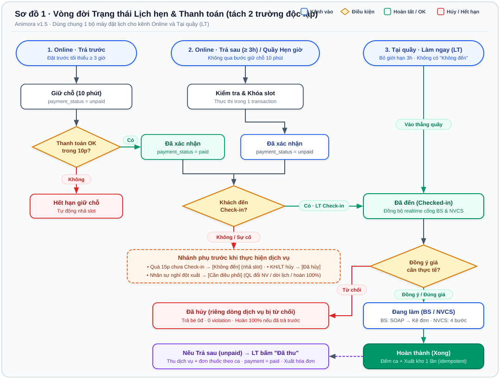
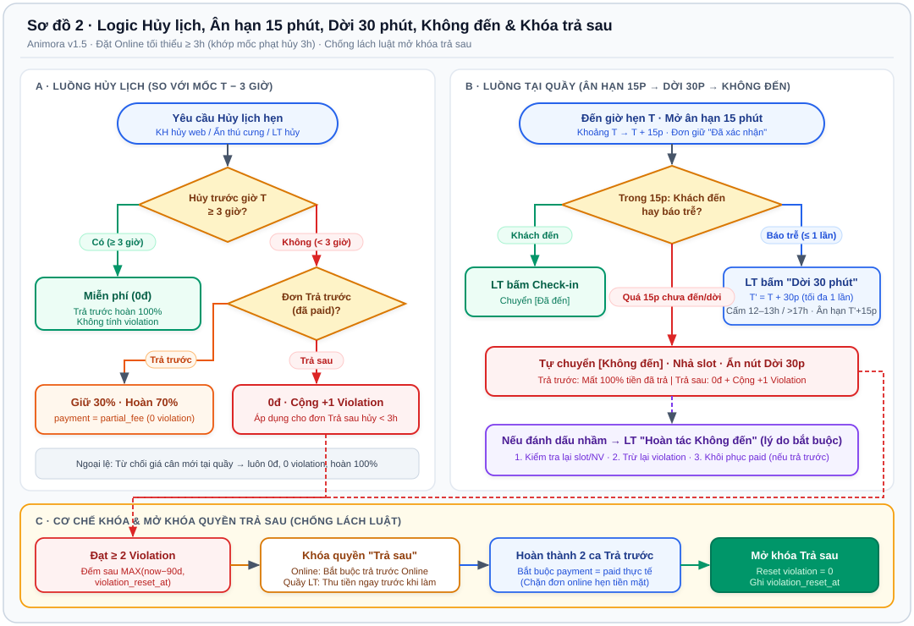
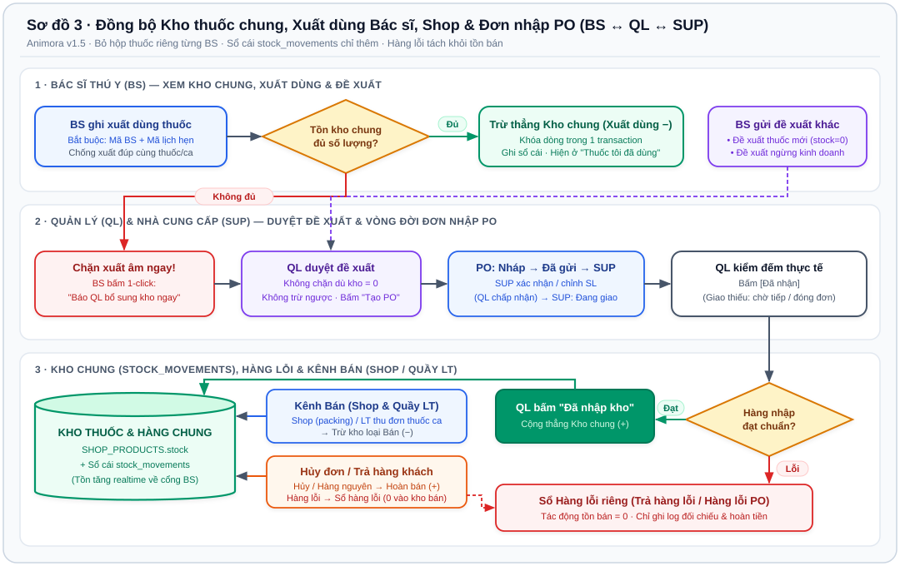

# Animora – Tài liệu Nghiệp vụ Tổng thể (v1.5 by Thùy)

> **Thông tin phiên bản:** `v1.5 by Thùy` · Cập nhật: `22/11/2026` · Kế thừa từ bản gốc `v1.4` (`@Toàn`, `19/11/2026`) và `ver1.4.1 by Thùy`.
> **Hiệu lực:** Bản này **thay thế hoàn toàn `v1.3` và `v1.4`** ở mọi điểm mâu thuẫn, đã giải quyết đầy đủ 100% điểm Review nghiệp vụ và đồng bộ phân quyền cho cả 7 vai trò (`KH`, `BS`, `NVCS`, `LT`, `QL`, `AD`, `SUP`).

---

## Bảng tra nhanh "Con số vàng" (Quick Reference)

| Thông số nghiệp vụ | Giá trị chốt ở v1.5 | Ghi chú áp dụng |
| --- | --- | --- |
| **Giờ làm việc** | `T2–T7`, `08:00–17:00` | Chủ Nhật nghỉ cố định; không tăng ca, không đổi ca |
| **Giờ nghỉ trưa** | `12:00–13:00` | Khóa slot cố định, gắn nhãn `"Nghỉ trưa"` |
| **Phạm vi loài** | `4 loài`: Chó, Mèo, Chuột, Thỏ | Loài khác không tạo hồ sơ và không đặt lịch |
| **Đặt trước Online tối thiểu** | `≥ 3 giờ` | Kênh tại quầy (LT) không bị giới hạn 3 giờ |
| **Giữ chỗ thanh toán Online** | `10 phút` | Chỉ áp dụng cho đơn Online trả trước; hết hạn tự nhả |
| **Phụ phí chọn đích danh** | `+10%` giá dòng dịch vụ | Áp dụng cho cả BS & NVCS (`is_preferred_staff = true`) |
| **Mốc phạt hủy lịch** | `< 3 giờ` trước giờ hẹn | Trả trước giữ `30%` (hoàn `70%`); Trả sau `0đ + 1 violation` |
| **Ân hạn Check-in** | `15 phút` sau giờ hẹn | Quá 15p chưa Check-in & chưa Dời → tự chuyển `Không đến` |
| **Dời trễ tại quầy** | `+30 phút`, tối đa `1 lần/đơn` | Trong thời gian ân hạn; cấm tràn `12:00–13:00` hoặc quá `17:00` |
| **Khóa quyền Trả sau** | `2 violation` / cửa sổ `90 ngày` | Đếm vi phạm sau `MAX(now - 90 ngày, violation_reset_at)` |
| **Mở khóa quyền Trả sau** | `2 ca trả trước` đã `paid` | Sau mốc bị khóa → ghi `violation_reset_at`, reset đếm về `0` |
| **Quỹ nghỉ phép tháng** | `4 ngày/tháng` (nguyên ngày) | Gửi trước `≥ 2 ngày` (BS/NVCS); chặn Chủ Nhật & tuần đã qua |
| **Bồi thường Nghỉ đột xuất** | Giảm `15%` hoặc Voucher `15%` | Đích danh PA1: hủy/hoàn `+10%` & giảm thêm `15%` |

---

## Mục lục

- [Phần I. Phạm vi & Thay đổi so với v1.3](#phần-i-phạm-vi--thay-đổi-so-với-v13)
- [Phần II. Bản đồ 7 Role & Ma trận Phân quyền (RBAC)](#phần-ii-bản-đồ-7-role--ma-trận-phân-quyền-rbac)
- [Phần III. Nghiệp vụ cốt lõi theo 6 Module](#phần-iii-nghiệp-vụ-cốt-lõi-theo-6-module)
  - [Module 1. Hồ sơ thú cưng & Khóa dữ liệu y tế](#module-1-hồ-sơ-thú-cưng--khóa-dữ-liệu-y-tế)
  - [Module 2. Đặt lịch, Giá, Thanh toán & Thực hiện dịch vụ](#module-2-đặt-lịch-giá-thanh-toán--thực-hiện-dịch-vụ)
  - [Module 3. Hủy lịch, Ân hạn 15 phút, Dời 30 phút, Không đến & Violation](#module-3-hủy-lịch-ân-hạn-15-phút-dời-30-phút-không-đến--violation)
  - [Module 4. Vận hành quầy Lễ tân (POS) & Điều chỉnh giá theo cân](#module-4-vận-hành-quầy-lễ-tân-pos--điều-chỉnh-giá-theo-cân)
  - [Module 5. Lịch làm việc, Nghỉ phép & Nghỉ đột xuất](#module-5-lịch-làm-việc-nghỉ-phép--nghỉ-đột-xuất)
  - [Module 6. Kho thuốc chung, Shop & Nhập hàng Nhà cung cấp](#module-6-kho-thuốc-chung-shop--nhập-hàng-nhà-cung-cấp)
- [Phần IV. Quản trị, Audit Log, Thống kê & Kế hoạch triển khai](#phần-iv-quản-trị-audit-log-thống-kê--kế-hoạch-triển-khai)
  - [1. Quản lý lương & Audit Log](#1-quản-lý-lương--audit-log)
  - [2. Thống kê (Dashboard 3 màn cốt lõi)](#2-thống-kê-dashboard-3-màn-cốt-lõi)
  - [3. Tiến độ thực tế 22/11, Checklist Backend/DB & Câu hỏi chốt Mentor](#3-tiến-độ-thực-tế-2211-checklist-backenddb--câu-hỏi-chốt-mentor)

---

## Phần I. Phạm vi & Thay đổi so với v1.3

### 1.1. Ranh giới phạm vi v1.5

| Trong phạm vi (Làm trong v1.5) | Ngoài phạm vi (Ghi rõ cho Mentor — Chưa làm lần này) |
| --- | --- |
| • Khám & chăm sóc sức khỏe thú y (SOAP + Đơn thuốc điện tử) | • Nhận nuôi và vai trò Trạm cứu hộ (TCH) |
| • Dịch vụ chăm sóc (tắm, cắt tỉa, spa thảo mộc, vệ sinh) | • Lưu trú qua đêm (24/7) |
| • Shop trực tuyến (thức ăn, đồ uống, phụ kiện, thuốc kê đơn) | • Mã vi mạch (microchip) của thú cưng |
| • Thanh toán Shop (`COD`/`Banking`), giao qua đơn vị vận chuyển bên ngoài hoặc nhận tại quầy | • Role Shipper giao hàng riêng (QL cập nhật trạng thái đơn thủ công) |
| • Kho thuốc chung, sổ cái kho, đơn nhập PO & cổng Nhà cung cấp | • Hộp thuốc / kệ riêng từng bác sĩ và cơ chế chia đều khi nhập PO |
| • Vận hành quầy Lễ tân (POS đặt lịch, check-in, cân thực tế, thu dịch vụ & đơn thuốc theo ca) | • POS bán lẻ thức ăn/phụ kiện Shop tại quầy Lễ tân |
| • Nghỉ phép thường & Nghỉ đột xuất cho nhân sự Full-time | • Nhân viên Part-time, đổi ca, tăng ca; luồng nghỉ phép web cho QL/AD |
| • AI Chat tư vấn hỏi-đáp cơ bản (chỉ đọc, từ `ai.service.js` sẵn có) | • Combo dịch vụ giá riêng (chỉ cộng dịch vụ, áp voucher nếu có) |
| • Quản lý lương cơ bản (xem/sửa có log) & 3 màn Dashboard cốt lõi | • Tự tính lương (kế toán làm ngoài hệ thống); duyệt bằng cấp BS trên hệ thống (AD/QL xác minh thủ công trước khi cấp tài khoản) |
| • Phục vụ **4 loài:** Chó, Mèo, Chuột, Thỏ | • Các loài khác ngoài 4 loài trên |

### 1.2. Bảng tóm tắt nâng cấp từ v1.3 → v1.5

| # | Chủ đề | v1.3 | v1.5 |
| --- | --- | --- | --- |
| 1 | Vai trò (Role) | 7 role có Trạm cứu hộ | 7 role: bỏ TCH, thêm Lễ tân (`LT`) |
| 2 | Hủy & đổi lịch | Không giới hạn, không phí | Đặt online tối thiểu `3h`; hủy `< 3h` và `Không đến` có phí/violation |
| 3 | Hồ sơ khách vãng lai | Chưa có | LT tạo hồ sơ bằng SĐT + tên (không đăng nhập); tạo tài khoản Web khi khách cần |
| 4 | Giá dịch vụ | Một giá cố định | Theo loài; dịch vụ có cờ theo hạng cân; chọn đích danh cộng `+10%` |
| 5 | Cân nặng | KH tự nhập | KH khai ban đầu → BS cập nhật & khóa y tế; dịch vụ chăm sóc theo cân cho LT nhập cân thực tế tại quầy |
| 6 | Lương | Tự tính theo ca | QL xem/sửa lương cấp dưới (`BS, NVCS, LT`) có log; **chặn tự sửa lương mình**; bỏ tự tính |
| 7 | Kho thuốc | Hộp thuốc từng BS | 1 **Kho chung** (PO cộng thẳng, xuất dùng ghi mã BS); tách `Trả hàng lỗi` khỏi tồn bán |
| 8 | Nghỉ đột xuất | Chưa có | Quy trình riêng, trừ quỹ 4 ngày/tháng (hết quỹ vẫn tạo & gắn cờ nghỉ không lương) |
| 9 | Nghỉ phép Lễ tân | Chưa có | Luồng gọn nhẹ (4 ngày/tháng, không khóa slot khách, báo trống quầy cho QL) |
| 10 | Nhân sự NVCS | Part-time, đổi ca, lưu trú, bảng kỹ năng | Chỉ Full-time (`T2–T7`), làm mọi dịch vụ chăm sóc; chỉ xem hồ sơ & lưu ý y khoa BS |
| 11 | Nhân sự BS | Tạo/xóa thú cưng, tự dời lịch, kệ thuốc riêng | Chỉ Full-time (`T2–T7`), không tạo/xóa thú cưng, không tự dời lịch; khám 2 bước SOAP → Kê đơn |

---

## Phần II. Bản đồ 7 Role & Ma trận Phân quyền (RBAC)

> [!IMPORTANT]
> **Nguyên tắc bảo mật & truy vết:** Mỗi người dùng sử dụng **1 tài khoản riêng** (LT không bao giờ đăng nhập tài khoản khách). Mọi quyền hạn bắt buộc kiểm tra ở **Backend**, không chỉ ẩn nút trên giao diện.

### 2.1. Mô tả 7 vai trò

| Role | Đối tượng | Trách nhiệm chính |
| --- | --- | --- |
| **KH** | Khách nuôi thú cưng | Tạo/ẩn thú cưng, đặt/hủy/đổi lịch, thanh toán, mua Shop, xem sổ sức khỏe |
| **BS** | Bác sĩ thú y | Khám lâm sàng (SOAP), kê đơn điện tử, làm chủ & khóa 4 trường y tế thú cưng, ghi xuất dùng thuốc |
| **NVCS** | Nhân viên chăm sóc | Thực hiện mọi dịch vụ chăm sóc (tiến trình 4 bước), xem hồ sơ & lưu ý y khoa từ BS, xin nghỉ phép |
| **LT** | Lễ tân | Tiếp nhận khách vãng lai, đặt/hủy/đổi lịch quầy, check-in, dời 30p, hoàn tác không đến, nhập cân tại quầy, thu tiền dịch vụ & đơn thuốc theo ca, xuất hóa đơn, xin nghỉ phép gọn nhẹ |
| **QL** | Quản lý | Điều phối nhân sự, duyệt nghỉ phép & tạo nghỉ đột xuất, khôi phục thú cưng đã ẩn, Shop/kho/đơn nhập, sửa lương cấp dưới, xem thống kê |
| **AD** | Admin | Quản lý tài khoản, phân quyền, cấu hình hệ thống, xem dữ liệu & Audit Log |
| **SUP** | Nhà cung cấp | Xem/xác nhận/chỉnh đơn nhập của mình, cập nhật trạng thái `"Đang giao"` |

### 2.2. Ma trận Phân quyền tổng hợp (RBAC)

*(Ký hiệu: `✅` Được phép · `👁️` Chỉ xem · `⚠️` Có điều kiện / giới hạn · `❌` Không được phép)*

| Nhóm | Chức năng | KH | BS | NVCS | LT | QL | AD | SUP |
| --- | --- | :---: | :---: | :---: | :---: | :---: | :---: | :---: |
| **Thú cưng** | Tạo hồ sơ thú cưng | ✅ | ❌ | ❌ | ⚠️ *(vãng lai)* | ❌ | ❌ | ❌ |
| **Thú cưng** | Xem hồ sơ thú cưng | ⚠️ *(của mình)* | ✅ | 👁️ | ✅ | 👁️ | 👁️ | ❌ |
| **Thú cưng** | Cập nhật 4 trường y tế *(cân, dị ứng, hành vi, triệt sản)* | ⚠️ *(khai ban đầu)* | ✅ *(rồi khóa)* | ❌ | ❌ | ❌ | ❌ | ❌ |
| **Thú cưng** | Nhập cân thực tế tại quầy tính giá dịch vụ | ❌ | ✅ *(qua SOAP)* | ❌ | ✅ *(trên lịch hẹn)* | ❌ | ❌ | ❌ |
| **Thú cưng** | Ẩn thú cưng / Khôi phục thú cưng đã ẩn | ✅ *(Ẩn)* | ❌ | ❌ | ❌ | ✅ *(Khôi phục)* | 👁️ *(Log)* | ❌ |
| **Lịch hẹn** | Đặt lịch hẹn | ✅ | ❌ | ❌ | ✅ *(giúp khách)* | ❌ | ❌ | ❌ |
| **Lịch hẹn** | Hủy / Đổi lịch hẹn | ⚠️ *(của mình)* | ❌ | ❌ | ✅ *(tại quầy)* | ⚠️ *(đổi NV đột xuất)* | ❌ | ❌ |
| **Quầy** | Check-in, Dời 30p, Hoàn tác không đến | ❌ | ❌ | ❌ | ✅ | ❌ | ❌ | ❌ |
| **Quầy** | Thu tiền dịch vụ & đơn thuốc theo ca, hoàn/bù, xuất hóa đơn | ❌ | ❌ | ❌ | ✅ | ❌ | ❌ | ❌ |
| **Thực hiện** | Cập nhật tiến độ dịch vụ (`Chờ → Đang làm → Xong`) | ❌ | ✅ | ✅ | ❌ | ❌ | ❌ | ❌ |
| **Y khoa** | Sổ sức khỏe & Kê đơn thuốc điện tử | 👁️ | ✅ | ❌ | 👁️ *(đơn thuốc thu tiền)* | 👁️ | 👁️ | ❌ |
| **Kho/Shop** | Mua hàng Shop / Quản lý Shop, kho, đơn nhập PO | ✅ *(Mua)* | 👁️ *(Tồn thuốc)* | ❌ | ⚠️ *(chỉ thu đơn thuốc ca)* | ✅ *(Nhận & Nhập kho)* | 👁️ | ⚠️ *(Đơn mình, Đang giao)* |
| **Nhân sự** | Nghỉ phép thường & Nghỉ đột xuất | ❌ | ✅ *(Xin)* | ✅ *(Xin)* | ✅ *(Xin gọn nhẹ)* | ✅ *(Duyệt & Tạo đột xuất)* | ❌ | ❌ |
| **Quản trị** | Sửa lương nhân sự | ❌ | ❌ | ❌ | ❌ | ⚠️ *(BS/NVCS/LT, cấm sửa mình)* | ❌ | ❌ |
| **Quản trị** | Dashboard thống kê | ❌ | ❌ | ❌ | ❌ | ✅ | 👁️ | ❌ |
| **Hệ thống** | Quản lý tài khoản & phân quyền | ❌ | ❌ | ❌ | ❌ | ❌ | ✅ | ❌ |

### 2.3. Ranh giới quyền trọng yếu giữa các Role vận hành

| Vai trò | Được phép làm | Tuyệt đối KHÔNG làm |
| --- | --- | --- |
| **LT vs. QL** | **LT** độc quyền thao tác quầy: Check-in, Dời 30p, Hoàn tác không đến, Nhập cân đo tại quầy (không ghi đè khóa y tế BS), Thu tiền dịch vụ & đơn thuốc gắn lịch hẹn, Hoàn/bù thủ công, Xuất hóa đơn. **QL** chỉ xem lịch hẹn, cấu hình bảng giá/dịch vụ, điều phối đổi nhân sự khi nghỉ đột xuất, duyệt nghỉ phép, quản lý Shop/Kho/PO, khôi phục thú cưng, sửa lương cấp dưới. | **LT** không kê đơn/sửa sổ sức khỏe, không bán lẻ phụ kiện Shop, không quản lý kho, không xem dashboard, không duyệt nghỉ, không ghi đè quy tắc đặt lịch, không gỡ khóa trả sau, không khôi phục thú cưng, không xóa dữ liệu. **QL** không Check-in/thu tiền thay LT, không tự sửa lương của chính mình, không gửi đơn nghỉ phép qua web. |
| **BS vs. NVCS** | **BS** làm chủ 4 trường y tế (khóa `medicalLocked = true` + xác nhận `customerNotes` 1-click), khám 2 bước (SOAP → Kê đơn), xem kho thuốc chung & ghi xuất dùng (trừ thẳng kho chung), gửi đề xuất kho lên QL. **NVCS** (Full-time, duy trì `≥ 2` người, thực hiện mọi dịch vụ chăm sóc không phân bảng kỹ năng) cập nhật tiến trình 4 bước, xem hồ sơ thú cưng + khung **"Lưu ý Y khoa từ BS"** + cân/giá tại quầy LT. | **Cả BS & NVCS** đều không tạo mới/xóa/ẩn thú cưng, không thu tiền, không tự ý đổi giờ hẹn hay đơn phương hủy ca của khách (sự cố chỉ dùng **"Báo Quản lý điều phối – Nghỉ đột xuất"**). **NVCS** bị chặn tuyệt đối Sổ sức khỏe, Kê đơn thuốc và Kho thuốc. |

---

## Phần III. Nghiệp vụ cốt lõi theo 6 Module

### Module 1. Hồ sơ thú cưng & Khóa dữ liệu y tế

- **Phạm vi loài & hàm dùng chung:** Chỉ nhận **4 loài** (`Chó`, `Mèo`, `Chuột`, `Thỏ`); loài khác bị chặn tạo hồ sơ và đặt lịch. Toàn hệ thống dùng chung **1 hàm lấy danh sách thú cưng đang hoạt động** để thú cưng đã ẩn không hiện khi đặt lịch. **Bỏ mã vi mạch.**
- **Hồ sơ khách vãng lai:** LT tạo hồ sơ nhanh cho khách vãng lai; cân nặng và dị ứng do LT nhập được gắn nhãn `"do khách khai"`, BS xác thực/cập nhật sau.
- **Thú con lớn nhanh:** Khách đưa đến để BS cân lại (hoặc LT cân tại quầy với dịch vụ chăm sóc); giá tính theo hạng cân mới (xem [Module 4](#module-4-vận-hành-quầy-lễ-tân-pos--điều-chỉnh-giá-theo-cân)).

| Trường dữ liệu | Khởi tạo ban đầu | Chủ sở hữu & Cơ chế khóa | Audit Log |
| --- | --- | --- | --- |
| **4 trường y tế:** `Cân nặng`, `Dị ứng`, `Hành vi đặc biệt` *(vd: sợ máy sấy)*, `Tình trạng triệt sản` | KH nhập khi tạo (hoặc LT nhập giúp khách vãng lai) | **BS** cập nhật (trực tiếp hoặc tự động khi lưu Phiếu khám SOAP) → bật cờ `medicalLocked = true`, khóa không cho KH tự sửa nữa | Ghi đủ: giá trị cũ → mới, người sửa, nguồn cập nhật, thời điểm |
| **Ghi chú bổ sung từ khách (`customerNotes`)** | KH thêm dòng mới có timestamp *(chỉ thêm, không sửa/xóa dòng cũ)* | **BS** bấm xác nhận 1-click để hợp nhất vào trường `Dị ứng` hoặc `Hành vi` chính thức *(chống trùng lặp, gắn tên BS & thời điểm)* | Ghi đầy đủ vào Audit Log |

> [!WARNING]
> **Quy tắc Ẩn thú cưng (Xóa mềm — chỉ KH thực hiện, kèm lý do cá nhân):**
> - Dữ liệu lịch sử, sổ sức khỏe và thống kê được **giữ nguyên**; chỉ ẩn khỏi danh sách của KH. **QL** có quyền khôi phục khi cần (có Audit Log).
> - **Chặn cứng ẩn** nếu bé đang có lịch hẹn ở trạng thái `Đã đến` hoặc `Đang làm`, hoặc còn hóa đơn dịch vụ chưa thu tiền.
> - Với lịch hẹn sắp tới (`Giữ chỗ` / `Đã xác nhận`), ẩn thú cưng được tính như **khách chủ động hủy lịch** → áp đúng quy tắc phạt `< 3 giờ` & `violation` tại [Module 3](#module-3-hủy-lịch-ân-hạn-15-phút-dời-30-phút-không-đến--violation) và **bắt buộc hiện popup cảnh báo số tiền bị giữ / violation** trước khi xác nhận ẩn.

---

### Module 2. Đặt lịch, Giá, Thanh toán & Thực hiện dịch vụ

Online và Tại quầy dùng chung **1 bộ máy đặt lịch** (cùng lịch nhân sự, cùng thuật toán tự gán, cùng khóa chống trùng trong 1 transaction).

#### 2.1. Sơ đồ vòng đời Trạng thái Lịch hẹn & Thanh toán (tách 2 trường độc lập)

| Trường trạng thái | Các giá trị chuẩn (đồng bộ DB, Backend & Frontend) |
| --- | --- |
| **`appointment_status`** | Chính: `Giữ chỗ` → `Đã xác nhận` → `Đã đến` → `Đang làm` → `Hoàn thành` Phụ: `Hết hạn giữ chỗ`, `Đã hủy`, `Không đến`, `Cần điều phối` *(nhân sự nghỉ đột xuất)* |
| **`payment_status`** | `Chưa thanh toán (unpaid)` · `Đã thanh toán (paid)` · `Thu phí hủy / Hoàn một phần (partial_fee)` · `Đã hoàn đủ (refunded)` |
| **Dòng dịch vụ** | `Chờ` → `Đang làm` → `Xong` *(chuyển `Xong` kích hoạt đếm ca & xuất kho trong 1 transaction, chống ghi trùng `idempotent`)* |

#### 2.2. So sánh 2 kênh đặt lịch

| Tiêu chí | Kênh Online (KH tự đặt) | Kênh Tại quầy (LT đặt giúp) |
| --- | --- | --- |
| Tài khoản khách | Bắt buộc có tài khoản | Không bắt buộc (chỉ cần Tên & SĐT 10 số) |
| Giữ chỗ 10 phút | Có *(chỉ đơn trả trước online)* | Không |
| Đặt trước tối thiểu | **Tối thiểu `3 giờ`** | Không *(làm ngay hoặc hẹn trong vòng 3h)* |
| Trạng thái lịch ban đầu | `Giữ chỗ` *(trả trước)* hoặc `Đã xác nhận` *(trả sau)* | `Đã xác nhận` *(Hẹn giờ)* hoặc `Đã đến` *(Làm ngay)* |
| Phương thức thanh toán | Trả trước Online *(VNPay/PayOS/CK sandbox)* hoặc Trả sau tiền mặt tại quầy *(bỏ "tiền mặt nộp trước" trên Online)* | Tiền mặt / Chuyển khoản *(thu ngay trước khi làm → tính trả trước, hoặc thu sau khi xong → trả sau)* |
| Khi hết nhân sự rảnh | Từ chối & gợi ý khung giờ gần nhất | Từ chối, không ghi đè |

#### 2.3. Quy tắc Giá dịch vụ & Tự gán nhân sự

- **Cấu trúc giá:** Theo loài (`Chó, Mèo, Chuột, Thỏ`). Dịch vụ có cờ `"tính theo hạng cân"` *(tắm, cắt tỉa, tiêm)* tính theo `loài × hạng cân` (`3–4` hạng cố định, không tính từng kg); dịch vụ giá cố định theo loài *(spa, massage, khám tổng quát)* không đổi theo cân nặng và không cần cân lại.
- **Chọn đích danh nhân sự:** Khách được chọn đích danh **BS hoặc NVCS** mong muốn, **cộng phụ phí `+10%` giá dòng dịch vụ đó** và gắn cờ `is_preferred_staff = true`.
- **Giá chụp & đổi dịch vụ:** Giá được lưu chụp lúc đặt; đổi giờ giữ giá cũ. **Đổi dịch vụ** coi như hủy lịch cũ và đặt mới: khách tự đổi trên web `< 3 giờ` áp đúng quy tắc hủy `< 3 giờ` ở [Module 3](#module-3-hủy-lịch-ân-hạn-15-phút-dời-30-phút-không-đến--violation); đổi qua LT tại quầy (nếu nhân sự đủ thời lượng) được miễn phạt có Audit Log.
- **Thuật toán tự gán nhân sự:** Xếp các dịch vụ trong giỏ (1 thú cưng/lần, cộng giá + áp voucher nếu có) nối tiếp gọn trong 1 buổi, chặn `12:00–13:00`. Mỗi dòng chọn người rảnh cùng chuyên môn có **ít ca nhất trong ngày, hòa thì theo mã nhân viên**. Đủ người cho mọi dòng → tự xác nhận (QL không duyệt).
- **Hoàn/bù tiền thủ công:** Tiền mặt hoặc VNPay/PayOS; hệ thống ghi nhận số tiền, người thao tác và lý do. Khách lớn tuổi không thanh toán online vẫn đặt và đóng tiền mặt đầy đủ qua LT.

#### 2.4. Thực hiện dịch vụ & Đồng bộ 2 chiều (LT ↔ NVCS / BS ↔ QL)

| Khía cạnh | Dịch vụ Chăm sóc (NVCS) | Khám lâm sàng (BS) |
| --- | --- | --- |
| **Quy trình thực hiện** | **Tiến trình 4 bước** *(chi tiết hóa `Chờ → Đang làm → Xong`)*: 1. *Tiếp nhận:* kiểm tra lông, da, tai/móng, tâm lý bé. 2. *Đang thực hiện:* tắm thảo mộc, spa, cắt tỉa, vệ sinh. 3. *Hoàn thiện:* sấy khô, chải tạo kiểu, kiểm tra cuối. 4. *Hoàn tất & bàn giao (`Xong`):* ghi tình trạng bé, tính 1 ca. | **Quy trình 2 bước** *(mở khi ca chuyển `Đang làm`)*: 1. *Phiếu khám SOAP:* cân nặng thực tế, nhiệt độ, triệu chứng, chẩn đoán, mức độ bệnh (nhẹ/nặng), lời dặn, lịch tái khám/tiêm/tẩy giun → tự sinh Sổ sức khỏe + đồng bộ cân & khóa `medicalLocked = true`. Dùng **ngày địa phương UTC+7** tránh lệch ngày lúc `00:00–06:59`. 2. *Kê đơn thuốc điện tử:* tự liên kết bệnh án cùng lịch/cùng ngày; đọc tồn **Kho chung** realtime (ẩn ngừng KD, ưu tiên `stock > 0`, chặn phát hành nếu hết hàng, cảnh báo khác loài, bệnh nặng khóa `0` lượt mua lại). |
| **Đồng bộ LT & Trả sau** | LT bấm `Đã đến` → cổng NVCS hiện `"Đã check-in tại quầy"` kèm cân thực tế/giá điều chỉnh; LT bấm `Không đến` → lịch NVCS tự đóng. Đơn `postpaid`: NVCS hoàn tất (`Xong`) trước rồi mời khách ra quầy LT thu tiền. | LT bấm `Đã đến` → cổng BS hiện `"Đã check-in tại quầy"`. Đơn `postpaid`: BS hoàn tất ca khám trước rồi mời khách thanh toán dịch vụ *(và đơn thuốc nếu lấy tại quầy)* tại quầy LT. Chống hoàn thành trùng ca (`idempotency`). |
| **Sự cố đột xuất** | Không tự hủy ca; chỉ gửi **"Báo Quản lý điều phối (Nghỉ đột xuất)"**. | Đã bỏ chức năng BS tự đề xuất đổi giờ hẹn; sự cố chỉ gửi **"Báo Quản lý điều phối (Nghỉ đột xuất)"**. |

---

### Module 3. Hủy lịch, Ân hạn 15 phút, Dời 30 phút, Không đến & Violation

*(Thay đổi có chủ đích so với `v1.3` — cần mentor xác nhận. Do đã nâng đặt trước online tối thiểu lên `3 giờ`, khách đặt online không rơi vào vùng bị phạt hủy ngay khi vừa đặt.)*

#### 3.1. Sơ đồ dòng thời gian xử lý Hủy, Ân hạn & Dời trễ

#### 3.2. Bảng hậu quả Hủy & Không đến

| Tình huống | Trả trước *(đã `payment_status = paid`)* | Trả sau *(tiền mặt tại quầy)* |
| --- | --- | --- |
| **Hủy trước `≥ 3 giờ`** | Hoàn 100% (`refunded`) | Không phát sinh |
| **Hủy trong vòng `< 3 giờ`** | Giữ `30%`, hoàn `70%` (`partial_fee`) | `0đ`, tính `1 violation` |
| **Không đến *(quá 15 phút)*** | Mất `100%` tiền đã trả (`partial_fee`) | `0đ`, tính `1 violation` |
| **Ngoại lệ: Từ chối giá cân mới tại quầy** | **Hoàn `100%` dòng dịch vụ đó** | **`0đ`, không tính `violation`** |

#### 3.3. Quy tắc Khóa/Mở quyền Trả sau (Chống lách luật) & Hoàn tác Không đến

- **Công thức đếm:** `violation_count` = số lần hủy `< 3 giờ` (đơn trả sau) + số lần `Không đến`, chỉ đếm các vi phạm phát sinh sau mốc `MAX(now - 90 ngày, violation_reset_at)`. Đổi lịch trước `≥ 3 giờ` không tính vi phạm và không phí.
- **Cơ chế khóa (khi `violation_count ≥ 2`):**
  - Tự động khóa tùy chọn `"Trả sau"` (kèm thông báo lý do rõ ràng và Audit Log).
  - **Đặt Online:** Bắt buộc **thanh toán trước online** trong 10 phút giữ chỗ (không cho chọn tiền mặt nộp sau tại quầy).
  - **Đặt Tại quầy (LT):** LT thấy cảnh báo vi phạm nhưng **không bị chặn đặt giúp**; đơn chỉ tính là trả trước khi khách đóng tiền ngay trước khi làm (`payment_status = paid`).
- **Cơ chế mở khóa & reset:** Tự mở lại khi khách hoàn thành **2 ca trả trước thực tế** (`payment_timing = prepaid` **VÀ** `payment_status = paid`, không tính đơn online hẹn tiền mặt tại quầy) sau thời điểm bị khóa → hệ thống ghi `violation_reset_at = now`, reset bộ đếm chu kỳ về `0` và ghi Audit Log.
- **Chi tiết Dời 30 phút & Hoàn tác `Không đến`:**
  - *Dời 30 phút:* Chặn tràn `12:00–13:00` hoặc quá `17:00`; kiểm tra trùng ca nhân sự và tự gán người rảnh ít ca nhất nếu trùng; giới hạn **tối đa 1 lần/đơn**.
  - *Không đến:* Không áp dụng cho đơn `"Làm ngay tại quầy"` (`walk_in_now`).
  - *Hoàn tác `Không đến`:* Bắt buộc nhập lý do + Audit Log → (1) kiểm tra lại slot/nhân sự sau nhả slot (trùng thì tự gán người rảnh cùng chuyên môn hoặc yêu cầu đổi khung giờ), (2) trừ lại `violation`, (3) khôi phục `payment_status = paid` & `cancellation_fee = 0` nếu là đơn trả trước.
- **Hạn chế đã biết:** Khách đổi SĐT hoặc tạo tài khoản mới có thể qua mặt bộ đếm (chấp nhận ở phiên bản này).

---

### Module 4. Vận hành quầy Lễ tân (POS) & Điều chỉnh giá theo cân

#### 4.1. 6 đầu việc chuẩn của Lễ tân (dùng tài khoản riêng của LT)

1. **Tiếp nhận khách vãng lai:** Gõ SĐT chuẩn hóa 10 số, tìm trước để chống trùng → tạo hồ sơ khách mới chỉ cần Tên + SĐT (không mật khẩu).
2. **Tạo thú cưng & Đặt lịch POS (`/receptionist/booking` & `/dat-lich`):** Tạo thú cưng nhanh thuộc 4 loài chuẩn (`"do khách khai"`); đặt 1 hoặc nhiều dịch vụ nối tiếp theo 2 chế độ: **"Làm ngay"** *(bỏ giới hạn 3h, trạng thái đầu `Đã đến`)* hoặc **"Hẹn giờ"** *(không giữ chỗ 10p, trạng thái đầu `Đã xác nhận`)*. Đơn tự gắn kênh = quầy, người thao tác = LT.
3. **Điều phối tại quầy:** Check-in khách đặt online; bấm `"Dời 30 phút"` (tối đa 1 lần/đơn) trong 15p ân hạn; đánh dấu hoặc hoàn tác `"Không đến"` kèm lý do.
4. **Thu tiền dịch vụ & đơn thuốc gắn lịch hẹn:** Bấm `"Đã thu"` và xuất hóa đơn cho khách trả sau; **thu tiền đơn thuốc BS vừa kê gắn liền với lịch hẹn đó** (cho cả khách vãng lai lẫn khách online muốn lấy thuốc luôn → tự trừ kho chung loại `Bán -`); ghi nhận hoàn/bù tiền thủ công.
5. **Nâng cấp khách vãng lai lên tài khoản Web:** Tạo tài khoản theo yêu cầu của khách (khách tự đặt mật khẩu hoặc xác thực OTP). Hệ thống nâng cấp trực tiếp trên hồ sơ khách hiện có *(hoặc tự gộp khi khách tự đăng ký trùng SĐT vãng lai chưa có tài khoản)* → **giữ nguyên 100% thú cưng, lịch sử khám và lịch sử `violation`**.
6. **Xin nghỉ phép gọn nhẹ (`/receptionist/leave`):** Gửi đơn nghỉ nguyên ngày (quỹ 4 ngày/tháng, chặn tuần đã qua, Chủ Nhật & trùng ngày), tự hủy khi còn `Chờ duyệt`, đồng bộ 2 chiều lên cổng QL kèm cảnh báo `"trống quầy — cần bố trí người trực thay"` (không khóa slot đặt lịch khách).

#### 4.2. Ma trận Điều chỉnh giá theo cân nặng thực tế tại quầy

Màn hình LT hiển thị cả cân nặng do BS cập nhật lẫn nút nhập **"Cân thực tế tại quầy (kg)"** *(dùng cho các ca Spa/Tắm/Chăm sóc không có BS)*. Hệ thống **tự tính giá mới** theo bảng giá & hạng cân — **LT không nhập giá tay** và ghi Audit Log đầy đủ *(cân cũ → mới, giá cũ → mới, người làm, lý do)*.

| Tình huống sau khi cân thực tế | Cách xử lý tài chính & lịch hẹn |
| --- | --- |
| **Khách đồng ý — Đơn Trả sau** | Xuất hóa đơn theo giá mới. |
| **Khách đồng ý — Đơn Trả trước, cân TĂNG** | LT thu bù phần chênh lệch (ghi nhận thủ công + log). |
| **Khách đồng ý — Đơn Trả trước, cân GIẢM** | LT hoàn lại phần chênh lệch (ghi nhận thủ công + log). |
| **Khách KHÔNG đồng ý giá mới** | Trả bé lại đối với dòng dịch vụ đó: **hủy miễn phí `0đ`, `0 violation`, hoàn `100%` dòng dịch vụ đó nếu đã trả trước**. Nếu lịch hẹn có nhiều dịch vụ và khách vẫn muốn làm các dòng còn lại thì chỉ hủy riêng dòng bị đội giá. |

---

### Module 5. Lịch làm việc, Nghỉ phép & Nghỉ đột xuất

- **Lịch chuẩn toàn trung tâm:** Chỉ còn **hình thức làm việc toàn thời gian (Full-time)** cho BS & NVCS: `T2–T7`, `08:00–17:00`, nghỉ trưa cố định `12:00–13:00`, Chủ Nhật nghỉ cố định, không tăng ca, không đổi ca. Ca bổ sung khi quá đông do QL tạo tay cho ngày/khung giờ cụ thể.
- **Minh bạch quỹ nghỉ & cảnh báo lịch tuần:** Thẻ quỹ tách 4 nhóm (*Nghỉ luân phiên · Nghỉ ốm/Không lương · Nghỉ đột xuất · Còn lại*) khớp 100% tổng ngày đã dùng. Lịch tuần kiểm tra trùng giờ theo khoảng `[bắt đầu, bắt đầu + thời lượng)` và cảnh báo tràn `12:00–13:00`.

#### 5.1. Quy tắc Nghỉ phép thường theo nhóm Role

| Nhóm Role | Quỹ tháng | Điều kiện gửi đơn | Xử lý lịch hẹn & Duyệt đơn |
| --- | :---: | --- | --- |
| **BS & NVCS** | `4 ngày` | Nghỉ nguyên ngày; gửi trước `≥ 2 ngày`; chặn tuần đã qua & Chủ Nhật | • Khi đơn `Chờ duyệt`: hệ thống **tạm giữ (hold)** không tự gán thêm ca mới trong ngày đó (nhả lại nếu từ chối/NV tự hủy). • Có lịch **chọn đích danh (`is_preferred_staff = true`)** → **chặn nghỉ phép thường**. • Chưa có lịch hoặc chỉ có lịch **tự gán (`false`)** → **cho gửi đơn**; khi QL bấm **Duyệt**, trong 1 transaction tự chuyển các lịch tự gán sang đồng nghiệp cùng vai trò rảnh **ít ca nhất** rồi khóa slot (nếu hết người thay thì báo lỗi không cho duyệt). Đã duyệt không thể hủy. |
| **LT** | `4 ngày` | Nghỉ nguyên ngày; chặn tuần đã qua, Chủ Nhật & trùng ngày | Không bị chặn bởi lịch khách & **không khóa slot đặt lịch**; QL nhận cảnh báo `"trống quầy — cần bố trí người trực thay"`. Tự hủy được khi `Chờ duyệt`. |
| **QL & AD** | Ngoài web | Không dùng luồng xin nghỉ trên hệ thống | Báo trực tiếp nội bộ ngoài hệ thống. |

#### 5.2. Quy trình & Bảng tình huống Nghỉ đột xuất (BS & NVCS)

1. Nhân sự gọi video call / báo gấp cho QL → QL bấm **"Tạo nghỉ đột xuất"** trực tiếp trên bảng duyệt đơn (chặn Chủ Nhật, lọc tách riêng *Nghỉ phép thường* và *Nghỉ đột xuất*).
2. Số ngày nghỉ trừ vào quỹ 4 ngày/tháng. **Nếu đã dùng hết 4 ngày/tháng, vẫn cho QL tạo** và tự gắn cờ **`Vượt hạn mức (Nghỉ không lương)`** để kế toán đối chiếu cuối tháng. Slot ngày nghỉ khóa ngay lập tức.
3. Hệ thống gắn cờ `"Chờ Quản lý điều phối (Nghỉ đột xuất)"`, liệt kê toàn bộ ca ảnh hưởng kèm lối tắt sang màn hình Lịch hẹn và xử lý theo từng loại lịch:

| Loại lịch hẹn bị ảnh hưởng | Tình trạng nhân sự thay thế | Phương án xử lý chuẩn |
| --- | --- | --- |
| **Lịch tự gán** (`is_preferred_staff = false`) | **Có** đồng nghiệp cùng vai trò rảnh | Hệ thống tự chuyển sang người rảnh theo đúng quy tắc chung: **ít ca nhất trong ngày, hòa theo mã NV**. |
| **Lịch tự gán** (`is_preferred_staff = false`) | **Không** tìm được người thay | Chuyển trạng thái `Cần điều phối` → QL/LT liên hệ khách chọn **dời lịch sang khung gần nhất (+ voucher `15%`)** hoặc **hủy miễn phí, hoàn `100%`, `0 violation`**. |
| **Lịch chọn đích danh** (`is_preferred_staff = true`) | **Có** nhân sự thay thế | Gọi khách chọn 1 trong 2 phương án: • **PA1:** Đổi sang NV thay thế, giữ nguyên giờ; **hủy/hoàn phụ phí `+10%` chọn đích danh** và **giảm thêm `15%`** giá dịch vụ. • **PA2:** Dời lịch sang ngày đúng nhân sự đó quay lại, tặng **voucher `15%`**. *(NVCS xử lý như BS; không đích danh thì không hoàn 10%.)* |
| **Mặc định sau 24 giờ / Không người thay** | Khách không phản hồi sau `24h` | Áp **PA1** nếu có người thay; nếu không có người thay thì chuyển **PA2** hoặc **hủy & hoàn `100%` (`0 violation`)**. Lịch dời cấm xếp vào `12:00–13:00`. |

---

### Module 6. Kho thuốc chung, Shop & Nhập hàng Nhà cung cấp

Bỏ hoàn toàn hộp thuốc/kệ riêng từng bác sĩ; mọi thuốc, vắc-xin và hàng Shop nằm trong **1 Kho chung**. `"Kệ thuốc bác sĩ"` chỉ còn là bộ lọc `"Thuốc tôi đã dùng"` trên sổ cái kho.

#### 6.1. Sơ đồ đồng bộ Kho thuốc chung & Đơn nhập PO (BS ↔ QL ↔ SUP)

#### 6.2. Sổ cái kho (`stock_movements` — Chỉ thêm, không sửa/xóa)

| Loại giao dịch | Tác động tồn bán | Điều kiện phát sinh |
| --- | :---: | --- |
| **Nhập** | `+` | QL xác nhận nhập kho từ đơn PO *(chỉ cộng số lượng đạt chuẩn)* |
| **Bán** | `−` | Đơn Shop chuyển `packing` hoặc LT bấm `"Đã thu"` đơn thuốc kê gắn lịch hẹn |
| **Xuất dùng** | `−` | BS ghi thuốc dùng tại phòng khám *(kèm Mã BS + Mã lịch hẹn; khóa dòng trong transaction; chống xuất đúp cùng thuốc/ca; chặn xuất âm + 1-click báo QL)* |
| **Hoàn bán** | `+` | **Chỉ dùng** cho đơn hủy trước khi giao hoặc hàng khách trả còn nguyên vẹn bán tiếp được |
| **Trả hàng lỗi** | `0` *(sổ riêng)* | **Hàng lỗi / hư hỏng / bể vỡ** khách trả hoặc phát hiện khi nhập PO — ghi đối chiếu & hoàn tiền, **tuyệt đối không cộng lại tồn bán** |
| **Điều chỉnh** | `±` | Hao hụt, hết hạn, kiểm kê *(bắt buộc có lý do & Audit Log)* |

#### 6.3. Thuốc kê đơn, Luồng đơn Shop & Đề xuất kho của Bác sĩ

- **Khóa thuốc kê đơn (`requiresPrescription = true`):**
  - Ngoài Shop online: gắn nhãn `"Thuốc kê đơn"` và **khóa nút tự thêm vào giỏ**. Khách có tài khoản chỉ mua/mua lại qua nút **"Mua thuốc theo đơn"** trong Sổ sức khỏe (đúng giới hạn lượt tái cấp; ca bệnh nặng = `0` lượt).
  - Tại quầy / Khách vãng lai: LT thu tiền đơn thuốc BS vừa kê gắn với lịch hẹn trên hóa đơn quầy (trừ kho `Bán -`). Thuốc dùng trực tiếp tại phòng khám tính vào giá dịch vụ (`Xuất dùng -`).
- **Luồng đơn hàng Shop:** Thanh toán `COD` hoặc `Banking / Online` (sandbox); giao hàng qua đơn vị vận chuyển bên ngoài *(QL cập nhật trạng thái thủ công)* hoặc nhận tại quầy. Vòng đời: `Chờ xác nhận (pending)` → `Đang đóng gói (packing)` *(trừ kho `Bán -`)* → `Đang giao (shipping)` → `Đã giao (delivered)` → `Khách đã nhận (received)`. Nhánh phụ: `Đã hủy` (`Hoàn bán +`), `Đổi trả (returned)` (hàng lỗi ghi `Trả hàng lỗi`).
- **Duyệt 3 loại đề xuất của BS (BS không tự xóa sản phẩm):**
  - *Bổ sung kho:* QL duyệt bình thường kể cả lúc `stock = 0` (**không chặn thiếu kho, không trừ ngược kho**), có nút 1-click `"Tạo PO NCC"`.
  - *Thuốc/vắc-xin mới:* Duyệt tạo SKU mới ở trạng thái `stock = 0` gắn NCC dược mặc định để tạo PO.
  - *Ngừng kinh doanh:* Kiểm tra ràng buộc *(tồn kho, yêu cầu chờ duyệt, đơn thuốc còn lượt mua lại, đơn/PO đang mở)* → ẩn khỏi Shop (`isHidden = true`), bảo toàn lịch sử.
  - Màn hình QL (`Kho thuốc & Đề xuất BS`) hiển thị **Tồn kho chung** kèm **Sản lượng đã xuất dùng theo từng BS**.

#### 6.4. Công thức Gợi ý nhập & Vòng đời Đơn nhập PO

$$\text{Tốc độ bán/ngày} = \frac{\text{Bán} + \text{Xuất dùng}}{\text{Số ngày còn hàng của kỳ}}$$

$$\text{Gợi ý nhập} = \max\Big(0,\ \text{Tốc độ} \times (\text{Ngày giao} + \text{Ngày dự trữ}) - \text{Tồn hiện tại} - \text{Hàng đang đặt chưa nhận}\Big)$$

- **Vòng đời PO (thanh tiến trình 5 mốc):** `Nháp` → `Đã gửi` *(1)* → `NCC xác nhận / chỉnh SL (hoặc từ chối)` *(2)* → `Đang giao [SUP]` *(3)* → `Đã nhận [QL]` *(4)* → `Đã nhập kho [QL]` *(5)*.
- NCC chỉnh số lượng thì QL phải bấm chấp nhận; giao thiếu thì QL chọn chờ phần còn lại hoặc đóng đơn; hàng lỗi ghi riêng không vào kho bán. Mỗi sản phẩm có 1 NCC mặc định; tài khoản SUP chỉ thấy đơn của mình (do người làm kho `D` phụ trách).
- **Chưa làm lần này:** công nợ & đối soát, hạn sử dụng theo lô, danh mục riêng của NCC, email tự động cho SUP, dự báo theo mùa.

---

## Phần IV. Quản trị, Audit Log, Thống kê & Kế hoạch triển khai

### 1. Quản lý lương & Audit Log

- **Lương:** QL xem và sửa mức lương của nhân viên cấp dưới (**BS, NVCS, LT**) kèm log sửa lương *(chỉ thêm, không sửa)*. **Chặn cứng ở Backend không cho QL tự sửa lương chính mình** (`targetUserId !== currentUserId`); lương QL do AD/kế toán quản lý ngoài hệ thống. Không tự tính lương (số ca BS chỉ hiển thị tham khảo; chưa có quy tắc lương riêng NVCS).
- **Audit Log** *(ghi đầy đủ: Ai làm · Lúc nào · Trước → Sau · Lý do nếu có)*:

| Nhóm hệ thống | Các thao tác bắt buộc ghi Audit Log |
| --- | --- |
| **Hồ sơ & Khách hàng** | Tạo/nâng cấp khách vãng lai; tạo thú cưng nhanh; cập nhật 4 trường y tế & xác nhận `customerNotes` (mã BS, nguồn); **ẩn thú cưng (KH) & khôi phục thú cưng (QL)**; **khóa/mở quyền trả sau** & reset `violation_reset_at`. |
| **Đặt lịch & Quầy (LT)** | Đặt/hủy/đổi lịch; check-in; dời 30 phút; đánh dấu & hoàn tác `Không đến`; điều chỉnh giá theo cân thực tế; thu tiền dịch vụ & đơn thuốc theo ca; hoàn/bù tiền thủ công; xuất hóa đơn. |
| **Lâm sàng (BS) & Chăm sóc (NVCS)** | Tiếp nhận/bắt đầu/tiến trình 4 bước/hoàn tất ca (chống trùng `idempotency`); lập bệnh án SOAP & phát hành đơn thuốc điện tử; báo cáo đánh giá vi phạm gửi QL. |
| **Kho, Shop & Đơn nhập PO** | Nhập kho PO (gồm NCC chỉnh SL, SUP chuyển `Đang giao`, QL `Đã nhận`/`Nhập kho`); xuất dùng thuốc tại phòng (`stock_movements` kèm mã BS & lịch hẹn); đề xuất kho BS & kết quả duyệt QL; đổi trả/hoàn tiền khách (`Hoàn bán +` vs `Trả hàng lỗi`); điều chỉnh tồn kho. |
| **Nhân sự, Lương & Quản trị** | Gửi/hủy/duyệt/từ chối đơn nghỉ phép (BS, NVCS, LT); tạo nghỉ đột xuất & đổi nhân sự; sửa lương cấp dưới; **QL thay đổi bảng giá dịch vụ & hạng cân**; **AD tạo/sửa/khóa tài khoản & phân quyền**. |

### 2. Thống kê (Dashboard 3 màn cốt lõi)

Chỉ **QL** và **AD (chỉ xem)** truy cập, có bộ lọc khoảng thời gian; dữ liệu mẫu 30 ngày tạo bằng **seed script chạy đúng nghiệp vụ** (không nhập tay):
1. **Doanh thu dịch vụ:** Lọc theo kênh Online vs Tại quầy.
2. **Hiệu suất bác sĩ & công suất lịch hẹn:** Thống kê số ca *(chỉ tham khảo, không dùng tính lương)*.
3. **Tồn kho, sản phẩm bán chạy & gợi ý nhập.**

### 3. Tiến độ thực tế 22/11, Checklist Backend/DB & Câu hỏi chốt Mentor

#### 3.1. Cập nhật ước lượng & điều phối trước mốc khóa tính năng `10/12`

- Ước lượng gốc (`19/11`): **115 ngày công** (+ đệm `10–15%` ≈ `125–130` ngày công vs. năng lực gốc `95` ngày công từ `17/11–12/12`).
- Tại mốc **`22/11/2026`** *(còn ~15 ngày làm việc đến `12/12`, khóa tính năng `10/12`)*: phần nền Frontend & khung 12 module Backend đã có sẵn phần lớn; bản v1.5 chốt **cắt giảm 7 ngày công** *(giữ nguyên phụ phí `+10%` chọn đích danh)*:
  - Rút Dashboard từ 5 xuống **3 màn cốt lõi** (`-5` ngày công).
  - **Nghỉ đột xuất bản gọn:** QL tạo bản ghi, tự chuyển ca không đích danh (hoặc gắn cờ `Cần điều phối`) và liệt kê ca ảnh hưởng cho QL/LT xử lý tay (`-2` ngày công).
- **Giải tỏa nút thắt Đặt lịch lõi (24 ngày công) trước checkpoint `26/11`:** Tách song song 2 luồng bám chung DTO `Booking`:
  - **Luồng A1 (Core đặt lịch):** Giỏ dịch vụ nối tiếp, phụ phí `+10%` chọn đích danh, tự gán nhân sự, khóa slot transaction, giữ chỗ 10p.
  - **Luồng A2 (Hậu đặt lịch):** Hủy/đổi lịch, `violation_count` + `violation_reset_at`, check-in/dời 30p/hoàn tác không đến, điều chỉnh giá theo cân.

#### 3.2. Checklist đồng bộ kỹ thuật Backend / DB (trước `26/11`)

- [ ] **DB Schema:** Thêm `violation_reset_at` (`customers`); tách `appointment_status` & `payment_status` (`appointments`); thêm `is_preferred_staff` (boolean) và `preferred_staff_surcharge` (decimal/int); thêm `delayed_30m_count` (int, max 1); thêm loại `defective_return` trong `stock_movements` (tác động tồn bán = `0`).
- [ ] **Backend Guards:** Chặn đặt online `< 3 giờ` (`isCounterChannel = false`); chặn QL tự sửa lương mình (`targetUserId !== req.user.id`); chặn ẩn thú cưng khi đang có ca `Đã đến`/`Đang làm` hoặc hóa đơn chưa thu; chặn mua sản phẩm `requires_prescription = true` trên Shop nếu thiếu `prescription_id` hợp lệ.
- [ ] **Kiểm kê API thực tế:** Rà soát 12 module `backend/src` đã nối DB thật vs. phần còn dùng mock localStorage ở Frontend để phân bổ nhân lực tuần 2–3.

#### 3.3. Rủi ro chính & Hạn chế đã biết

| Rủi ro chính cần theo dõi | Hạn chế đã biết (chấp nhận trong v1.5) |
| --- | --- |
| • Tỷ lệ API Backend nối DB thật cần chốt ngay đầu tuần 2 | • Chỉ hỗ trợ 4 loài; mọi NVCS làm mọi dịch vụ chăm sóc (chưa có bảng kỹ năng) |
| • Đặt lịch lõi trễ sẽ chặn dashboard & hoàn thành dịch vụ *(checkpoint `26/11`)* | • Tự gán nhân sự theo từng dòng (greedy), có thể chưa tối ưu toàn cục |
| • Thanh toán trả trước phải xong sớm vì khóa trả sau, hoàn & bù phụ thuộc vào nó | • Bộ đếm violation có thể bị qua mặt khi khách đổi SĐT |
| • Thành viên nghỉ/ốm; mentor phản hồi chậm; phát sinh tính năng sau `10/12` | • Chưa có hạn sử dụng theo lô, chưa có quy tắc lương NVCS; hoàn/bù tiền thủ công đối chiếu qua log |

#### 3.4. Câu hỏi cần xác nhận

**4 câu hỏi trình Mentor ký duyệt:**
1. Bỏ Hộp thuốc riêng, dùng **Kho chung** ghi mã BS ở mỗi lần xuất dùng: có đồng ý không? Có loại thuốc nào cần sổ theo dõi riêng từng BS không?
2. Bỏ **duyệt bằng cấp BS** trên hệ thống (AD/QL xác minh thủ công ngoài hệ thống trước khi cấp tài khoản): có ổn với yêu cầu phòng khám thú y không?
3. Nâng đặt trước online tối thiểu lên **3 giờ**, hủy `< 3 giờ` giữ **30%** với khách trả trước, khóa trả sau sau **2 violation**: có chấp nhận thay đổi so với **v1.3** không?
4. Giảm **15%** hoặc voucher **15%** khi nghỉ đột xuất là chi phí thật: có đồng ý mức này không?

**2 điểm nhóm chốt nhanh đầu tuần:**
1. Tỷ lệ `%` API phần nền Backend đã nối DB thật cho từng module.
2. OTP xác thực tài khoản Web khi nâng cấp khách vãng lai: gửi thật hay dùng mã giả lập (`123456`) khi demo.
