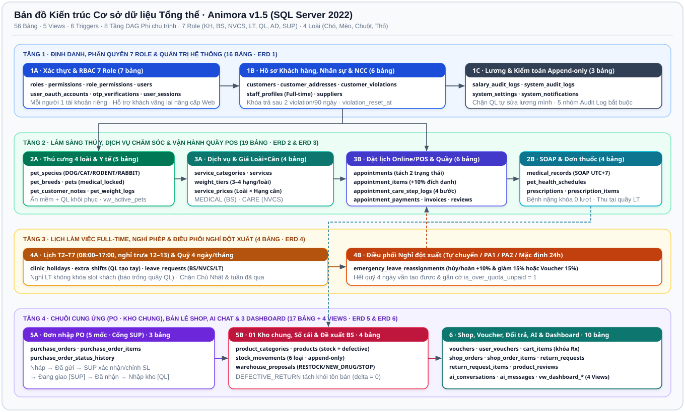
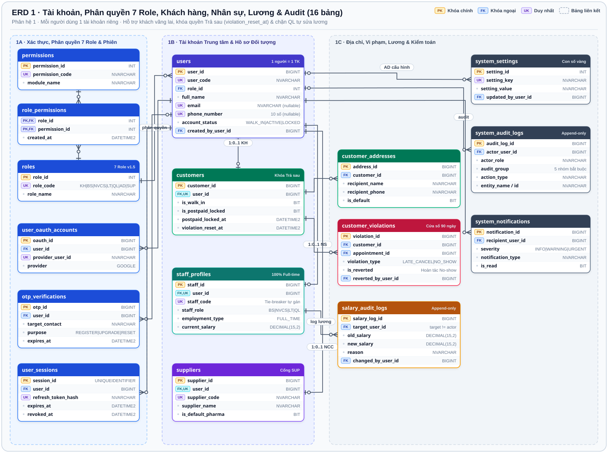
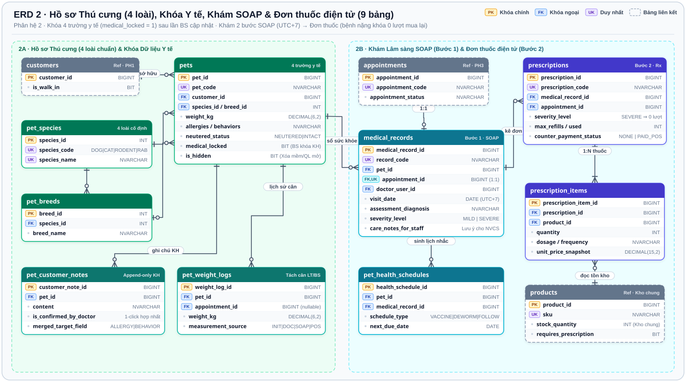
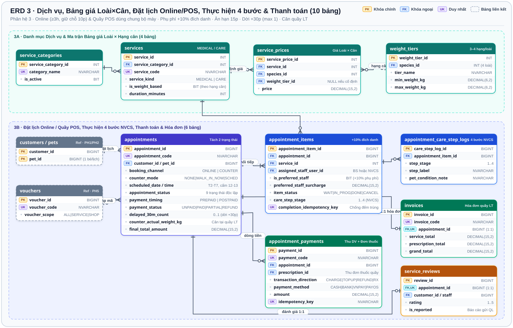
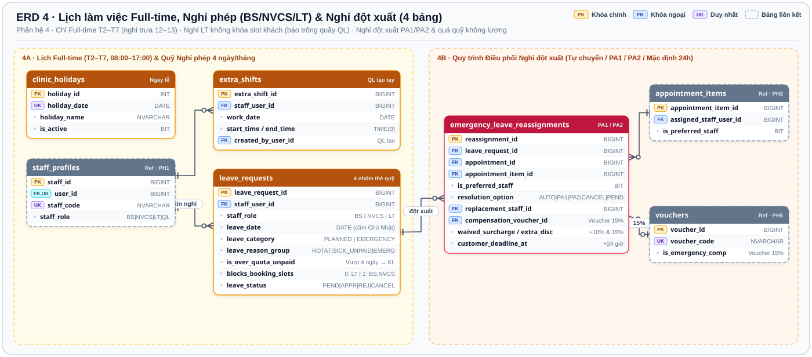
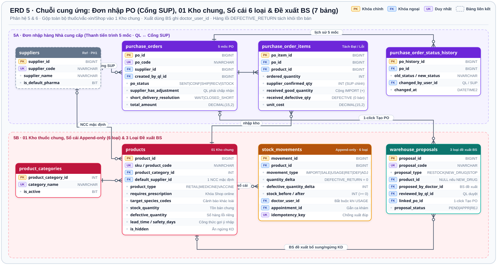
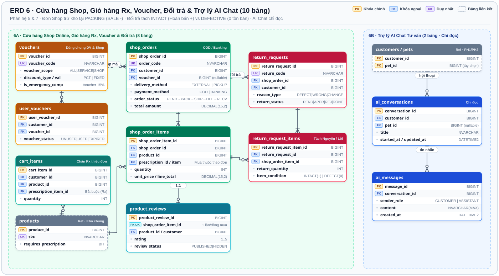

# ANIMORA – THIẾT KẾ CƠ SỞ DỮ LIỆU CHUẨN (SQL SERVER 2022 · v1.5)

> **Phiên bản:** `v1.5` (Thiết kế mới hoàn toàn — Greenfield) · **Cập nhật:** `22/11/2026`
> **Tài liệu nghiệp vụ nguồn:** [Animora_Tai_lieu_nghiep_vu_v1.5.md](./Animora_Tai_lieu_nghiep_vu_v1.5.md)
> **Mục đích:** Tài liệu đặc tả kỹ thuật chuẩn (Database Design Specification) làm bản thiết kế gốc để xây dựng file khởi tạo CSDL SQL Server (`AnimoraDB`) mới hoàn chỉnh cho toàn bộ hệ thống.

---

## Mục lục

- [Phần 1. Tổng quan Kiến trúc CSDL, Quy ước T-SQL & Hằng số Nghiệp vụ](#phan-1)
- [Phần 2. Sơ đồ ERD Tổng thể & Thứ tự Khởi tạo 8 Tầng (DAG)](#phan-2)
- [Phần 3. Phân hệ 1 — Tài khoản, Phân quyền 7 Role, Khách hàng, Nhân sự, Lương & Audit (16 bảng)](#phan-3)
- [Phần 4. Phân hệ 2 — Hồ sơ Thú cưng, Khóa Y tế, Khám SOAP & Đơn thuốc điện tử (9 bảng + 1 View)](#phan-4)
- [Phần 5. Phân hệ 3 — Dịch vụ, Bảng giá Loài × Hạng cân, Đặt lịch Online/POS, Thực hiện & Thanh toán (10 bảng)](#phan-5)
- [Phần 6. Phân hệ 4 — Lịch làm việc Full-time, Nghỉ phép (BS/NVCS/LT) & Nghỉ đột xuất (4 bảng)](#phan-6)
- [Phần 7. Phân hệ 5 & 6 — Kho thuốc chung, Sổ cái kho, Đề xuất BS, Shop, Voucher, Đổi trả & Đơn nhập PO (15 bảng)](#phan-7)
- [Phần 8. Phân hệ 7 — AI Chat tư vấn & Lớp Báo cáo 3 Màn Dashboard cốt lõi (2 bảng + 4 Views)](#phan-8)
- [Phần 9. Triggers Bảo vệ Dữ liệu, Đặc tả Dữ liệu Khởi tạo (Master Seed) & Ma trận Truy vết v1.5](#phan-9)

---

<a id="phan-1"></a>
## Phần 1. Tổng quan Kiến trúc CSDL, Quy ước T-SQL & Hằng số Nghiệp vụ

### 1.1. Phạm vi Hệ thống & Kiến trúc Tổng quan

Cơ sở dữ liệu **`AnimoraDB`** phục vụ nền tảng quản lý phòng khám thú y, chăm sóc thú cưng và cửa hàng trực tuyến Animora theo đúng phạm vi v1.5:

- **7 Vai trò (RBAC):** Khách hàng (`KH`), Bác sĩ thú y (`BS`), Nhân viên chăm sóc (`NVCS`), Lễ tân (`LT`), Quản lý (`QL`), Admin (`AD`), Nhà cung cấp (`SUP`). Mỗi người dùng sử dụng **01 tài khoản riêng** để truy vết chính xác trên Audit Log.
- **4 Loài thú cưng chuẩn:** Chó (`DOG`), Mèo (`CAT`), Chuột (`RODENT`), Thỏ (`RABBIT`). Chặn loài khác ngay từ tầng dữ liệu.
- **6 Module nghiệp vụ + Quản trị/AI/Báo cáo:**
  1. Hồ sơ thú cưng & Khóa dữ liệu y tế (`medical_locked`) + Khám lâm sàng SOAP & Đơn thuốc điện tử.
  2. Bảng giá theo loài × hạng cân, Đặt lịch Online & Quầy POS dùng chung bộ máy, phụ phí `+10%` chọn đích danh, Thanh toán tách trạng thái.
  3. Hủy lịch (`< 3h`), Ân hạn `15 phút`, Dời `+30 phút`, `Không đến`, Hoàn tác `Không đến` & Cơ chế khóa/mở quyền Trả sau (`violation_reset_at`).
  4. Lịch làm việc Full-time cố định (`T2–T7`, `08:00–17:00`, nghỉ trưa `12:00–13:00`, Chủ Nhật nghỉ), Nghỉ phép thường (`BS/NVCS/LT`) & Nghỉ đột xuất (PA1/PA2).
  5. 01 Kho thuốc chung, Sổ cái kho chỉ thêm (`stock_movements` 6 loại tách `DEFECTIVE_RETURN`), Đề xuất kho BS (3 loại), Shop (`COD`/`Banking`), Voucher, Đổi trả & Đơn nhập hàng PO (5 mốc với cổng `SUP`).
  6. Quản lý lương cấp dưới có log (chặn tự sửa lương mình), Audit Log toàn hệ thống, AI Chat chỉ đọc & 3 màn Dashboard cốt lõi.

### 1.2. Quy ước Thiết kế T-SQL (SQL Server 2022)

| Hạng mục | Quy ước chuẩn | Lý do & Áp dụng |
| --- | --- | --- |
| **Database & Collation** | `AnimoraDB` · `Vietnamese_100_CI_AS` | Sắp xếp và tìm kiếm tiếng Việt có dấu chính xác |
| **Tên bảng & cột** | `snake_case`, số nhiều cho tên bảng (`dbo.users`, `dbo.appointments`) | Nhất quán 100%, đồng bộ định danh với tài liệu nghiệp vụ v1.5 |
| **Tiền tố đối tượng** | `pk_`, `fk_`, `uq_`, `ck_`, `df_`, `ix_`, `ux_` *(Filtered Unique)*, `vw_`, `trg_` | Dễ đọc lỗi constraint từ SQL Server và thuận tiện bảo trì |
| **Khóa chính (PK)** | `INT IDENTITY(1,1)` cho danh mục; `BIGINT IDENTITY(1,1)` cho bảng nghiệp vụ/giao dịch | Tối ưu lưu trữ danh mục và chống tràn ID ở bảng log/giao dịch |
| **Tiền tệ (VND)** | `DECIMAL(15,2)` | Chính xác tuyệt đối không sai số dấu phẩy động |
| **Thời gian & Múi giờ** | `DATETIME2(0)` theo giờ địa phương **UTC+7** (`Asia/Ho_Chi_Minh`); `DATE` luôn là ngày địa phương UTC+7 | Tránh lệch ngày khám / liên kết SOAP–Đơn thuốc khung `00:00–06:59` |
| **Chuỗi văn bản** | `NVARCHAR(n)` / `NVARCHAR(MAX)` | Hỗ trợ Unicode tiếng Việt đầy đủ |
| **Boolean** | `BIT NOT NULL DEFAULT 0/1` | Kiểu chuẩn T-SQL |
| **Khóa ngoại (FK)** | Mặc định `NO ACTION` (tránh lỗi `1785` multiple cascade paths) | Kết hợp xóa mềm (`is_hidden`, `status`) và bảng append-only |
| **Cột `NULL` duy nhất** | Dùng **Filtered Unique Index** (`WHERE col IS NOT NULL`) | SQL Server chỉ cho phép 1 `NULL` với `UNIQUE CONSTRAINT` thông thường |
| **Chống ghi đè đồng thời** | `row_version INT NOT NULL DEFAULT 1` (Optimistic Locking) | Dùng trên `pets`, `appointments`, `leave_requests`, `products`, `shop_orders`, `purchase_orders`, `vouchers` |
| **Chống trùng thao tác** | `idempotency_key NVARCHAR(120)` + Filtered Unique Index | Áp dụng cho thanh toán, hoàn tất dòng dịch vụ và xuất dùng thuốc |
| **Bất biến (Append-only)** | Chặn `UPDATE`/`DELETE` bằng Trigger tầng DB | Áp dụng cho `stock_movements`, `salary_audit_logs`, `system_audit_logs` |

### 1.3. Bảng Hằng số Nghiệp vụ ("Con số vàng" → `dbo.system_settings`)

| `setting_key` | `setting_value` | Ý nghĩa áp dụng |
| --- | :---: | --- |
| `clinic.work_start_time` | `08:00` | Giờ mở cửa làm việc (`T2–T7`) |
| `clinic.work_end_time` | `17:00` | Giờ đóng cửa làm việc (`T2–T7`, Chủ Nhật nghỉ cố định) |
| `clinic.lunch_start_time` | `12:00` | Bắt đầu nghỉ trưa cố định toàn trung tâm |
| `clinic.lunch_end_time` | `13:00` | Kết thúc nghỉ trưa cố định (cấm xếp/dời lịch tràn khung này) |
| `booking.online_min_lead_hours` | `3` | Thời gian đặt trước tối thiểu trên kênh Online (giờ) |
| `booking.prepaid_hold_minutes` | `10` | Thời gian giữ chỗ thanh toán Online trả trước (phút) |
| `booking.preferred_staff_surcharge_pct` | `10` | Phụ phí chọn đích danh BS / NVCS (`+10%` giá dòng dịch vụ) |
| `booking.late_cancel_threshold_hours` | `3` | Mốc phạt hủy lịch (`< 3 giờ` trước giờ hẹn) |
| `booking.late_cancel_fee_pct` | `30` | Tỷ lệ giữ phí hủy `< 3 giờ` với đơn trả trước (hoàn `70%`) |
| `booking.checkin_grace_minutes` | `15` | Thời gian ân hạn Check-in sau giờ hẹn (quá hạn → `NO_SHOW`) |
| `booking.counter_delay_minutes` | `30` | Số phút dời trễ tại quầy LT (tối đa `1` lần/đơn) |
| `booking.counter_delay_max_count` | `1` | Giới hạn số lần dời trễ tại quầy trên mỗi đơn |
| `violation.lock_threshold_count` | `2` | Số vi phạm để tự động khóa quyền Trả sau |
| `violation.window_days` | `90` | Cửa sổ đếm vi phạm: `MAX(now - 90 ngày, violation_reset_at)` |
| `violation.unlock_prepaid_completed_count` | `2` | Số ca trả trước đã `PAID` hoàn thành sau khi khóa để mở lại & reset |
| `leave.monthly_quota_days` | `4` | Quỹ nghỉ phép nguyên ngày mỗi tháng (BS, NVCS, LT) |
| `leave.planned_min_lead_days` | `2` | Số ngày gửi trước tối thiểu với đơn nghỉ thường (BS, NVCS) |
| `leave.emergency_compensation_pct` | `15` | Mức giảm giá / Voucher bồi thường nghỉ đột xuất (`15%`) |
| `leave.emergency_customer_timeout_hours` | `24` | Thời hạn chờ khách phản hồi phương án PA1/PA2 trước khi áp mặc định |

---

<a id="phan-2"></a>
## Phần 2. Sơ đồ ERD Tổng thể & Thứ tự Khởi tạo 8 Tầng (DAG)

### 2.1. Hệ thống Hình vẽ Sơ đồ ERD (Chuẩn Crow's Foot SVG · Đủ 56 Bảng)

Toàn bộ sơ đồ ERD được vẽ thành **07 file ảnh vector `.svg` độ phân giải cao** lưu tại thư mục [`./diagrams/`](./diagrams/), hiển thị rõ từng cột `PK` / `FK` / `UK`, kiểu dữ liệu, bản số quan hệ Crow's Foot (`1`, `0..1`, `1..N`, `0..N`) và khung phân vùng theo luồng nghiệp vụ:

#### 2.1.1. Bản đồ Kiến trúc Dữ liệu Tổng thể (4 Tầng · 7 Phân hệ · 56 Bảng)

> **Luồng đọc:** Tầng 1 Định danh 7 Role → Tầng 2 Lâm sàng/Dịch vụ/POS ↔ Tầng 3 Lịch Full-time & Nghỉ đột xuất → Tầng 4 Chuỗi cung ứng PO, 01 Kho chung, Shop & Dashboard.



---

#### 2.1.2. ERD 1 — Tài khoản, Phân quyền 7 Role, Khách hàng, Nhân sự, Lương & Audit (16 bảng)

> **Luồng đọc:** `permissions` ↔ `roles` (7 vai trò) → `users` (1 người = 1 tài khoản) rẽ nhánh Hồ sơ KH (`customers`, `customer_addresses`, `customer_violations` + `violation_reset_at`), Nhân sự Full-time (`staff_profiles`, `salary_audit_logs`), Nhà cung cấp (`suppliers`) & Kiểm toán hệ thống (`system_*`).



---

#### 2.1.3. ERD 2 — Hồ sơ Thú cưng (4 loài), Khóa Y tế, Khám SOAP & Đơn thuốc điện tử (9 bảng)

> **Luồng đọc:** `pet_species` (4 loài chuẩn) → `pet_breeds` → `pets` (`medical_locked`, xóa mềm `is_hidden`) → Ghi chú KH & Lịch sử cân nặng → Khám Bước 1 (`medical_records` SOAP UTC+7 + `pet_health_schedules`) → Kê đơn Bước 2 (`prescriptions` → `prescription_items` đọc Kho chung `products`).



---

#### 2.1.4. ERD 3 — Dịch vụ, Bảng giá Loài × Hạng cân, Đặt lịch Online/POS, Thực hiện & Thanh toán (10 bảng)

> **Luồng đọc:** Khối trên định giá (`service_categories` → `services` × `weight_tiers` → `service_prices`); Khối dưới vận hành đặt lịch dùng chung Online/POS (`appointments` tách 2 trạng thái → `appointment_items` `+10%` đích danh → 4 bước NVCS, `appointment_payments`, `invoices` & `service_reviews`).



---

#### 2.1.5. ERD 4 — Lịch Full-time, Nghỉ phép (BS/NVCS/LT) & Điều phối Nghỉ đột xuất (4 bảng)

> **Luồng đọc:** `clinic_holidays` + `extra_shifts` (QL tạo tay) + `leave_requests` (quỹ 4 ngày/tháng, LT không khóa slot khách) → khi nghỉ đột xuất sinh `emergency_leave_reassignments` xử lý ca ảnh hưởng (`PA1` hủy `+10%` & giảm `15%`, `PA2` dời lịch + `vouchers` `15%`).



---

#### 2.1.6. ERD 5 — Chuỗi cung ứng: Đơn nhập PO (Cổng SUP), 01 Kho chung, Sổ cái & Đề xuất BS (7 bảng)

> **Luồng đọc:** `suppliers` ↔ `purchase_orders` (5 mốc) → `purchase_order_items` (tách SL đạt chuẩn & SL lỗi) → nhập vào `products` (01 Kho chung) qua sổ cái bất biến `stock_movements` (6 loại, tách `DEFECTIVE_RETURN` = `0` tồn bán) và đồng bộ 3 loại `warehouse_proposals` của BS.



---

#### 2.1.7. ERD 6 — Cửa hàng Shop, Giỏ hàng Rx, Voucher, Đổi trả & Trợ lý AI Chat (10 bảng)

> **Luồng đọc:** Bên trái là luồng bán lẻ (`vouchers` → `user_vouchers`, `cart_items` khóa thuốc Rx → `shop_orders` → `shop_order_items` → `product_reviews` / `return_requests` tách `INTACT` vs `DEFECTIVE`); Bên phải tách riêng cụm Trợ lý AI Chat chỉ đọc (`ai_conversations` → `ai_messages`).



### 2.2. Thứ tự Thực thi Tạo bảng (8 Tầng DAG — Phi chu trình 100%)

Khi ghép toàn bộ DDL thành một file `Animora_v1.5.sql` duy nhất để chạy một lần (`F5`), thực thi đúng theo thứ tự 8 tầng dưới đây sẽ đảm bảo **không có vòng lặp khóa ngoại**:

| Tầng | Số bảng | Danh sách bảng theo đúng thứ tự `CREATE TABLE` |
| :---: | :---: | --- |
| **Tầng 1** | 6 | `roles`, `permissions`, `pet_species`, `service_categories`, `product_categories`, `clinic_holidays` |
| **Tầng 2** | 5 | `role_permissions`, `users`, `pet_breeds`, `weight_tiers`, `services` |
| **Tầng 3** | 11 | `user_oauth_accounts`, `otp_verifications`, `user_sessions`, `customers`, `staff_profiles`, `suppliers`, `system_settings`, `system_audit_logs`, `system_notifications`, `salary_audit_logs`, `service_prices` |
| **Tầng 4** | 10 | `customer_addresses`, `pets`, `pet_customer_notes`, `products`, `vouchers`, `user_vouchers`, `extra_shifts`, `leave_requests`, `purchase_orders`, `ai_conversations` |
| **Tầng 5** | 5 | `appointments`, `purchase_order_items`, `purchase_order_status_history`, `warehouse_proposals`, `ai_messages` |
| **Tầng 6** | 8 | `appointment_items`, `appointment_care_step_logs`, `customer_violations`, `pet_weight_logs`, `medical_records`, `pet_health_schedules`, `emergency_leave_reassignments`, `service_reviews` |
| **Tầng 7** | 7 | `prescriptions`, `prescription_items`, `appointment_payments`, `invoices`, `cart_items`, `shop_orders`, `shop_order_items` |
| **Tầng 8** | 4 | `return_requests`, `return_request_items`, `product_reviews`, `stock_movements` *(tiếp theo tạo 5 Views và Triggers)* |

**Tổng quy mô lược đồ:** **56 bảng** · **5 Views** · **Triggers bảo vệ bất biến & toàn vẹn** · **Master Seed Data**.

---

<a id="phan-3"></a>
## Phần 3. Phân hệ 1 — Tài khoản, Phân quyền 7 Role, Khách hàng, Nhân sự, Lương & Audit (16 bảng)

### 3.1. Vòng đời Trạng thái Tài khoản (State Machine)

| Trạng thái hiện tại | Hành động / Sự kiện | Trạng thái kế tiếp | Vai trò thực hiện | Tác động dữ liệu & Bảo mật |
| --- | --- | --- | --- | --- |
| *(Khởi tạo)* | `LT` tạo hồ sơ khách vãng lai (Tên + SĐT 10 số) | `WALK_IN` | `LT` | Tạo `users` (`password_hash = NULL`) + `customers` (`is_walk_in = 1`); chưa đăng nhập Web được. |
| *(Khởi tạo)* | `KH` tự đăng ký tài khoản Web mới | `PENDING_OTP` | `KH` | Tạo mã OTP 6 số (lưu hash) trong `otp_verifications`. |
| `WALK_IN` / `PENDING_OTP` | Xác thực OTP / đặt mật khẩu nâng cấp Web | `ACTIVE` | `KH`, `LT` *(khởi tạo giúp)* | Đặt `password_hash`, cập nhật `is_walk_in = 0`, `upgraded_to_web_at`; giữ nguyên 100% thú cưng, bệnh án & `violation`. |
| *(Khởi tạo)* | `AD` cấp tài khoản nội bộ (`BS`, `NVCS`, `LT`, `QL`, `SUP`) | `ACTIVE` | `AD` | Tạo `users` + hồ sơ tương ứng (`staff_profiles` hoặc `suppliers`); ghi `system_audit_logs`. |
| `ACTIVE` | Nhập sai mật khẩu vượt ngưỡng / bị `AD` khóa | `LOCKED` | System, `AD` | Thu hồi phiên hoạt động trong `user_sessions`; ghi `system_audit_logs`. |
| `ACTIVE` / `LOCKED` | `AD` ngừng hoạt động tài khoản | `INACTIVE` | `AD` | Thu hồi toàn bộ `user_sessions`; chặn đăng nhập; ghi `system_audit_logs`. |

### 3.2. Thiết kế DDL Chuẩn T-SQL (16 bảng)

```sql
-- ============================================================================
-- KHỞI TẠO DATABASE (Dùng cho file .sql mới)
-- ============================================================================
-- IF DB_ID(N'AnimoraDB') IS NULL
--     CREATE DATABASE AnimoraDB COLLATE Vietnamese_100_CI_AS;
-- GO
-- USE AnimoraDB;
-- GO

-- [Tầng 1] 1. Danh mục 7 vai trò chuẩn v1.5
CREATE TABLE dbo.roles (
    role_id     INT IDENTITY(1,1) NOT NULL,
    role_code   NVARCHAR(10)      NOT NULL,
    role_name   NVARCHAR(100)     NOT NULL,
    description NVARCHAR(300)     NULL,
    created_at  DATETIME2(0)      NOT NULL CONSTRAINT df_roles_created_at DEFAULT SYSDATETIME(),
    CONSTRAINT pk_roles PRIMARY KEY (role_id),
    CONSTRAINT uq_roles_code UNIQUE (role_code),
    CONSTRAINT ck_roles_code CHECK (role_code IN (N'KH', N'BS', N'NVCS', N'LT', N'QL', N'AD', N'SUP'))
);

-- [Tầng 1] 2. Danh mục quyền chi tiết (kiểm tra tại Backend RBAC)
CREATE TABLE dbo.permissions (
    permission_id   INT IDENTITY(1,1) NOT NULL,
    permission_code NVARCHAR(100)     NOT NULL,
    permission_name NVARCHAR(150)     NOT NULL,
    module_name     NVARCHAR(50)      NOT NULL,
    description     NVARCHAR(500)     NULL,
    CONSTRAINT pk_permissions PRIMARY KEY (permission_id),
    CONSTRAINT uq_permissions_code UNIQUE (permission_code)
);

-- [Tầng 2] 3. Bảng gán quyền theo vai trò
CREATE TABLE dbo.role_permissions (
    role_id       INT          NOT NULL,
    permission_id INT          NOT NULL,
    created_at    DATETIME2(0) NOT NULL CONSTRAINT df_role_permissions_created_at DEFAULT SYSDATETIME(),
    CONSTRAINT pk_role_permissions PRIMARY KEY (role_id, permission_id),
    CONSTRAINT fk_role_permissions_roles FOREIGN KEY (role_id) REFERENCES dbo.roles(role_id),
    CONSTRAINT fk_role_permissions_permissions FOREIGN KEY (permission_id) REFERENCES dbo.permissions(permission_id)
);

-- [Tầng 2] 4. Bảng tài khoản người dùng trung tâm (mỗi người 01 tài khoản riêng)
CREATE TABLE dbo.users (
    user_id               BIGINT IDENTITY(1,1) NOT NULL,
    user_code             NVARCHAR(30)         NOT NULL, -- VD: USR-20261122-0001
    role_id               INT                  NOT NULL,
    full_name             NVARCHAR(150)        NOT NULL,
    email                 NVARCHAR(255)        NULL,
    phone_number          NVARCHAR(15)         NULL,     -- Chuẩn hóa 10 chữ số VN cho KH
    password_hash         NVARCHAR(500)        NULL,     -- NULL khi status = WALK_IN
    avatar_url            NVARCHAR(1000)       NULL,
    account_status        NVARCHAR(20)         NOT NULL CONSTRAINT df_users_status DEFAULT N'ACTIVE',
    is_email_verified     BIT                  NOT NULL CONSTRAINT df_users_email_verified DEFAULT 0,
    failed_login_attempts INT                  NOT NULL CONSTRAINT df_users_failed_login DEFAULT 0,
    locked_until          DATETIME2(0)         NULL,
    last_login_at         DATETIME2(0)         NULL,
    row_version           INT                  NOT NULL CONSTRAINT df_users_row_version DEFAULT 1,
    created_by_user_id    BIGINT               NULL,
    created_at            DATETIME2(0)         NOT NULL CONSTRAINT df_users_created_at DEFAULT SYSDATETIME(),
    updated_at            DATETIME2(0)         NOT NULL CONSTRAINT df_users_updated_at DEFAULT SYSDATETIME(),
    CONSTRAINT pk_users PRIMARY KEY (user_id),
    CONSTRAINT uq_users_code UNIQUE (user_code),
    CONSTRAINT fk_users_roles FOREIGN KEY (role_id) REFERENCES dbo.roles(role_id),
    CONSTRAINT fk_users_created_by FOREIGN KEY (created_by_user_id) REFERENCES dbo.users(user_id),
    CONSTRAINT ck_users_status CHECK (account_status IN (N'WALK_IN', N'PENDING_OTP', N'ACTIVE', N'LOCKED', N'INACTIVE')),
    CONSTRAINT ck_users_contact CHECK (email IS NOT NULL OR phone_number IS NOT NULL),
    CONSTRAINT ck_users_failed_login CHECK (failed_login_attempts >= 0),
    CONSTRAINT ck_users_walkin_password CHECK (account_status = N'WALK_IN' OR password_hash IS NOT NULL OR account_status = N'PENDING_OTP')
);

CREATE UNIQUE INDEX ux_users_email ON dbo.users(email) WHERE email IS NOT NULL;
CREATE UNIQUE INDEX ux_users_phone_number ON dbo.users(phone_number) WHERE phone_number IS NOT NULL;
CREATE INDEX ix_users_role_status ON dbo.users(role_id, account_status);

-- [Tầng 3] 5. Liên kết đăng nhập Google OAuth2
CREATE TABLE dbo.user_oauth_accounts (
    oauth_id         BIGINT IDENTITY(1,1) NOT NULL,
    user_id          BIGINT               NOT NULL,
    provider         NVARCHAR(20)         NOT NULL CONSTRAINT df_oauth_provider DEFAULT N'GOOGLE',
    provider_user_id NVARCHAR(150)        NOT NULL,
    provider_email   NVARCHAR(255)        NOT NULL,
    linked_at        DATETIME2(0)         NOT NULL CONSTRAINT df_oauth_linked_at DEFAULT SYSDATETIME(),
    CONSTRAINT pk_user_oauth_accounts PRIMARY KEY (oauth_id),
    CONSTRAINT fk_oauth_users FOREIGN KEY (user_id) REFERENCES dbo.users(user_id),
    CONSTRAINT uq_oauth_provider_user UNIQUE (provider, provider_user_id),
    CONSTRAINT ck_oauth_provider CHECK (provider IN (N'GOOGLE'))
);

-- [Tầng 3] 6. Mã xác thực OTP (Đăng ký, Nâng cấp khách vãng lai, Quên mật khẩu)
CREATE TABLE dbo.otp_verifications (
    otp_id         BIGINT IDENTITY(1,1) NOT NULL,
    user_id        BIGINT               NULL,
    target_contact NVARCHAR(255)        NOT NULL, -- SĐT hoặc Email
    otp_code_hash  NVARCHAR(255)        NOT NULL,
    purpose        NVARCHAR(30)         NOT NULL,
    attempt_count  INT                  NOT NULL CONSTRAINT df_otp_attempts DEFAULT 0,
    is_used        BIT                  NOT NULL CONSTRAINT df_otp_is_used DEFAULT 0,
    expires_at     DATETIME2(0)         NOT NULL,
    created_at     DATETIME2(0)         NOT NULL CONSTRAINT df_otp_created_at DEFAULT SYSDATETIME(),
    CONSTRAINT pk_otp_verifications PRIMARY KEY (otp_id),
    CONSTRAINT fk_otp_users FOREIGN KEY (user_id) REFERENCES dbo.users(user_id),
    CONSTRAINT ck_otp_purpose CHECK (purpose IN (N'REGISTER', N'UPGRADE_WALKIN', N'RESET_PASSWORD')),
    CONSTRAINT ck_otp_attempts CHECK (attempt_count >= 0)
);

CREATE INDEX ix_otp_target_purpose ON dbo.otp_verifications(target_contact, purpose, expires_at DESC);

-- [Tầng 3] 7. Phiên đăng nhập & Refresh Token
CREATE TABLE dbo.user_sessions (
    session_id         UNIQUEIDENTIFIER NOT NULL CONSTRAINT df_user_sessions_id DEFAULT NEWID(),
    user_id            BIGINT           NOT NULL,
    refresh_token_hash NVARCHAR(500)    NOT NULL,
    device_info        NVARCHAR(300)    NULL,
    ip_address         NVARCHAR(45)     NULL,
    last_active_at     DATETIME2(0)     NOT NULL CONSTRAINT df_user_sessions_last_active DEFAULT SYSDATETIME(),
    expires_at         DATETIME2(0)     NOT NULL,
    revoked_at         DATETIME2(0)     NULL,
    revoke_reason      NVARCHAR(50)     NULL,
    created_at         DATETIME2(0)     NOT NULL CONSTRAINT df_user_sessions_created_at DEFAULT SYSDATETIME(),
    CONSTRAINT pk_user_sessions PRIMARY KEY (session_id),
    CONSTRAINT uq_user_sessions_token UNIQUE (refresh_token_hash),
    CONSTRAINT fk_user_sessions_users FOREIGN KEY (user_id) REFERENCES dbo.users(user_id),
    CONSTRAINT ck_user_sessions_expiry CHECK (expires_at > created_at),
    CONSTRAINT ck_user_sessions_revoke CHECK (
        (revoked_at IS NULL AND revoke_reason IS NULL)
        OR (revoked_at IS NOT NULL AND revoke_reason IS NOT NULL)
    )
);

CREATE INDEX ix_user_sessions_active ON dbo.user_sessions(user_id, expires_at) WHERE revoked_at IS NULL;

-- [Tầng 3] 8. Hồ sơ Khách hàng (Vãng lai + Web + Cơ chế khóa/mở quyền Trả sau)
CREATE TABLE dbo.customers (
    customer_id          BIGINT IDENTITY(1,1) NOT NULL,
    user_id              BIGINT               NOT NULL,
    is_walk_in           BIT                  NOT NULL CONSTRAINT df_customers_is_walk_in DEFAULT 0,
    upgraded_to_web_at   DATETIME2(0)         NULL,
    date_of_birth        DATE                 NULL,
    gender               NVARCHAR(20)         NULL,
    default_address      NVARCHAR(500)        NULL,
    -- Quản lý khóa/mở quyền Trả sau (Module 3 v1.5)
    is_postpaid_locked   BIT                  NOT NULL CONSTRAINT df_customers_postpaid_locked DEFAULT 0,
    postpaid_locked_at   DATETIME2(0)         NULL,
    postpaid_lock_reason NVARCHAR(300)        NULL,
    violation_reset_at   DATETIME2(0)         NULL, -- Ghi NOW khi hoàn thành 2 ca prepaid+paid sau lúc khóa
    created_at           DATETIME2(0)         NOT NULL CONSTRAINT df_customers_created_at DEFAULT SYSDATETIME(),
    updated_at           DATETIME2(0)         NOT NULL CONSTRAINT df_customers_updated_at DEFAULT SYSDATETIME(),
    CONSTRAINT pk_customers PRIMARY KEY (customer_id),
    CONSTRAINT uq_customers_user UNIQUE (user_id),
    CONSTRAINT fk_customers_users FOREIGN KEY (user_id) REFERENCES dbo.users(user_id),
    CONSTRAINT ck_customers_gender CHECK (gender IS NULL OR gender IN (N'MALE', N'FEMALE', N'OTHER')),
    CONSTRAINT ck_customers_lock_consistency CHECK (
        (is_postpaid_locked = 0) OR (is_postpaid_locked = 1 AND postpaid_locked_at IS NOT NULL)
    )
);

-- [Tầng 4] 9. Sổ địa chỉ giao hàng Shop của Khách hàng
CREATE TABLE dbo.customer_addresses (
    address_id      BIGINT IDENTITY(1,1) NOT NULL,
    customer_id     BIGINT               NOT NULL,
    address_label   NVARCHAR(50)         NULL,
    recipient_name  NVARCHAR(150)        NOT NULL,
    recipient_phone NVARCHAR(15)         NOT NULL,
    address_line    NVARCHAR(500)        NOT NULL,
    ward            NVARCHAR(150)        NULL,
    district        NVARCHAR(150)        NULL,
    province        NVARCHAR(150)        NOT NULL,
    is_default      BIT                  NOT NULL CONSTRAINT df_customer_addresses_default DEFAULT 0,
    is_active       BIT                  NOT NULL CONSTRAINT df_customer_addresses_active DEFAULT 1,
    created_at      DATETIME2(0)         NOT NULL CONSTRAINT df_customer_addresses_created_at DEFAULT SYSDATETIME(),
    updated_at      DATETIME2(0)         NOT NULL CONSTRAINT df_customer_addresses_updated_at DEFAULT SYSDATETIME(),
    CONSTRAINT pk_customer_addresses PRIMARY KEY (address_id),
    CONSTRAINT fk_customer_addresses_customers FOREIGN KEY (customer_id) REFERENCES dbo.customers(customer_id)
);

CREATE UNIQUE INDEX ux_customer_addresses_default
    ON dbo.customer_addresses(customer_id)
    WHERE is_default = 1 AND is_active = 1;

-- [Tầng 3] 10. Hồ sơ Nhân sự nội bộ (BS, NVCS, LT, QL — 100% Full-time)
CREATE TABLE dbo.staff_profiles (
    staff_id             BIGINT IDENTITY(1,1) NOT NULL,
    user_id              BIGINT               NOT NULL,
    staff_code           NVARCHAR(30)         NOT NULL, -- Tie-breaker cho thuật toán tự gán nhân sự
    staff_role           NVARCHAR(10)         NOT NULL,
    employment_type      NVARCHAR(20)         NOT NULL CONSTRAINT df_staff_employment_type DEFAULT N'FULL_TIME',
    specialization       NVARCHAR(200)        NULL,     -- Chủ yếu dùng cho BS
    biography            NVARCHAR(2000)       NULL,
    hire_date            DATE                 NULL,
    current_salary       DECIMAL(15,2)        NULL,     -- QL xem/sửa cho BS, NVCS, LT (cấm sửa mình)
    is_active            BIT                  NOT NULL CONSTRAINT df_staff_is_active DEFAULT 1,
    created_at           DATETIME2(0)         NOT NULL CONSTRAINT df_staff_created_at DEFAULT SYSDATETIME(),
    updated_at           DATETIME2(0)         NOT NULL CONSTRAINT df_staff_updated_at DEFAULT SYSDATETIME(),
    CONSTRAINT pk_staff_profiles PRIMARY KEY (staff_id),
    CONSTRAINT uq_staff_profiles_user UNIQUE (user_id),
    CONSTRAINT uq_staff_profiles_code UNIQUE (staff_code),
    CONSTRAINT fk_staff_profiles_users FOREIGN KEY (user_id) REFERENCES dbo.users(user_id),
    CONSTRAINT ck_staff_profiles_role CHECK (staff_role IN (N'BS', N'NVCS', N'LT', N'QL')),
    CONSTRAINT ck_staff_profiles_fulltime CHECK (employment_type = N'FULL_TIME'),
    CONSTRAINT ck_staff_profiles_salary CHECK (current_salary IS NULL OR current_salary >= 0)
);

CREATE INDEX ix_staff_profiles_role_active ON dbo.staff_profiles(staff_role, is_active, staff_code);

-- [Tầng 3] 11. Nhật ký sửa lương nhân sự (Append-only, chặn cứng QL tự sửa lương mình)
CREATE TABLE dbo.salary_audit_logs (
    salary_log_id      BIGINT IDENTITY(1,1) NOT NULL,
    target_user_id     BIGINT               NOT NULL,
    old_salary         DECIMAL(15,2)        NULL,
    new_salary         DECIMAL(15,2)        NOT NULL,
    reason             NVARCHAR(500)        NOT NULL,
    changed_by_user_id BIGINT               NOT NULL,
    created_at         DATETIME2(0)         NOT NULL CONSTRAINT df_salary_audit_created_at DEFAULT SYSDATETIME(),
    CONSTRAINT pk_salary_audit_logs PRIMARY KEY (salary_log_id),
    CONSTRAINT fk_salary_audit_target FOREIGN KEY (target_user_id) REFERENCES dbo.users(user_id),
    CONSTRAINT fk_salary_audit_actor FOREIGN KEY (changed_by_user_id) REFERENCES dbo.users(user_id),
    CONSTRAINT ck_salary_audit_no_self_edit CHECK (target_user_id <> changed_by_user_id),
    CONSTRAINT ck_salary_audit_amounts CHECK ((old_salary IS NULL OR old_salary >= 0) AND new_salary >= 0)
);

CREATE INDEX ix_salary_audit_target ON dbo.salary_audit_logs(target_user_id, created_at DESC);

-- [Tầng 3] 12. Hồ sơ Nhà cung cấp (SUP)
CREATE TABLE dbo.suppliers (
    supplier_id      BIGINT IDENTITY(1,1) NOT NULL,
    user_id          BIGINT               NOT NULL,
    supplier_code    NVARCHAR(30)         NOT NULL,
    supplier_name    NVARCHAR(200)        NOT NULL,
    contact_person   NVARCHAR(150)        NULL,
    phone_number     NVARCHAR(20)         NULL,
    email            NVARCHAR(255)        NULL,
    address          NVARCHAR(500)        NULL,
    tax_code         NVARCHAR(50)         NULL,
    is_default_pharma BIT                 NOT NULL CONSTRAINT df_suppliers_default_pharma DEFAULT 0,
    is_active        BIT                  NOT NULL CONSTRAINT df_suppliers_is_active DEFAULT 1,
    created_at       DATETIME2(0)         NOT NULL CONSTRAINT df_suppliers_created_at DEFAULT SYSDATETIME(),
    updated_at       DATETIME2(0)         NOT NULL CONSTRAINT df_suppliers_updated_at DEFAULT SYSDATETIME(),
    CONSTRAINT pk_suppliers PRIMARY KEY (supplier_id),
    CONSTRAINT uq_suppliers_user UNIQUE (user_id),
    CONSTRAINT uq_suppliers_code UNIQUE (supplier_code),
    CONSTRAINT fk_suppliers_users FOREIGN KEY (user_id) REFERENCES dbo.users(user_id)
);

CREATE UNIQUE INDEX ux_suppliers_default_pharma ON dbo.suppliers(is_default_pharma) WHERE is_default_pharma = 1;

-- [Tầng 3] 13. Cấu hình tham số hệ thống
CREATE TABLE dbo.system_settings (
    setting_id         INT IDENTITY(1,1) NOT NULL,
    setting_key        NVARCHAR(150)     NOT NULL,
    setting_value      NVARCHAR(MAX)     NOT NULL,
    description        NVARCHAR(1000)    NULL,
    updated_by_user_id BIGINT            NULL,
    updated_at         DATETIME2(0)      NOT NULL CONSTRAINT df_system_settings_updated_at DEFAULT SYSDATETIME(),
    CONSTRAINT pk_system_settings PRIMARY KEY (setting_id),
    CONSTRAINT uq_system_settings_key UNIQUE (setting_key),
    CONSTRAINT fk_system_settings_users FOREIGN KEY (updated_by_user_id) REFERENCES dbo.users(user_id)
);

-- [Tầng 3] 14. Nhật ký Kiểm toán Toàn hệ thống (Append-only — phủ đủ 5 nhóm v1.5)
CREATE TABLE dbo.system_audit_logs (
    audit_log_id  BIGINT IDENTITY(1,1) NOT NULL,
    actor_user_id BIGINT               NULL,     -- NULL chỉ khi tiến trình hệ thống (Cron) tự chạy
    actor_role    NVARCHAR(20)         NOT NULL, -- KH, BS, NVCS, LT, QL, AD, SUP, SYSTEM
    audit_group   NVARCHAR(30)         NOT NULL, -- PROFILE, BOOKING_POS, CLINICAL_CARE, WAREHOUSE_SHOP_PO, HR_ADMIN
    action_type   NVARCHAR(80)         NOT NULL,
    entity_name   NVARCHAR(100)        NOT NULL,
    entity_id     NVARCHAR(100)        NOT NULL,
    old_values    NVARCHAR(MAX)        NULL,     -- JSON snapshot trước thay đổi
    new_values    NVARCHAR(MAX)        NULL,     -- JSON snapshot sau thay đổi
    reason        NVARCHAR(1000)       NULL,
    ip_address    NVARCHAR(45)         NULL,
    created_at    DATETIME2(0)         NOT NULL CONSTRAINT df_system_audit_created_at DEFAULT SYSDATETIME(),
    CONSTRAINT pk_system_audit_logs PRIMARY KEY (audit_log_id),
    CONSTRAINT fk_system_audit_actor FOREIGN KEY (actor_user_id) REFERENCES dbo.users(user_id),
    CONSTRAINT ck_system_audit_group CHECK (
        audit_group IN (N'PROFILE', N'BOOKING_POS', N'CLINICAL_CARE', N'WAREHOUSE_SHOP_PO', N'HR_ADMIN')
    ),
    CONSTRAINT ck_system_audit_old_json CHECK (old_values IS NULL OR ISJSON(old_values) = 1),
    CONSTRAINT ck_system_audit_new_json CHECK (new_values IS NULL OR ISJSON(new_values) = 1)
);

CREATE INDEX ix_system_audit_entity ON dbo.system_audit_logs(entity_name, entity_id, created_at DESC);
CREATE INDEX ix_system_audit_actor ON dbo.system_audit_logs(actor_user_id, created_at DESC) WHERE actor_user_id IS NOT NULL;
CREATE INDEX ix_system_audit_group_date ON dbo.system_audit_logs(audit_group, created_at DESC);

-- [Tầng 3] 15. Hệ thống Thông báo nội bộ & Khách hàng
CREATE TABLE dbo.system_notifications (
    notification_id    BIGINT IDENTITY(1,1) NOT NULL,
    recipient_user_id  BIGINT               NOT NULL,
    severity           NVARCHAR(15)         NOT NULL CONSTRAINT df_notifications_severity DEFAULT N'INFO',
    notification_type  NVARCHAR(60)         NOT NULL, -- VD: LT_COUNTER_EMPTY, EMERGENCY_LEAVE, STOCK_OUT_ALERT
    title              NVARCHAR(250)        NOT NULL,
    content            NVARCHAR(1500)       NOT NULL,
    reference_type     NVARCHAR(50)         NULL,
    reference_id       NVARCHAR(50)         NULL,
    is_read            BIT                  NOT NULL CONSTRAINT df_notifications_is_read DEFAULT 0,
    read_at            DATETIME2(0)         NULL,
    created_at         DATETIME2(0)         NOT NULL CONSTRAINT df_notifications_created_at DEFAULT SYSDATETIME(),
    CONSTRAINT pk_system_notifications PRIMARY KEY (notification_id),
    CONSTRAINT fk_notifications_recipient FOREIGN KEY (recipient_user_id) REFERENCES dbo.users(user_id),
    CONSTRAINT ck_notifications_severity CHECK (severity IN (N'INFO', N'WARNING', N'URGENT'))
);

CREATE INDEX ix_notifications_recipient_unread
    ON dbo.system_notifications(recipient_user_id, is_read, created_at DESC);

-- [Tầng 6] 16. Sổ theo dõi Vi phạm của Khách hàng (phục vụ Khóa/Mở quyền Trả sau & Hoàn tác No-show)
-- (Lưu ý: Tạo ở Tầng 6 sau khi đã có bảng dbo.appointments)
CREATE TABLE dbo.customer_violations (
    violation_id        BIGINT IDENTITY(1,1) NOT NULL,
    customer_id         BIGINT               NOT NULL,
    appointment_id      BIGINT               NOT NULL,
    violation_type      NVARCHAR(30)         NOT NULL, -- LATE_CANCEL_POSTPAID | NO_SHOW
    occurred_at         DATETIME2(0)         NOT NULL CONSTRAINT df_customer_violations_occurred_at DEFAULT SYSDATETIME(),
    is_reverted         BIT                  NOT NULL CONSTRAINT df_customer_violations_reverted DEFAULT 0,
    reverted_by_user_id BIGINT               NULL,
    reverted_at         DATETIME2(0)         NULL,
    revert_reason       NVARCHAR(500)        NULL,
    CONSTRAINT pk_customer_violations PRIMARY KEY (violation_id),
    CONSTRAINT fk_violations_customers FOREIGN KEY (customer_id) REFERENCES dbo.customers(customer_id),
    CONSTRAINT fk_violations_appointments FOREIGN KEY (appointment_id) REFERENCES dbo.appointments(appointment_id),
    CONSTRAINT fk_violations_reverted_by FOREIGN KEY (reverted_by_user_id) REFERENCES dbo.users(user_id),
    CONSTRAINT ck_violations_type CHECK (violation_type IN (N'LATE_CANCEL_POSTPAID', N'NO_SHOW')),
    CONSTRAINT ck_violations_revert_consistency CHECK (
        (is_reverted = 0 AND reverted_by_user_id IS NULL AND reverted_at IS NULL)
        OR (is_reverted = 1 AND reverted_by_user_id IS NOT NULL AND reverted_at IS NOT NULL AND revert_reason IS NOT NULL)
    )
);

CREATE UNIQUE INDEX ux_violations_active_per_appointment
    ON dbo.customer_violations(appointment_id)
    WHERE is_reverted = 0;
CREATE INDEX ix_violations_customer_window
    ON dbo.customer_violations(customer_id, occurred_at DESC)
    WHERE is_reverted = 0;
```

### 3.3. Quy tắc Toàn vẹn & Kỹ thuật Tầng Ứng dụng (Phân hệ 1)

- **Chuẩn hóa SĐT & Nâng cấp khách vãng lai (Module 4.1):**
  - Mọi SĐT khách hàng đều chuẩn hóa thành 10 chữ số trước khi lưu/tra cứu.
  - Khi `LT` tiếp nhận khách tại quầy: tìm trước theo `users.phone_number` để tránh tạo trùng.
  - Khi khách vãng lai (`account_status = 'WALK_IN'`) muốn dùng Web (hoặc tự đăng ký trùng SĐT chưa có tài khoản): nâng cấp trực tiếp trên cùng bản ghi `user_id`/`customer_id` (`account_status = 'ACTIVE'`, `is_walk_in = 0`, `upgraded_to_web_at = SYSDATETIME()`) → bảo toàn 100% thú cưng, bệnh án, lịch hẹn và lịch sử `customer_violations`.
- **Chặn cứng QL tự sửa lương mình (Phần IV.1):**
  - Ràng buộc `ck_salary_audit_no_self_edit` chặn trực tiếp ở DB (`target_user_id <> changed_by_user_id`).
  - Backend bổ sung guard chỉ cho phép `QL` sửa lương khi `target_staff.staff_role IN ('BS', 'NVCS', 'LT')` và ghi đồng thời `staff_profiles.current_salary` + `salary_audit_logs` + `system_audit_logs` trong 1 transaction.

---

<a id="phan-4"></a>
## Phần 4. Phân hệ 2 — Hồ sơ Thú cưng, Khóa Y tế, Khám SOAP & Đơn thuốc điện tử (9 bảng + 1 View)

### 4.1. Thiết kế DDL Chuẩn T-SQL (9 bảng + 1 View)

```sql
-- [Tầng 1] 1. Danh mục Loài thú cưng (Cố định đúng 4 loài chuẩn v1.5)
CREATE TABLE dbo.pet_species (
    species_id   INT IDENTITY(1,1) NOT NULL,
    species_code NVARCHAR(20)      NOT NULL,
    species_name NVARCHAR(50)      NOT NULL,
    is_active    BIT               NOT NULL CONSTRAINT df_pet_species_active DEFAULT 1,
    CONSTRAINT pk_pet_species PRIMARY KEY (species_id),
    CONSTRAINT uq_pet_species_code UNIQUE (species_code),
    CONSTRAINT uq_pet_species_name UNIQUE (species_name),
    CONSTRAINT ck_pet_species_allowed_four CHECK (species_code IN (N'DOG', N'CAT', N'RODENT', N'RABBIT'))
);

-- [Tầng 2] 2. Danh mục Giống thú cưng theo 4 loài
CREATE TABLE dbo.pet_breeds (
    breed_id   INT IDENTITY(1,1) NOT NULL,
    species_id INT               NOT NULL,
    breed_name NVARCHAR(120)     NOT NULL,
    is_active  BIT               NOT NULL CONSTRAINT df_pet_breeds_active DEFAULT 1,
    CONSTRAINT pk_pet_breeds PRIMARY KEY (breed_id),
    CONSTRAINT fk_pet_breeds_species FOREIGN KEY (species_id) REFERENCES dbo.pet_species(species_id),
    CONSTRAINT uq_pet_breeds_species_name UNIQUE (species_id, breed_name)
);

-- [Tầng 4] 3. Hồ sơ Thú cưng (4 trường y tế + Khóa medical_locked + Ẩn mềm & Khôi phục QL)
CREATE TABLE dbo.pets (
    pet_id                BIGINT IDENTITY(1,1) NOT NULL,
    pet_code              NVARCHAR(30)         NOT NULL, -- VD: PET-20261122-0001
    customer_id           BIGINT               NOT NULL,
    species_id            INT                  NOT NULL,
    breed_id              INT                  NULL,
    custom_breed_name     NVARCHAR(120)        NULL,
    pet_name              NVARCHAR(120)        NOT NULL,
    gender                NVARCHAR(15)         NOT NULL CONSTRAINT df_pets_gender DEFAULT N'UNKNOWN',
    birth_date            DATE                 NULL,
    estimated_age_months  INT                  NULL,
    coat_color            NVARCHAR(100)        NULL,
    avatar_url            NVARCHAR(1000)       NULL,

    -- 4 trường y tế trọng yếu (KH/LT khai ban đầu -> BS cập nhật & bật medical_locked = 1)
    weight_kg             DECIMAL(6,2)         NULL,
    weight_source         NVARCHAR(30)         NOT NULL CONSTRAINT df_pets_weight_source DEFAULT N'CUSTOMER_DECLARED',
    allergies             NVARCHAR(MAX)        NULL,
    special_behaviors     NVARCHAR(MAX)        NULL,     -- VD: Sợ tiếng máy sấy
    neutered_status       NVARCHAR(20)         NOT NULL CONSTRAINT df_pets_neutered DEFAULT N'UNKNOWN',
    medical_locked        BIT                  NOT NULL CONSTRAINT df_pets_medical_locked DEFAULT 0,
    medical_locked_by     BIGINT               NULL,     -- BS cập nhật/khóa
    medical_locked_at     DATETIME2(0)         NULL,

    -- Xóa mềm: Ẩn thú cưng (chỉ KH) & Khôi phục thú cưng (chỉ QL)
    is_hidden             BIT                  NOT NULL CONSTRAINT df_pets_is_hidden DEFAULT 0,
    hidden_reason         NVARCHAR(500)        NULL,
    hidden_by_user_id     BIGINT               NULL,
    hidden_at             DATETIME2(0)         NULL,
    restored_by_user_id   BIGINT               NULL,
    restored_at           DATETIME2(0)         NULL,

    row_version           INT                  NOT NULL CONSTRAINT df_pets_row_version DEFAULT 1,
    created_by_user_id    BIGINT               NOT NULL,
    created_at            DATETIME2(0)         NOT NULL CONSTRAINT df_pets_created_at DEFAULT SYSDATETIME(),
    updated_at            DATETIME2(0)         NOT NULL CONSTRAINT df_pets_updated_at DEFAULT SYSDATETIME(),

    CONSTRAINT pk_pets PRIMARY KEY (pet_id),
    CONSTRAINT uq_pets_code UNIQUE (pet_code),
    CONSTRAINT fk_pets_customers FOREIGN KEY (customer_id) REFERENCES dbo.customers(customer_id),
    CONSTRAINT fk_pets_species FOREIGN KEY (species_id) REFERENCES dbo.pet_species(species_id),
    CONSTRAINT fk_pets_breeds FOREIGN KEY (breed_id) REFERENCES dbo.pet_breeds(breed_id),
    CONSTRAINT fk_pets_locked_by FOREIGN KEY (medical_locked_by) REFERENCES dbo.users(user_id),
    CONSTRAINT fk_pets_hidden_by FOREIGN KEY (hidden_by_user_id) REFERENCES dbo.users(user_id),
    CONSTRAINT fk_pets_restored_by FOREIGN KEY (restored_by_user_id) REFERENCES dbo.users(user_id),
    CONSTRAINT fk_pets_created_by FOREIGN KEY (created_by_user_id) REFERENCES dbo.users(user_id),
    CONSTRAINT ck_pets_gender CHECK (gender IN (N'MALE', N'FEMALE', N'UNKNOWN')),
    CONSTRAINT ck_pets_weight CHECK (weight_kg IS NULL OR weight_kg > 0),
    CONSTRAINT ck_pets_age CHECK (estimated_age_months IS NULL OR estimated_age_months >= 0),
    CONSTRAINT ck_pets_weight_source CHECK (
        weight_source IN (N'CUSTOMER_DECLARED', N'RECEPTIONIST_DECLARED', N'DOCTOR_VERIFIED')
    ),
    CONSTRAINT ck_pets_neutered CHECK (neutered_status IN (N'NEUTERED', N'INTACT', N'UNKNOWN')),
    CONSTRAINT ck_pets_medical_lock_consistency CHECK (
        (medical_locked = 0) OR (medical_locked = 1 AND medical_locked_by IS NOT NULL AND medical_locked_at IS NOT NULL)
    ),
    CONSTRAINT ck_pets_hidden_consistency CHECK (
        (is_hidden = 0) OR (is_hidden = 1 AND hidden_reason IS NOT NULL AND hidden_by_user_id IS NOT NULL AND hidden_at IS NOT NULL)
    )
);

CREATE INDEX ix_pets_customer_active ON dbo.pets(customer_id, is_hidden);
CREATE INDEX ix_pets_species ON dbo.pets(species_id) WHERE is_hidden = 0;

-- [Tầng 4] 4. Ghi chú bổ sung từ khách hàng (customerNotes — Append-only đối với KH, BS xác nhận 1-click)
CREATE TABLE dbo.pet_customer_notes (
    customer_note_id       BIGINT IDENTITY(1,1) NOT NULL,
    pet_id                 BIGINT               NOT NULL,
    content                NVARCHAR(1000)       NOT NULL,
    created_by_user_id     BIGINT               NOT NULL, -- KH thêm dòng mới
    created_at             DATETIME2(0)         NOT NULL CONSTRAINT df_pet_customer_notes_created_at DEFAULT SYSDATETIME(),
    -- Xác nhận 1-click của BS hợp nhất vào trường Dị ứng hoặc Hành vi chính thức
    is_confirmed_by_doctor BIT                  NOT NULL CONSTRAINT df_pet_customer_notes_confirmed DEFAULT 0,
    merged_target_field    NVARCHAR(20)         NULL,     -- ALLERGY | BEHAVIOR
    confirmed_by_doctor_id BIGINT               NULL,
    confirmed_at           DATETIME2(0)         NULL,
    CONSTRAINT pk_pet_customer_notes PRIMARY KEY (customer_note_id),
    CONSTRAINT fk_pet_notes_pets FOREIGN KEY (pet_id) REFERENCES dbo.pets(pet_id),
    CONSTRAINT fk_pet_notes_creator FOREIGN KEY (created_by_user_id) REFERENCES dbo.users(user_id),
    CONSTRAINT fk_pet_notes_doctor FOREIGN KEY (confirmed_by_doctor_id) REFERENCES dbo.users(user_id),
    CONSTRAINT ck_pet_notes_target CHECK (
        merged_target_field IS NULL OR merged_target_field IN (N'ALLERGY', N'BEHAVIOR')
    ),
    CONSTRAINT ck_pet_notes_confirm_consistency CHECK (
        (is_confirmed_by_doctor = 0 AND confirmed_by_doctor_id IS NULL AND confirmed_at IS NULL)
        OR (is_confirmed_by_doctor = 1 AND merged_target_field IS NOT NULL AND confirmed_by_doctor_id IS NOT NULL AND confirmed_at IS NOT NULL)
    )
);

CREATE INDEX ix_pet_customer_notes_pet ON dbo.pet_customer_notes(pet_id, created_at DESC);

-- [Tầng 6] 5. Lịch sử Cân nặng thú cưng (Phân tách cân y tế BS và cân thực tế tại quầy LT)
CREATE TABLE dbo.pet_weight_logs (
    weight_log_id      BIGINT IDENTITY(1,1) NOT NULL,
    pet_id             BIGINT               NOT NULL,
    appointment_id     BIGINT               NULL,     -- Có giá trị khi cân qua SOAP hoặc cân tại quầy LT
    weight_kg          DECIMAL(6,2)         NOT NULL,
    measurement_source NVARCHAR(30)         NOT NULL,
    recorded_by_user_id BIGINT              NOT NULL,
    recorded_by_role   NVARCHAR(10)         NOT NULL,
    note               NVARCHAR(500)        NULL,
    recorded_at        DATETIME2(0)         NOT NULL CONSTRAINT df_pet_weight_logs_recorded_at DEFAULT SYSDATETIME(),
    CONSTRAINT pk_pet_weight_logs PRIMARY KEY (weight_log_id),
    CONSTRAINT fk_weight_logs_pets FOREIGN KEY (pet_id) REFERENCES dbo.pets(pet_id),
    CONSTRAINT fk_weight_logs_appointments FOREIGN KEY (appointment_id) REFERENCES dbo.appointments(appointment_id),
    CONSTRAINT fk_weight_logs_users FOREIGN KEY (recorded_by_user_id) REFERENCES dbo.users(user_id),
    CONSTRAINT ck_weight_logs_weight CHECK (weight_kg > 0),
    CONSTRAINT ck_weight_logs_source CHECK (
        measurement_source IN (N'INITIAL_DECLARED', N'DOCTOR_UPDATE', N'SOAP_EXAM', N'COUNTER_WEIGHING')
    )
);

CREATE INDEX ix_pet_weight_logs_pet ON dbo.pet_weight_logs(pet_id, recorded_at DESC);

-- [Tầng 6] 6. Phiếu khám lâm sàng SOAP (Tự sinh Sổ sức khỏe & Lưu ý y khoa cho NVCS)
CREATE TABLE dbo.medical_records (
    medical_record_id   BIGINT IDENTITY(1,1) NOT NULL,
    record_code         NVARCHAR(30)         NOT NULL, -- VD: EMR-20261122-0001
    pet_id              BIGINT               NOT NULL,
    appointment_id      BIGINT               NOT NULL, -- Gắn 1-1 với lịch hẹn khám
    doctor_user_id      BIGINT               NOT NULL,
    visit_date          DATE                 NOT NULL, -- Ngày địa phương UTC+7 (tránh lệch 00:00–06:59)

    -- Khám thực thể & 4 phần SOAP
    actual_weight_kg    DECIMAL(6,2)         NULL,
    temperature_c       DECIMAL(4,1)         NULL,
    subjective_symptoms NVARCHAR(MAX)        NULL,     -- S: Triệu chứng khách khai
    objective_findings  NVARCHAR(MAX)        NULL,     -- O: Khám lâm sàng
    assessment_diagnosis NVARCHAR(MAX)       NOT NULL, -- A: Chẩn đoán
    severity_level      NVARCHAR(10)         NOT NULL CONSTRAINT df_medical_records_severity DEFAULT N'MILD',
    plan_treatment      NVARCHAR(MAX)        NULL,     -- P: Phác đồ điều trị
    doctor_advice       NVARCHAR(MAX)        NULL,     -- Lời dặn khách hàng
    care_notes_for_staff NVARCHAR(1000)      NULL,     -- Hiển thị tại khung "Lưu ý Y khoa từ BS" cho NVCS
    follow_up_date      DATE                 NULL,

    created_at          DATETIME2(0)         NOT NULL CONSTRAINT df_medical_records_created_at DEFAULT SYSDATETIME(),
    updated_at          DATETIME2(0)         NOT NULL CONSTRAINT df_medical_records_updated_at DEFAULT SYSDATETIME(),

    CONSTRAINT pk_medical_records PRIMARY KEY (medical_record_id),
    CONSTRAINT uq_medical_records_code UNIQUE (record_code),
    CONSTRAINT uq_medical_records_appointment UNIQUE (appointment_id),
    CONSTRAINT fk_medical_records_pets FOREIGN KEY (pet_id) REFERENCES dbo.pets(pet_id),
    CONSTRAINT fk_medical_records_appointments FOREIGN KEY (appointment_id) REFERENCES dbo.appointments(appointment_id),
    CONSTRAINT fk_medical_records_doctor FOREIGN KEY (doctor_user_id) REFERENCES dbo.users(user_id),
    CONSTRAINT ck_medical_records_weight CHECK (actual_weight_kg IS NULL OR actual_weight_kg > 0),
    CONSTRAINT ck_medical_records_temp CHECK (temperature_c IS NULL OR temperature_c BETWEEN 30.0 AND 45.0),
    CONSTRAINT ck_medical_records_severity CHECK (severity_level IN (N'MILD', N'SEVERE'))
);

CREATE INDEX ix_medical_records_pet_date ON dbo.medical_records(pet_id, visit_date DESC);

-- [Tầng 6] 7. Lịch tiêm phòng, tẩy giun & tái khám (Sinh từ SOAP / Sổ sức khỏe)
CREATE TABLE dbo.pet_health_schedules (
    health_schedule_id BIGINT IDENTITY(1,1) NOT NULL,
    pet_id             BIGINT               NOT NULL,
    medical_record_id  BIGINT               NULL,
    schedule_type      NVARCHAR(20)         NOT NULL, -- VACCINATION | DEWORMING | FOLLOW_UP
    title              NVARCHAR(200)        NOT NULL,
    performed_date     DATE                 NULL,
    next_due_date      DATE                 NULL,
    reminder_status    NVARCHAR(20)         NOT NULL CONSTRAINT df_health_schedules_status DEFAULT N'PENDING',
    notes              NVARCHAR(1000)       NULL,
    created_by_user_id BIGINT               NOT NULL,
    created_at         DATETIME2(0)         NOT NULL CONSTRAINT df_health_schedules_created_at DEFAULT SYSDATETIME(),
    CONSTRAINT pk_pet_health_schedules PRIMARY KEY (health_schedule_id),
    CONSTRAINT fk_health_schedules_pets FOREIGN KEY (pet_id) REFERENCES dbo.pets(pet_id),
    CONSTRAINT fk_health_schedules_emr FOREIGN KEY (medical_record_id) REFERENCES dbo.medical_records(medical_record_id),
    CONSTRAINT fk_health_schedules_creator FOREIGN KEY (created_by_user_id) REFERENCES dbo.users(user_id),
    CONSTRAINT ck_health_schedules_type CHECK (schedule_type IN (N'VACCINATION', N'DEWORMING', N'FOLLOW_UP')),
    CONSTRAINT ck_health_schedules_status CHECK (reminder_status IN (N'PENDING', N'SENT', N'COMPLETED', N'CANCELLED'))
);

CREATE INDEX ix_pet_health_schedules_due ON dbo.pet_health_schedules(pet_id, next_due_date);

-- [Tầng 7] 8. Đơn thuốc điện tử (Bước 2 sau SOAP — liên kết bệnh án cùng lịch/cùng ngày UTC+7)
CREATE TABLE dbo.prescriptions (
    prescription_id        BIGINT IDENTITY(1,1) NOT NULL,
    prescription_code      NVARCHAR(30)         NOT NULL, -- VD: RX-20261122-0001
    medical_record_id      BIGINT               NOT NULL,
    appointment_id         BIGINT               NOT NULL,
    pet_id                 BIGINT               NOT NULL,
    customer_id            BIGINT               NOT NULL,
    doctor_user_id         BIGINT               NOT NULL,
    prescribed_date        DATE                 NOT NULL, -- Ngày địa phương UTC+7
    severity_level         NVARCHAR(10)         NOT NULL, -- Kế thừa từ SOAP: MILD | SEVERE
    max_refills            INT                  NOT NULL CONSTRAINT df_prescriptions_max_refills DEFAULT 0,
    used_refills           INT                  NOT NULL CONSTRAINT df_prescriptions_used_refills DEFAULT 0,
    valid_until            DATE                 NULL,
    prescription_status    NVARCHAR(20)         NOT NULL CONSTRAINT df_prescriptions_status DEFAULT N'ISSUED',
    -- Hỗ trợ thu tiền đơn thuốc gắn lịch hẹn ngay tại quầy LT
    counter_payment_status NVARCHAR(20)         NOT NULL CONSTRAINT df_prescriptions_counter_pay DEFAULT N'NONE',
    counter_paid_at        DATETIME2(0)         NULL,
    counter_paid_by        BIGINT               NULL,
    notes                  NVARCHAR(1500)       NULL,
    created_at             DATETIME2(0)         NOT NULL CONSTRAINT df_prescriptions_created_at DEFAULT SYSDATETIME(),
    updated_at             DATETIME2(0)         NOT NULL CONSTRAINT df_prescriptions_updated_at DEFAULT SYSDATETIME(),

    CONSTRAINT pk_prescriptions PRIMARY KEY (prescription_id),
    CONSTRAINT uq_prescriptions_code UNIQUE (prescription_code),
    CONSTRAINT fk_prescriptions_emr FOREIGN KEY (medical_record_id) REFERENCES dbo.medical_records(medical_record_id),
    CONSTRAINT fk_prescriptions_appointments FOREIGN KEY (appointment_id) REFERENCES dbo.appointments(appointment_id),
    CONSTRAINT fk_prescriptions_pets FOREIGN KEY (pet_id) REFERENCES dbo.pets(pet_id),
    CONSTRAINT fk_prescriptions_customers FOREIGN KEY (customer_id) REFERENCES dbo.customers(customer_id),
    CONSTRAINT fk_prescriptions_doctor FOREIGN KEY (doctor_user_id) REFERENCES dbo.users(user_id),
    CONSTRAINT fk_prescriptions_counter_by FOREIGN KEY (counter_paid_by) REFERENCES dbo.users(user_id),
    CONSTRAINT ck_prescriptions_severity CHECK (severity_level IN (N'MILD', N'SEVERE')),
    CONSTRAINT ck_prescriptions_severe_zero_refill CHECK (severity_level <> N'SEVERE' OR max_refills = 0),
    CONSTRAINT ck_prescriptions_refills CHECK (max_refills >= 0 AND used_refills >= 0 AND used_refills <= max_refills),
    CONSTRAINT ck_prescriptions_status CHECK (prescription_status IN (N'DRAFT', N'ISSUED', N'EXHAUSTED', N'EXPIRED', N'CANCELLED')),
    CONSTRAINT ck_prescriptions_counter_pay CHECK (counter_payment_status IN (N'NONE', N'PAID_AT_COUNTER'))
);

CREATE INDEX ix_prescriptions_customer_pet ON dbo.prescriptions(customer_id, pet_id, prescribed_date DESC);
CREATE INDEX ix_prescriptions_appointment ON dbo.prescriptions(appointment_id);

-- [Tầng 7] 9. Chi tiết dòng thuốc trong Đơn thuốc (đọc tồn Kho chung)
CREATE TABLE dbo.prescription_items (
    prescription_item_id BIGINT IDENTITY(1,1) NOT NULL,
    prescription_id      BIGINT               NOT NULL,
    product_id           BIGINT               NOT NULL,
    quantity             INT                  NOT NULL,
    dosage               NVARCHAR(200)        NOT NULL,
    frequency            NVARCHAR(200)        NULL,
    duration_days        INT                  NULL,
    usage_instructions   NVARCHAR(1000)       NULL,
    unit_price_snapshot  DECIMAL(15,2)        NOT NULL,
    species_mismatch_ack BIT                  NOT NULL CONSTRAINT df_rx_items_species_ack DEFAULT 0,
    CONSTRAINT pk_prescription_items PRIMARY KEY (prescription_item_id),
    CONSTRAINT fk_rx_items_prescriptions FOREIGN KEY (prescription_id) REFERENCES dbo.prescriptions(prescription_id),
    CONSTRAINT fk_rx_items_products FOREIGN KEY (product_id) REFERENCES dbo.products(product_id),
    CONSTRAINT uq_rx_items_rx_product UNIQUE (prescription_id, product_id),
    CONSTRAINT ck_rx_items_qty CHECK (quantity > 0),
    CONSTRAINT ck_rx_items_duration CHECK (duration_days IS NULL OR duration_days > 0),
    CONSTRAINT ck_rx_items_price CHECK (unit_price_snapshot >= 0)
);

-- [View dùng chung toàn hệ thống] 10. Danh sách thú cưng đang hoạt động (loại trừ thú cưng đã ẩn)
GO
CREATE OR ALTER VIEW dbo.vw_active_pets AS
SELECT
    p.pet_id,
    p.pet_code,
    p.customer_id,
    p.species_id,
    s.species_code,
    s.species_name,
    p.breed_id,
    b.breed_name,
    p.custom_breed_name,
    p.pet_name,
    p.gender,
    p.birth_date,
    p.estimated_age_months,
    p.weight_kg,
    p.weight_source,
    p.allergies,
    p.special_behaviors,
    p.neutered_status,
    p.medical_locked,
    p.avatar_url,
    p.created_at,
    p.updated_at
FROM dbo.pets p
INNER JOIN dbo.pet_species s ON s.species_id = p.species_id
LEFT JOIN dbo.pet_breeds b ON b.breed_id = p.breed_id
WHERE p.is_hidden = 0;
GO
```

### 4.2. Quy tắc Toàn vẹn & Luồng Nghiệp vụ (Phân hệ 2)

- **Dùng chung 1 hàm/view lấy thú cưng hoạt động:** Mọi màn hình chọn thú cưng khi đặt lịch Online và Tại quầy đều truy vấn từ `dbo.vw_active_pets` (`is_hidden = 0`).
- **Khóa 4 trường y tế (`medical_locked`):** Khi `BS` cập nhật trực tiếp 4 trường (`weight_kg`, `allergies`, `special_behaviors`, `neutered_status`) hoặc lưu `medical_records` (SOAP có `actual_weight_kg`), cùng 1 transaction đồng bộ `pets.weight_kg`, đặt `weight_source = 'DOCTOR_VERIFIED'`, `medical_locked = 1`, ghi `pet_weight_logs` và `system_audit_logs`. Sau mốc này API chặn `KH` tự sửa 4 trường y tế; `KH` chỉ được thêm dòng mới vào `pet_customer_notes`.
- **Cân thực tế tại quầy LT không ghi đè khóa y tế BS:** Khi `LT` cân đo tại quầy cho dịch vụ chăm sóc, hệ thống ghi `appointments.counter_actual_weight_kg` và thêm 1 dòng `pet_weight_logs` (`measurement_source = 'COUNTER_WEIGHING'`), **không** sửa đổi trạng thái khóa `pets.medical_locked` của BS.
- **Chặn cứng ẩn thú cưng & Áp phạt hủy lịch:**
  - Chặn ẩn (`400 Bad Request`) nếu thú cưng đang có lịch `appointment_status IN ('CHECKED_IN', 'IN_PROGRESS')` HOẶC có hóa đơn/lịch đã hoàn thành nhưng `payment_status = 'UNPAID'`.
  - Nếu có lịch sắp tới (`HOLDING` / `CONFIRMED`), thao tác ẩn bắt buộc chạy qua cùng bộ xử lý hủy lịch của Khách hàng (`cancel_source = 'PET_HIDDEN'`), tính đủ phạt `< 3 giờ` (`30%` trả trước / `1 violation` trả sau) và yêu cầu popup xác nhận trước khi thực thi.
- **Kê đơn thuốc điện tử:** Chỉ hiển thị sản phẩm `is_hidden = 0`, ưu tiên `stock_quantity > 0`, chặn phát hành nếu tồn kho chung không đủ (`stock_quantity < quantity`), cảnh báo nếu `species_code` của thú cưng không nằm trong `products.target_species_codes`, và ép cứng `max_refills = 0` khi `severity_level = 'SEVERE'`.

---

<a id="phan-5"></a>
## Phần 5. Phân hệ 3 — Dịch vụ, Bảng giá Loài × Hạng cân, Đặt lịch Online/POS, Thực hiện & Thanh toán (10 bảng)

### 5.1. Sơ đồ Vòng đời Trạng thái (Tách 2 Trường Độc lập + Dòng Dịch vụ)

#### Trục 1 — Trạng thái Lịch hẹn (`appointment_status`)

| Trạng thái hiện tại | Hành động / Sự kiện | Trạng thái kế tiếp | Vai trò | Tác động dữ liệu & Quy tắc |
| --- | --- | --- | --- | --- |
| *(Khởi tạo)* | `KH` đặt Online Trả trước (`≥ 3h`) | `HOLDING` *(Giữ chỗ 10p)* | `KH` | Khóa slot nhân sự, đặt `hold_expires_at = NOW + 10 phút`; `payment_status = UNPAID`. |
| *(Khởi tạo)* | `KH` đặt Online Trả sau (`≥ 3h`) hoặc `LT` đặt "Hẹn giờ" | `CONFIRMED` *(Đã xác nhận)* | `KH`, `LT` | Kiểm tra rảnh & khóa slot trong 1 transaction (không giữ chỗ 10p); tự gán nhân sự. |
| *(Khởi tạo)* | `LT` đặt tại quầy chế độ "Làm ngay" (`WALK_IN_NOW`) | `CHECKED_IN` *(Đã đến)* | `LT` | Bỏ giới hạn 3h, không giữ chỗ 10p, **không áp dụng `NO_SHOW`**. |
| `HOLDING` | Thanh toán Online thành công trong 10p | `CONFIRMED` | System | `payment_status = PAID`; giữ nguyên nhân sự đã gán. |
| `HOLDING` | Quá 10p chưa thanh toán | `HOLD_EXPIRED` *(Hết hạn giữ chỗ)* | System (Cron) | Tự động nhả slot nhân sự; không tính `violation`. |
| `HOLDING` / `CONFIRMED` | Khách / `LT` hủy lịch (hoặc `KH` ẩn thú cưng) | `CANCELLED` | `KH`, `LT` | Nhả slot. `< 3h`: trả trước giữ `30%` hoàn `70%` (`PARTIAL_FEE`), trả sau `0đ + 1 violation`. `≥ 3h`: trả trước hoàn `100%` (`REFUNDED`). |
| `CONFIRMED` | `LT` bấm Check-in (trong 15p ân hạn hoặc sau Dời 30p) | `CHECKED_IN` | `LT` | Đồng bộ realtime lên cổng `BS` / `NVCS` kèm cân thực tế & giá điều chỉnh (nếu có). |
| `CONFIRMED` | Quá 15p chưa Check-in & chưa Dời 30p | `NO_SHOW` *(Không đến)* | System / `LT` | Nhả slot; trả trước mất `100%` (`PARTIAL_FEE`), trả sau `0đ + 1 violation`. |
| `NO_SHOW` | `LT` bấm Hoàn tác `Không đến` *(bắt buộc lý do)* | `CONFIRMED` / `CHECKED_IN` | `LT` | Kiểm tra lại slot/nhân sự, trừ lại `violation`, khôi phục `payment_status = PAID` & `cancellation_fee = 0` nếu trả trước; ghi Audit Log. |
| `CONFIRMED` | Nhân sự nghỉ đột xuất & không có người thay tự động | `NEEDS_REASSIGNMENT` *(Cần điều phối)* | `QL` / System | Đưa vào danh sách điều phối PA1/PA2 hoặc hủy hoàn `100%` (`0 violation`). |
| `CHECKED_IN` | `BS` / `NVCS` bắt đầu thực hiện dòng dịch vụ đầu tiên | `IN_PROGRESS` *(Đang làm)* | `BS`, `NVCS` | Mở Phiếu khám SOAP (`BS`) hoặc Tiến trình 4 bước (`NVCS`); chặn hủy lịch & chặn ẩn thú cưng. |
| `IN_PROGRESS` | Tất cả dòng dịch vụ không bị hủy đều chuyển `COMPLETED` | `COMPLETED` *(Hoàn thành)* | `BS`, `NVCS` | Nếu `POSTPAID`, mời khách ra quầy `LT` thu tiền (`payment_status: UNPAID → PAID`) & xuất hóa đơn. |

#### Trục 2 — Trạng thái Thanh toán (`payment_status`) & Tiến độ Dòng Dịch vụ (`item_status`)

- **`payment_status`:** `UNPAID` *(Chưa thanh toán)* · `PAID` *(Đã thanh toán)* · `PARTIAL_FEE` *(Thu phí hủy / Hoàn một phần)* · `REFUNDED` *(Đã hoàn đủ)*.
- **`appointment_items.item_status`:** `WAITING` *(Chờ)* → `IN_PROGRESS` *(Đang làm)* → `COMPLETED` *(Xong — kích hoạt đếm ca & xuất kho idempotent)*; nhánh `CANCELLED` *(chỉ hủy riêng dòng dịch vụ bị từ chối giá cân mới tại quầy)*.
- **`appointment_items.care_step_stage` (NVCS — Tiến trình 4 bước):** `1` *(Tiếp nhận)* → `2` *(Đang thực hiện)* → `3` *(Hoàn thiện)* → `4` *(Hoàn tất & bàn giao)*.

### 5.2. Thiết kế DDL Chuẩn T-SQL (10 bảng)

```sql
-- [Tầng 1] 1. Danh mục Dịch vụ
CREATE TABLE dbo.service_categories (
    service_category_id INT IDENTITY(1,1) NOT NULL,
    category_name       NVARCHAR(150)     NOT NULL,
    description         NVARCHAR(500)     NULL,
    is_active           BIT               NOT NULL CONSTRAINT df_service_categories_active DEFAULT 1,
    CONSTRAINT pk_service_categories PRIMARY KEY (service_category_id),
    CONSTRAINT uq_service_categories_name UNIQUE (category_name)
);

-- [Tầng 2] 2. Bảng Dịch vụ gốc (phân loại MEDICAL -> BS | CARE -> NVCS, có cờ theo hạng cân)
CREATE TABLE dbo.services (
    service_id          INT IDENTITY(1,1) NOT NULL,
    service_category_id INT               NOT NULL,
    service_code        NVARCHAR(30)      NOT NULL,
    service_name        NVARCHAR(200)     NOT NULL,
    description         NVARCHAR(2000)    NULL,
    service_kind        NVARCHAR(15)      NOT NULL, -- MEDICAL (BS) | CARE (NVCS)
    is_weight_based     BIT               NOT NULL CONSTRAINT df_services_weight_based DEFAULT 0,
    duration_minutes    INT               NOT NULL,
    is_active           BIT               NOT NULL CONSTRAINT df_services_active DEFAULT 1,
    row_version         INT               NOT NULL CONSTRAINT df_services_row_version DEFAULT 1,
    updated_by_user_id  BIGINT            NULL,
    created_at          DATETIME2(0)      NOT NULL CONSTRAINT df_services_created_at DEFAULT SYSDATETIME(),
    updated_at          DATETIME2(0)      NOT NULL CONSTRAINT df_services_updated_at DEFAULT SYSDATETIME(),
    CONSTRAINT pk_services PRIMARY KEY (service_id),
    CONSTRAINT uq_services_code UNIQUE (service_code),
    CONSTRAINT fk_services_categories FOREIGN KEY (service_category_id) REFERENCES dbo.service_categories(service_category_id),
    CONSTRAINT fk_services_updated_by FOREIGN KEY (updated_by_user_id) REFERENCES dbo.users(user_id),
    CONSTRAINT ck_services_kind CHECK (service_kind IN (N'MEDICAL', N'CARE')),
    CONSTRAINT ck_services_duration CHECK (duration_minutes > 0 AND duration_minutes <= 240)
);

CREATE INDEX ix_services_kind_active ON dbo.services(service_kind, is_active);

-- [Tầng 2] 3. Hạng cân cố định theo loài (3-4 hạng/loài, không tính từng kg)
CREATE TABLE dbo.weight_tiers (
    weight_tier_id INT IDENTITY(1,1) NOT NULL,
    species_id     INT               NOT NULL,
    tier_name      NVARCHAR(80)      NOT NULL, -- VD: Nhỏ (< 5kg), Trung bình (5-15kg), Lớn (15-30kg), Rất lớn (> 30kg)
    min_weight_kg  DECIMAL(6,2)      NOT NULL, -- Bao gồm (>=)
    max_weight_kg  DECIMAL(6,2)      NULL,     -- Không giới hạn trên nếu NULL (VD: > 30kg)
    sort_order     TINYINT           NOT NULL,
    is_active      BIT               NOT NULL CONSTRAINT df_weight_tiers_active DEFAULT 1,
    CONSTRAINT pk_weight_tiers PRIMARY KEY (weight_tier_id),
    CONSTRAINT fk_weight_tiers_species FOREIGN KEY (species_id) REFERENCES dbo.pet_species(species_id),
    CONSTRAINT uq_weight_tiers_species_order UNIQUE (species_id, sort_order),
    CONSTRAINT ck_weight_tiers_range CHECK (
        min_weight_kg >= 0 AND (max_weight_kg IS NULL OR max_weight_kg > min_weight_kg)
    )
);

-- [Tầng 3] 4. Bảng giá Dịch vụ theo Loài × Hạng cân (hỗ trợ cả giá cố định theo loài & giá theo cân)
CREATE TABLE dbo.service_prices (
    service_price_id   INT IDENTITY(1,1) NOT NULL,
    service_id         INT               NOT NULL,
    species_id         INT               NOT NULL,
    weight_tier_id     INT               NULL,     -- NULL nếu services.is_weight_based = 0
    price              DECIMAL(15,2)     NOT NULL,
    is_active          BIT               NOT NULL CONSTRAINT df_service_prices_active DEFAULT 1,
    updated_by_user_id BIGINT            NULL,
    updated_at         DATETIME2(0)      NOT NULL CONSTRAINT df_service_prices_updated_at DEFAULT SYSDATETIME(),
    CONSTRAINT pk_service_prices PRIMARY KEY (service_price_id),
    CONSTRAINT fk_service_prices_services FOREIGN KEY (service_id) REFERENCES dbo.services(service_id),
    CONSTRAINT fk_service_prices_species FOREIGN KEY (species_id) REFERENCES dbo.pet_species(species_id),
    CONSTRAINT fk_service_prices_tiers FOREIGN KEY (weight_tier_id) REFERENCES dbo.weight_tiers(weight_tier_id),
    CONSTRAINT fk_service_prices_updated_by FOREIGN KEY (updated_by_user_id) REFERENCES dbo.users(user_id),
    CONSTRAINT ck_service_prices_price CHECK (price >= 0)
);

-- Chống trùng bảng giá cho cả dịch vụ cố định theo loài lẫn dịch vụ theo hạng cân
CREATE UNIQUE INDEX ux_service_prices_fixed
    ON dbo.service_prices(service_id, species_id)
    WHERE weight_tier_id IS NULL AND is_active = 1;
CREATE UNIQUE INDEX ux_service_prices_weighted
    ON dbo.service_prices(service_id, species_id, weight_tier_id)
    WHERE weight_tier_id IS NOT NULL AND is_active = 1;

-- [Tầng 5] 5. Bảng Lịch hẹn chính (Online & POS dùng chung 1 bộ máy, tách 2 trường trạng thái)
CREATE TABLE dbo.appointments (
    appointment_id            BIGINT IDENTITY(1,1) NOT NULL,
    appointment_code          NVARCHAR(30)         NOT NULL, -- VD: APT-20261122-0001
    customer_id               BIGINT               NOT NULL,
    pet_id                    BIGINT               NOT NULL, -- 1 thú cưng / lịch hẹn

    -- Kênh & chế độ đặt lịch
    booking_channel           NVARCHAR(15)         NOT NULL, -- ONLINE | COUNTER
    counter_mode              NVARCHAR(20)         NOT NULL CONSTRAINT df_appointments_counter_mode DEFAULT N'NONE',
    created_by_user_id        BIGINT               NOT NULL, -- KH hoặc LT

    -- Thời gian hẹn (khóa gọn 1 buổi, cấm tràn 12:00-13:00 và quá 17:00)
    scheduled_date            DATE                 NOT NULL, -- Ngày địa phương UTC+7
    start_time                TIME(0)              NOT NULL,
    end_time                  TIME(0)              NOT NULL,
    scheduled_at              DATETIME2(0)         NOT NULL,
    end_at                    DATETIME2(0)         NOT NULL,
    total_duration_minutes    INT                  NOT NULL,
    hold_expires_at           DATETIME2(0)         NULL,     -- +10 phút cho Online trả trước

    -- 2 trường trạng thái tách biệt độc lập (Checklist 3.2 v1.5)
    appointment_status        NVARCHAR(25)         NOT NULL,
    payment_timing            NVARCHAR(15)         NOT NULL, -- PREPAID | POSTPAID
    payment_status            NVARCHAR(20)         NOT NULL CONSTRAINT df_appointments_payment_status DEFAULT N'UNPAID',

    -- Check-in, Dời trễ +30p (tối đa 1 lần/đơn) & Hoàn tác Không đến (chỉ LT)
    checked_in_at             DATETIME2(0)         NULL,
    checked_in_by_user_id     BIGINT               NULL,
    delayed_30m_count         INT                  NOT NULL CONSTRAINT df_appointments_delayed_count DEFAULT 0,
    delayed_30m_at            DATETIME2(0)         NULL,
    delayed_30m_by_user_id    BIGINT               NULL,
    reschedule_count          INT                  NOT NULL CONSTRAINT df_appointments_reschedule_count DEFAULT 0,
    no_show_marked_at         DATETIME2(0)         NULL,
    no_show_reverted_at       DATETIME2(0)         NULL,
    no_show_reverted_by       BIGINT               NULL,
    no_show_revert_reason     NVARCHAR(500)        NULL,

    -- Cân thực tế tại quầy LT (cho dịch vụ chăm sóc theo cân; không ghi đè khóa y tế BS)
    booked_weight_kg          DECIMAL(6,2)         NULL,
    counter_actual_weight_kg  DECIMAL(6,2)         NULL,
    counter_weighed_by        BIGINT               NULL,
    counter_weighed_at        DATETIME2(0)         NULL,

    -- Tài chính chụp lúc đặt & điều chỉnh phát sinh
    subtotal_amount           DECIMAL(15,2)        NOT NULL CONSTRAINT df_appointments_subtotal DEFAULT 0,
    preferred_surcharge_total DECIMAL(15,2)        NOT NULL CONSTRAINT df_appointments_surcharge DEFAULT 0,
    voucher_id                BIGINT               NULL,
    user_voucher_id           BIGINT               NULL,
    voucher_discount_amount   DECIMAL(15,2)        NOT NULL CONSTRAINT df_appointments_voucher_disc DEFAULT 0,
    emergency_discount_amount DECIMAL(15,2)        NOT NULL CONSTRAINT df_appointments_emerg_disc DEFAULT 0,
    weight_adjustment_delta   DECIMAL(15,2)        NOT NULL CONSTRAINT df_appointments_weight_delta DEFAULT 0, -- Có thể âm/dương
    final_total_amount        DECIMAL(15,2)        NOT NULL CONSTRAINT df_appointments_final_total DEFAULT 0,
    paid_amount               DECIMAL(15,2)        NOT NULL CONSTRAINT df_appointments_paid DEFAULT 0,
    cancellation_fee          DECIMAL(15,2)        NOT NULL CONSTRAINT df_appointments_cancel_fee DEFAULT 0,
    refunded_amount           DECIMAL(15,2)        NOT NULL CONSTRAINT df_appointments_refunded DEFAULT 0,

    -- Thông tin hủy lịch
    cancelled_at              DATETIME2(0)         NULL,
    cancelled_by_user_id      BIGINT               NULL,
    cancel_source             NVARCHAR(35)         NULL,
    cancel_reason             NVARCHAR(500)        NULL,

    customer_note             NVARCHAR(1000)       NULL,
    internal_note             NVARCHAR(1000)       NULL,
    row_version               INT                  NOT NULL CONSTRAINT df_appointments_row_version DEFAULT 1,
    created_at                DATETIME2(0)         NOT NULL CONSTRAINT df_appointments_created_at DEFAULT SYSDATETIME(),
    updated_at                DATETIME2(0)         NOT NULL CONSTRAINT df_appointments_updated_at DEFAULT SYSDATETIME(),

    CONSTRAINT pk_appointments PRIMARY KEY (appointment_id),
    CONSTRAINT uq_appointments_code UNIQUE (appointment_code),
    CONSTRAINT fk_appointments_customers FOREIGN KEY (customer_id) REFERENCES dbo.customers(customer_id),
    CONSTRAINT fk_appointments_pets FOREIGN KEY (pet_id) REFERENCES dbo.pets(pet_id),
    CONSTRAINT fk_appointments_created_by FOREIGN KEY (created_by_user_id) REFERENCES dbo.users(user_id),
    CONSTRAINT fk_appointments_checked_in_by FOREIGN KEY (checked_in_by_user_id) REFERENCES dbo.users(user_id),
    CONSTRAINT fk_appointments_delayed_by FOREIGN KEY (delayed_30m_by_user_id) REFERENCES dbo.users(user_id),
    CONSTRAINT fk_appointments_reverted_by FOREIGN KEY (no_show_reverted_by) REFERENCES dbo.users(user_id),
    CONSTRAINT fk_appointments_weighed_by FOREIGN KEY (counter_weighed_by) REFERENCES dbo.users(user_id),
    CONSTRAINT fk_appointments_vouchers FOREIGN KEY (voucher_id) REFERENCES dbo.vouchers(voucher_id),
    CONSTRAINT fk_appointments_user_vouchers FOREIGN KEY (user_voucher_id) REFERENCES dbo.user_vouchers(user_voucher_id),
    CONSTRAINT fk_appointments_cancelled_by FOREIGN KEY (cancelled_by_user_id) REFERENCES dbo.users(user_id),

    CONSTRAINT ck_appointments_channel CHECK (booking_channel IN (N'ONLINE', N'COUNTER')),
    CONSTRAINT ck_appointments_counter_mode CHECK (
        (booking_channel = N'ONLINE' AND counter_mode = N'NONE')
        OR (booking_channel = N'COUNTER' AND counter_mode IN (N'WALK_IN_NOW', N'SCHEDULED'))
    ),
    CONSTRAINT ck_appointments_status CHECK (
        appointment_status IN (
            N'HOLDING', N'CONFIRMED', N'CHECKED_IN', N'IN_PROGRESS', N'COMPLETED',
            N'HOLD_EXPIRED', N'CANCELLED', N'NO_SHOW', N'NEEDS_REASSIGNMENT'
        )
    ),
    CONSTRAINT ck_appointments_payment_timing CHECK (payment_timing IN (N'PREPAID', N'POSTPAID')),
    CONSTRAINT ck_appointments_payment_status CHECK (
        payment_status IN (N'UNPAID', N'PAID', N'PARTIAL_FEE', N'REFUNDED')
    ),
    CONSTRAINT ck_appointments_working_hours CHECK (
        start_time >= '08:00:00' AND end_time <= '17:00:00' AND end_time > start_time
        AND NOT (start_time < '13:00:00' AND end_time > '12:00:00')
    ),
    CONSTRAINT ck_appointments_time_order CHECK (end_at > scheduled_at AND total_duration_minutes > 0),
    CONSTRAINT ck_appointments_delayed_max_1 CHECK (delayed_30m_count BETWEEN 0 AND 1),
    CONSTRAINT ck_appointments_walkin_no_noshow CHECK (
        NOT (counter_mode = N'WALK_IN_NOW' AND appointment_status = N'NO_SHOW')
    ),
    CONSTRAINT ck_appointments_weights CHECK (
        (booked_weight_kg IS NULL OR booked_weight_kg > 0)
        AND (counter_actual_weight_kg IS NULL OR counter_actual_weight_kg > 0)
    ),
    CONSTRAINT ck_appointments_money CHECK (
        subtotal_amount >= 0 AND preferred_surcharge_total >= 0 AND voucher_discount_amount >= 0
        AND emergency_discount_amount >= 0 AND final_total_amount >= 0 AND paid_amount >= 0
        AND cancellation_fee >= 0 AND refunded_amount >= 0
    ),
    CONSTRAINT ck_appointments_cancel_source CHECK (
        cancel_source IS NULL OR cancel_source IN (
            N'CUSTOMER', N'COUNTER_LT', N'PET_HIDDEN', N'PRICE_REJECTED_AT_COUNTER',
            N'EMERGENCY_LEAVE', N'SYSTEM_EXPIRED'
        )
    )
);

CREATE INDEX ix_appointments_customer_date ON dbo.appointments(customer_id, scheduled_at DESC);
CREATE INDEX ix_appointments_pet_status ON dbo.appointments(pet_id, appointment_status, scheduled_at);
CREATE INDEX ix_appointments_date_status ON dbo.appointments(scheduled_date, appointment_status, start_time);
CREATE INDEX ix_appointments_hold_expiry
    ON dbo.appointments(hold_expires_at)
    WHERE appointment_status = N'HOLDING' AND hold_expires_at IS NOT NULL;
CREATE INDEX ix_appointments_noshow_scan
    ON dbo.appointments(scheduled_at, counter_mode)
    WHERE appointment_status = N'CONFIRMED';

-- [Tầng 6] 6. Chi tiết từng dòng dịch vụ nối tiếp trong lịch hẹn (chọn đích danh +10%, tiến độ & idempotency)
CREATE TABLE dbo.appointment_items (
    appointment_item_id          BIGINT IDENTITY(1,1) NOT NULL,
    appointment_id               BIGINT               NOT NULL,
    service_id                   INT                  NOT NULL,
    sequence_order               TINYINT              NOT NULL,
    assigned_staff_user_id       BIGINT               NOT NULL, -- BS hoặc NVCS

    -- Chọn đích danh (+10%) & Bồi thường nghỉ đột xuất PA1
    is_preferred_staff           BIT                  NOT NULL CONSTRAINT df_apt_items_preferred DEFAULT 0,
    preferred_staff_surcharge    DECIMAL(15,2)        NOT NULL CONSTRAINT df_apt_items_surcharge DEFAULT 0,
    is_preferred_surcharge_waived BIT                 NOT NULL CONSTRAINT df_apt_items_surcharge_waived DEFAULT 0,
    emergency_discount_amount    DECIMAL(15,2)        NOT NULL CONSTRAINT df_apt_items_emerg_disc DEFAULT 0,

    -- Giá chụp lúc đặt & điều chỉnh theo cân thực tế tại quầy
    booked_weight_tier_id        INT                  NULL,
    base_price_snapshot          DECIMAL(15,2)        NOT NULL,
    adjusted_weight_tier_id      INT                  NULL,
    adjusted_base_price          DECIMAL(15,2)        NULL,
    line_final_amount            DECIMAL(15,2)        NOT NULL,

    -- Khung giờ nối tiếp trong buổi & tiến độ thực hiện
    item_start_time              TIME(0)              NOT NULL,
    item_end_time                TIME(0)              NOT NULL,
    duration_minutes             INT                  NOT NULL,
    item_status                  NVARCHAR(20)         NOT NULL CONSTRAINT df_apt_items_status DEFAULT N'WAITING',
    care_step_stage              TINYINT              NULL,     -- 1..4 cho dịch vụ CARE (NVCS)
    started_at                   DATETIME2(0)         NULL,
    completed_at                 DATETIME2(0)         NULL,
    completion_idempotency_key   NVARCHAR(120)        NULL,     -- Chống hoàn thành trùng ca & xuất kho trùng
    cancelled_reason             NVARCHAR(300)        NULL,     -- VD: Khách từ chối giá cân mới cho riêng dòng này
    staff_notes                  NVARCHAR(1000)       NULL,

    CONSTRAINT pk_appointment_items PRIMARY KEY (appointment_item_id),
    CONSTRAINT uq_appointment_items_seq UNIQUE (appointment_id, sequence_order),
    CONSTRAINT fk_apt_items_appointments FOREIGN KEY (appointment_id) REFERENCES dbo.appointments(appointment_id),
    CONSTRAINT fk_apt_items_services FOREIGN KEY (service_id) REFERENCES dbo.services(service_id),
    CONSTRAINT fk_apt_items_staff FOREIGN KEY (assigned_staff_user_id) REFERENCES dbo.users(user_id),
    CONSTRAINT fk_apt_items_booked_tier FOREIGN KEY (booked_weight_tier_id) REFERENCES dbo.weight_tiers(weight_tier_id),
    CONSTRAINT fk_apt_items_adjusted_tier FOREIGN KEY (adjusted_weight_tier_id) REFERENCES dbo.weight_tiers(weight_tier_id),

    CONSTRAINT ck_apt_items_time CHECK (
        item_start_time >= '08:00:00' AND item_end_time <= '17:00:00' AND item_end_time > item_start_time
        AND NOT (item_start_time < '13:00:00' AND item_end_time > '12:00:00')
    ),
    CONSTRAINT ck_apt_items_duration CHECK (duration_minutes > 0),
    CONSTRAINT ck_apt_items_status CHECK (item_status IN (N'WAITING', N'IN_PROGRESS', N'COMPLETED', N'CANCELLED')),
    CONSTRAINT ck_apt_items_care_stage CHECK (care_step_stage IS NULL OR care_step_stage BETWEEN 1 AND 4),
    CONSTRAINT ck_apt_items_money CHECK (
        base_price_snapshot >= 0 AND preferred_staff_surcharge >= 0 AND emergency_discount_amount >= 0
        AND (adjusted_base_price IS NULL OR adjusted_base_price >= 0) AND line_final_amount >= 0
    ),
    CONSTRAINT ck_apt_items_preferred_surcharge CHECK (
        is_preferred_staff = 1 OR preferred_staff_surcharge = 0
    )
);

CREATE INDEX ix_apt_items_staff_schedule ON dbo.appointment_items(assigned_staff_user_id, item_status);
CREATE UNIQUE INDEX ux_apt_items_completion_idempotency
    ON dbo.appointment_items(completion_idempotency_key)
    WHERE completion_idempotency_key IS NOT NULL;

-- [Tầng 6] 7. Nhật ký tiến trình 4 bước chăm sóc của NVCS
CREATE TABLE dbo.appointment_care_step_logs (
    care_step_log_id    BIGINT IDENTITY(1,1) NOT NULL,
    appointment_item_id BIGINT               NOT NULL,
    step_stage          TINYINT              NOT NULL, -- 1: Tiếp nhận | 2: Đang làm | 3: Hoàn thiện | 4: Bàn giao
    step_label          NVARCHAR(100)        NOT NULL,
    pet_condition_note  NVARCHAR(1000)       NULL,     -- Tình trạng lông, da, tai/móng, tâm lý bé
    recorded_by_user_id BIGINT               NOT NULL,
    recorded_at         DATETIME2(0)         NOT NULL CONSTRAINT df_care_step_logs_at DEFAULT SYSDATETIME(),
    CONSTRAINT pk_appointment_care_step_logs PRIMARY KEY (care_step_log_id),
    CONSTRAINT fk_care_step_logs_item FOREIGN KEY (appointment_item_id) REFERENCES dbo.appointment_items(appointment_item_id),
    CONSTRAINT fk_care_step_logs_staff FOREIGN KEY (recorded_by_user_id) REFERENCES dbo.users(user_id),
    CONSTRAINT ck_care_step_logs_stage CHECK (step_stage BETWEEN 1 AND 4)
);

CREATE INDEX ix_care_step_logs_item ON dbo.appointment_care_step_logs(appointment_item_id, step_stage);

-- [Tầng 7] 8. Giao dịch Thanh toán / Hoàn tiền / Bù chênh lệch & Thu đơn thuốc gắn lịch hẹn
CREATE TABLE dbo.appointment_payments (
    payment_id              BIGINT IDENTITY(1,1) NOT NULL,
    payment_code            NVARCHAR(40)         NOT NULL,
    appointment_id          BIGINT               NOT NULL,
    prescription_id         BIGINT               NULL, -- Có giá trị khi LT thu tiền đơn thuốc BS kê theo ca này
    transaction_direction   NVARCHAR(30)         NOT NULL,
    payment_method          NVARCHAR(25)         NOT NULL,
    amount                  DECIMAL(15,2)        NOT NULL,
    payment_tx_status       NVARCHAR(20)         NOT NULL CONSTRAINT df_apt_payments_status DEFAULT N'PENDING',
    gateway_transaction_ref NVARCHAR(150)        NULL,
    idempotency_key         NVARCHAR(120)        NULL,
    operator_user_id        BIGINT               NULL, -- LT thực hiện tại quầy; NULL nếu khách tự thanh toán Online
    reason                  NVARCHAR(500)        NULL, -- Bắt buộc khi hoàn/bù tiền thủ công
    paid_at                 DATETIME2(0)         NULL,
    created_at              DATETIME2(0)         NOT NULL CONSTRAINT df_apt_payments_created_at DEFAULT SYSDATETIME(),
    CONSTRAINT pk_appointment_payments PRIMARY KEY (payment_id),
    CONSTRAINT uq_appointment_payments_code UNIQUE (payment_code),
    CONSTRAINT fk_apt_payments_appointments FOREIGN KEY (appointment_id) REFERENCES dbo.appointments(appointment_id),
    CONSTRAINT fk_apt_payments_prescriptions FOREIGN KEY (prescription_id) REFERENCES dbo.prescriptions(prescription_id),
    CONSTRAINT fk_apt_payments_operator FOREIGN KEY (operator_user_id) REFERENCES dbo.users(user_id),
    CONSTRAINT ck_apt_payments_direction CHECK (
        transaction_direction IN (N'SERVICE_CHARGE', N'WEIGHT_TOPUP', N'REFUND', N'PRESCRIPTION_COUNTER_SALE')
    ),
    CONSTRAINT ck_apt_payments_method CHECK (
        payment_method IN (N'CASH', N'BANK_TRANSFER', N'VNPAY', N'PAYOS')
    ),
    CONSTRAINT ck_apt_payments_status CHECK (
        payment_tx_status IN (N'PENDING', N'SUCCESS', N'FAILED', N'CANCELLED')
    ),
    CONSTRAINT ck_apt_payments_amount CHECK (amount > 0),
    CONSTRAINT ck_apt_payments_rx_link CHECK (
        transaction_direction <> N'PRESCRIPTION_COUNTER_SALE' OR prescription_id IS NOT NULL
    )
);

CREATE INDEX ix_apt_payments_appointment ON dbo.appointment_payments(appointment_id, created_at DESC);
CREATE UNIQUE INDEX ux_apt_payments_idempotency
    ON dbo.appointment_payments(idempotency_key)
    WHERE idempotency_key IS NOT NULL;
CREATE UNIQUE INDEX ux_apt_payments_gateway_ref
    ON dbo.appointment_payments(payment_method, gateway_transaction_ref)
    WHERE gateway_transaction_ref IS NOT NULL;

-- [Tầng 7] 9. Hóa đơn xuất tại quầy Lễ tân (gồm dịch vụ + đơn thuốc gắn lịch hẹn nếu có)
CREATE TABLE dbo.invoices (
    invoice_id         BIGINT IDENTITY(1,1) NOT NULL,
    invoice_code       NVARCHAR(40)         NOT NULL, -- VD: INV-20261122-0001
    appointment_id     BIGINT               NOT NULL,
    customer_id        BIGINT               NOT NULL,
    service_total      DECIMAL(15,2)        NOT NULL,
    prescription_total DECIMAL(15,2)        NOT NULL CONSTRAINT df_invoices_rx_total DEFAULT 0,
    discount_total     DECIMAL(15,2)        NOT NULL CONSTRAINT df_invoices_discount DEFAULT 0,
    grand_total        DECIMAL(15,2)        NOT NULL,
    issued_by_user_id  BIGINT               NOT NULL, -- LT xuất hóa đơn
    issued_at          DATETIME2(0)         NOT NULL CONSTRAINT df_invoices_issued_at DEFAULT SYSDATETIME(),
    notes              NVARCHAR(500)        NULL,
    CONSTRAINT pk_invoices PRIMARY KEY (invoice_id),
    CONSTRAINT uq_invoices_code UNIQUE (invoice_code),
    CONSTRAINT uq_invoices_appointment UNIQUE (appointment_id),
    CONSTRAINT fk_invoices_appointments FOREIGN KEY (appointment_id) REFERENCES dbo.appointments(appointment_id),
    CONSTRAINT fk_invoices_customers FOREIGN KEY (customer_id) REFERENCES dbo.customers(customer_id),
    CONSTRAINT fk_invoices_issuer FOREIGN KEY (issued_by_user_id) REFERENCES dbo.users(user_id),
    CONSTRAINT ck_invoices_amounts CHECK (
        service_total >= 0 AND prescription_total >= 0 AND discount_total >= 0 AND grand_total >= 0
    )
);

-- [Tầng 6] 10. Đánh giá Dịch vụ & Báo cáo đánh giá vi phạm gửi QL
CREATE TABLE dbo.service_reviews (
    review_id            BIGINT IDENTITY(1,1) NOT NULL,
    appointment_id       BIGINT               NOT NULL,
    customer_id          BIGINT               NOT NULL,
    staff_user_id        BIGINT               NULL,
    rating               TINYINT              NOT NULL,
    comment              NVARCHAR(2000)       NULL,
    review_status        NVARCHAR(20)         NOT NULL CONSTRAINT df_service_reviews_status DEFAULT N'PUBLISHED',
    is_reported          BIT                  NOT NULL CONSTRAINT df_service_reviews_reported DEFAULT 0,
    reported_by_user_id  BIGINT               NULL, -- BS/NVCS báo cáo đánh giá vi phạm gửi QL
    report_reason        NVARCHAR(500)        NULL,
    moderated_by_user_id BIGINT               NULL, -- QL xử lý
    moderated_at         DATETIME2(0)         NULL,
    created_at           DATETIME2(0)         NOT NULL CONSTRAINT df_service_reviews_created_at DEFAULT SYSDATETIME(),
    CONSTRAINT pk_service_reviews PRIMARY KEY (review_id),
    CONSTRAINT uq_service_reviews_appointment UNIQUE (appointment_id),
    CONSTRAINT fk_service_reviews_appointments FOREIGN KEY (appointment_id) REFERENCES dbo.appointments(appointment_id),
    CONSTRAINT fk_service_reviews_customers FOREIGN KEY (customer_id) REFERENCES dbo.customers(customer_id),
    CONSTRAINT fk_service_reviews_staff FOREIGN KEY (staff_user_id) REFERENCES dbo.users(user_id),
    CONSTRAINT fk_service_reviews_reporter FOREIGN KEY (reported_by_user_id) REFERENCES dbo.users(user_id),
    CONSTRAINT fk_service_reviews_moderator FOREIGN KEY (moderated_by_user_id) REFERENCES dbo.users(user_id),
    CONSTRAINT ck_service_reviews_rating CHECK (rating BETWEEN 1 AND 5),
    CONSTRAINT ck_service_reviews_status CHECK (review_status IN (N'PUBLISHED', N'HIDDEN'))
);
```

### 5.3. Quy tắc Truy vấn & Giao dịch Trọng yếu (Phân hệ 3)

- **Thuật toán tự gán nhân sự (Transaction chống trùng slot):**
  1. Lọc nhân sự `staff_profiles.is_active = 1` cùng chuyên môn (`MEDICAL` → `BS`; `CARE` → `NVCS`).
  2. Loại trừ nhân sự có đơn `leave_requests` (`status IN ('PENDING', 'APPROVED')`, `blocks_booking_slots = 1`) trong ngày `scheduled_date` *(lưu ý: đơn `PENDING` của BS/NVCS có tác dụng tạm hold không nhận thêm ca mới)*.
  3. Loại trừ nhân sự có bất kỳ dòng `appointment_items` thuộc lịch `appointment_status IN ('HOLDING', 'CONFIRMED', 'CHECKED_IN', 'IN_PROGRESS')` giao cắt khoảng `[item_start_time, item_end_time)`.
  4. Sắp xếp ứng viên rảnh theo **ít ca nhất trong ngày** (`COUNT(appointment_items)` tăng dần), hòa thì theo **`staff_profiles.staff_code ASC`**.
  5. Nếu `is_preferred_staff = 1`, áp phụ phí `preferred_staff_surcharge = ROUND(base_price_snapshot * 0.10, 0)`.
- **Đếm `violation_count`, Khóa & Mở khóa quyền Trả sau:**
  ```sql
  -- 1. Đếm số vi phạm hiệu lực trong cửa sổ MAX(NOW - 90 ngày, violation_reset_at)
  SELECT COUNT(*) AS active_violation_count
  FROM dbo.customer_violations v
  INNER JOIN dbo.customers c ON c.customer_id = v.customer_id
  WHERE v.customer_id = @customer_id
    AND v.is_reverted = 0
    AND v.occurred_at >= CASE
        WHEN c.violation_reset_at IS NOT NULL
         AND c.violation_reset_at > DATEADD(DAY, -90, SYSDATETIME())
        THEN c.violation_reset_at
        ELSE DATEADD(DAY, -90, SYSDATETIME())
    END;

  -- 2. Kiểm tra điều kiện tự mở khóa quyền Trả sau (2 ca trả trước thực tế đã PAID sau lúc bị khóa)
  SELECT COUNT(*) AS completed_prepaid_count
  FROM dbo.appointments a
  INNER JOIN dbo.customers c ON c.customer_id = a.customer_id
  WHERE a.customer_id = @customer_id
    AND c.is_postpaid_locked = 1
    AND a.payment_timing = N'PREPAID'
    AND a.payment_status = N'PAID'
    AND a.appointment_status = N'COMPLETED'
    AND a.updated_at >= c.postpaid_locked_at;
  -- Nếu >= 2 -> UPDATE dbo.customers SET is_postpaid_locked = 0, violation_reset_at = SYSDATETIME() + Audit Log
  ```
- **Điều chỉnh giá theo cân nặng thực tế tại quầy (LT):**
  - LT chỉ nhập `counter_actual_weight_kg`; hệ thống tự tra `weight_tiers` → `service_prices` cho từng dòng có `services.is_weight_based = 1`.
  - Nếu khách **không đồng ý** giá mới: chuyển riêng dòng dịch vụ bị đội giá sang `item_status = 'CANCELLED'`, tính lại `final_total_amount`, hoàn `100%` dòng đó nếu trả trước (`0đ`, `0 violation`); nếu tất cả dòng bị hủy thì chuyển `appointment_status = 'CANCELLED'`, `cancel_source = 'PRICE_REJECTED_AT_COUNTER'`.
- **Thu tiền đơn thuốc BS kê gắn lịch hẹn tại quầy LT:** Trong cùng 1 transaction: ghi `appointment_payments` (`PRESCRIPTION_COUNTER_SALE`), cập nhật `prescriptions.counter_payment_status = 'PAID_AT_COUNTER'`, xuất kho `stock_movements` (`SALE -`) cho từng dòng `prescription_items` và cập nhật `invoices.prescription_total`.

---

<a id="phan-6"></a>
## Phần 6. Phân hệ 4 — Lịch làm việc Full-time, Nghỉ phép (BS/NVCS/LT) & Nghỉ đột xuất (4 bảng)

### 6.1. Sơ đồ Chuyển đổi Trạng thái Đơn Nghỉ phép & Nghỉ đột xuất

| Luồng | Trạng thái hiện tại | Sự kiện | Trạng thái kế tiếp | Tác động hệ thống |
| --- | --- | --- | --- | --- |
| **Nghỉ thường (BS/NVCS)** | *(Khởi tạo)* | Gửi đơn trước `≥ 2 ngày`, không rơi Chủ Nhật/tuần đã qua, không có lịch đích danh (`is_preferred_staff = 1`), còn quỹ `4 ngày/tháng` | `PENDING` | Tạm giữ (**hold**) không cho hệ thống tự gán thêm ca mới trong ngày đó. |
| **Nghỉ thường (LT)** | *(Khởi tạo)* | Gửi đơn gọn nhẹ (còn quỹ `4 ngày/tháng`, không trùng ngày/Chủ Nhật/tuần đã qua) | `PENDING` | `blocks_booking_slots = 0` (không khóa slot khách); gửi thông báo `"trống quầy"` lên `QL`. |
| **Nghỉ thường** | `PENDING` | Nhân sự tự hủy đơn | `CANCELLED` | Nhả hold tạm (nếu BS/NVCS); hoàn quỹ tháng. |
| **Nghỉ thường** | `PENDING` | `QL` từ chối đơn *(kèm lý do)* | `REJECTED` | Nhả hold tạm; hoàn quỹ tháng. |
| **Nghỉ thường** | `PENDING` | `QL` duyệt đơn | `APPROVED` | Trong 1 transaction: tự chuyển lịch tự gán (`is_preferred_staff = 0`) sang đồng nghiệp rảnh ít ca nhất (hết người thì báo lỗi chặn duyệt) rồi khóa slot ngày nghỉ. **Đã duyệt không thể hủy.** |
| **Nghỉ đột xuất (BS/NVCS)** | *(Khởi tạo)* | `QL` bấm "Tạo nghỉ đột xuất" *(chặn Chủ Nhật)* | `APPROVED` *(ngay lập tức)* | Trừ quỹ `4 ngày/tháng`; nếu đã hết quỹ vẫn tạo được & bật `is_over_quota_unpaid = 1`. Khóa slot ngay, tự chuyển ca tự gán; ca hết người / ca đích danh chuyển `NEEDS_REASSIGNMENT` vào `emergency_leave_reassignments` xử lý PA1/PA2. |

### 6.2. Thiết kế DDL Chuẩn T-SQL (4 bảng)

```sql
-- [Tầng 1] 1. Ngày nghỉ lễ đóng cửa toàn trung tâm
CREATE TABLE dbo.clinic_holidays (
    holiday_id         INT IDENTITY(1,1) NOT NULL,
    holiday_date       DATE              NOT NULL,
    holiday_name       NVARCHAR(150)     NOT NULL,
    note               NVARCHAR(500)     NULL,
    is_active          BIT               NOT NULL CONSTRAINT df_clinic_holidays_active DEFAULT 1,
    created_at         DATETIME2(0)      NOT NULL CONSTRAINT df_clinic_holidays_created_at DEFAULT SYSDATETIME(),
    CONSTRAINT pk_clinic_holidays PRIMARY KEY (holiday_id),
    CONSTRAINT uq_clinic_holidays_date UNIQUE (holiday_date)
);

-- [Tầng 4] 2. Ca bổ sung khi quá đông (do QL tạo tay cho ngày/khung giờ cụ thể)
CREATE TABLE dbo.extra_shifts (
    extra_shift_id     BIGINT IDENTITY(1,1) NOT NULL,
    staff_user_id      BIGINT               NOT NULL,
    work_date          DATE                 NOT NULL,
    start_time         TIME(0)              NOT NULL,
    end_time           TIME(0)              NOT NULL,
    reason             NVARCHAR(500)        NOT NULL,
    created_by_user_id BIGINT               NOT NULL, -- QL tạo
    created_at         DATETIME2(0)         NOT NULL CONSTRAINT df_extra_shifts_created_at DEFAULT SYSDATETIME(),
    CONSTRAINT pk_extra_shifts PRIMARY KEY (extra_shift_id),
    CONSTRAINT fk_extra_shifts_staff FOREIGN KEY (staff_user_id) REFERENCES dbo.users(user_id),
    CONSTRAINT fk_extra_shifts_creator FOREIGN KEY (created_by_user_id) REFERENCES dbo.users(user_id),
    CONSTRAINT ck_extra_shifts_time CHECK (end_time > start_time)
);

CREATE INDEX ix_extra_shifts_staff_date ON dbo.extra_shifts(staff_user_id, work_date);

-- [Tầng 4] 3. Đơn nghỉ phép nguyên ngày & Nghỉ đột xuất (BS, NVCS, LT — chặn QL/AD ở tầng nghiệp vụ)
CREATE TABLE dbo.leave_requests (
    leave_request_id            BIGINT IDENTITY(1,1) NOT NULL,
    staff_user_id               BIGINT               NOT NULL,
    staff_role                  NVARCHAR(10)         NOT NULL, -- BS | NVCS | LT
    leave_date                  DATE                 NOT NULL, -- Nghỉ nguyên ngày (chặn Chủ Nhật)
    leave_category              NVARCHAR(15)         NOT NULL, -- PLANNED | EMERGENCY
    leave_reason_group          NVARCHAR(20)         NOT NULL, -- Khớp thẻ quỹ 4 nhóm: ROTATIONAL | SICK_UNPAID | EMERGENCY
    reason_detail               NVARCHAR(500)        NOT NULL,
    is_over_quota_unpaid        BIT                  NOT NULL CONSTRAINT df_leave_over_quota DEFAULT 0, -- =1 nếu đột xuất vượt 4 ngày/tháng
    blocks_booking_slots        BIT                  NOT NULL CONSTRAINT df_leave_blocks_slots DEFAULT 1, -- =0 cho LT, =1 cho BS/NVCS
    leave_status                NVARCHAR(20)         NOT NULL CONSTRAINT df_leave_status DEFAULT N'PENDING',
    affected_appointments_count INT                  NOT NULL CONSTRAINT df_leave_affected_cnt DEFAULT 0,
    review_note                 NVARCHAR(500)        NULL,
    created_by_user_id          BIGINT               NOT NULL, -- NV tự tạo hoặc QL tạo nghỉ đột xuất
    reviewed_by_user_id         BIGINT               NULL,
    reviewed_at                 DATETIME2(0)         NULL,
    row_version                 INT                  NOT NULL CONSTRAINT df_leave_row_version DEFAULT 1,
    created_at                  DATETIME2(0)         NOT NULL CONSTRAINT df_leave_created_at DEFAULT SYSDATETIME(),
    updated_at                  DATETIME2(0)         NOT NULL CONSTRAINT df_leave_updated_at DEFAULT SYSDATETIME(),

    CONSTRAINT pk_leave_requests PRIMARY KEY (leave_request_id),
    CONSTRAINT fk_leave_requests_staff FOREIGN KEY (staff_user_id) REFERENCES dbo.users(user_id),
    CONSTRAINT fk_leave_requests_creator FOREIGN KEY (created_by_user_id) REFERENCES dbo.users(user_id),
    CONSTRAINT fk_leave_requests_reviewer FOREIGN KEY (reviewed_by_user_id) REFERENCES dbo.users(user_id),
    CONSTRAINT ck_leave_requests_role CHECK (staff_role IN (N'BS', N'NVCS', N'LT')),
    CONSTRAINT ck_leave_requests_category CHECK (leave_category IN (N'PLANNED', N'EMERGENCY')),
    CONSTRAINT ck_leave_requests_reason_group CHECK (leave_reason_group IN (N'ROTATIONAL', N'SICK_UNPAID', N'EMERGENCY')),
    CONSTRAINT ck_leave_requests_status CHECK (leave_status IN (N'PENDING', N'APPROVED', N'REJECTED', N'CANCELLED')),
    CONSTRAINT ck_leave_requests_lt_no_block CHECK (staff_role <> N'LT' OR blocks_booking_slots = 0),
    CONSTRAINT ck_leave_requests_over_quota CHECK (is_over_quota_unpaid = 0 OR leave_category = N'EMERGENCY'),
    CONSTRAINT ck_leave_requests_affected_cnt CHECK (affected_appointments_count >= 0)
);

-- Chặn trùng ngày nghỉ đang chờ duyệt hoặc đã duyệt trên cùng nhân sự
CREATE UNIQUE INDEX ux_leave_requests_active_date
    ON dbo.leave_requests(staff_user_id, leave_date)
    WHERE leave_status IN (N'PENDING', N'APPROVED');
CREATE INDEX ix_leave_requests_date_category
    ON dbo.leave_requests(leave_date, leave_category, leave_status);

-- [Tầng 6] 4. Bảng điều phối ca ảnh hưởng do Nghỉ đột xuất (tự chuyển / PA1 / PA2 / Hủy hoàn 100%)
CREATE TABLE dbo.emergency_leave_reassignments (
    reassignment_id         BIGINT IDENTITY(1,1) NOT NULL,
    leave_request_id        BIGINT               NOT NULL,
    appointment_id          BIGINT               NOT NULL,
    appointment_item_id     BIGINT               NOT NULL,
    original_staff_user_id  BIGINT               NOT NULL,
    is_preferred_staff      BIT                  NOT NULL,
    resolution_option       NVARCHAR(35)         NOT NULL CONSTRAINT df_emerg_reassign_option DEFAULT N'PENDING_DECISION',
    replacement_staff_id    BIGINT               NULL,
    compensation_voucher_id BIGINT               NULL,     -- Voucher 15% (PA2 / dời lịch)
    waived_surcharge_amount DECIMAL(15,2)        NOT NULL CONSTRAINT df_emerg_waived_surcharge DEFAULT 0, -- Hoàn/hủy +10% (PA1)
    extra_discount_amount   DECIMAL(15,2)        NOT NULL CONSTRAINT df_emerg_extra_disc DEFAULT 0,       -- Giảm thêm 15% (PA1)
    customer_deadline_at    DATETIME2(0)         NULL,     -- Mốc 24h chờ phản hồi trước khi áp mặc định
    handled_by_user_id      BIGINT               NULL,
    handled_at              DATETIME2(0)         NULL,
    notes                   NVARCHAR(1000)       NULL,
    created_at              DATETIME2(0)         NOT NULL CONSTRAINT df_emerg_reassign_created_at DEFAULT SYSDATETIME(),

    CONSTRAINT pk_emergency_leave_reassignments PRIMARY KEY (reassignment_id),
    CONSTRAINT fk_emerg_reassign_leave FOREIGN KEY (leave_request_id) REFERENCES dbo.leave_requests(leave_request_id),
    CONSTRAINT fk_emerg_reassign_apt FOREIGN KEY (appointment_id) REFERENCES dbo.appointments(appointment_id),
    CONSTRAINT fk_emerg_reassign_item FOREIGN KEY (appointment_item_id) REFERENCES dbo.appointment_items(appointment_item_id),
    CONSTRAINT fk_emerg_reassign_orig_staff FOREIGN KEY (original_staff_user_id) REFERENCES dbo.users(user_id),
    CONSTRAINT fk_emerg_reassign_new_staff FOREIGN KEY (replacement_staff_id) REFERENCES dbo.users(user_id),
    CONSTRAINT fk_emerg_reassign_voucher FOREIGN KEY (compensation_voucher_id) REFERENCES dbo.vouchers(voucher_id),
    CONSTRAINT fk_emerg_reassign_handler FOREIGN KEY (handled_by_user_id) REFERENCES dbo.users(user_id),
    CONSTRAINT ck_emerg_reassign_option CHECK (
        resolution_option IN (
            N'PENDING_DECISION', N'AUTO_REASSIGNED', N'PA1_REPLACE_STAFF',
            N'PA2_RESCHEDULE_VOUCHER', N'CANCELLED_FULL_REFUND'
        )
    ),
    CONSTRAINT ck_emerg_reassign_amounts CHECK (waived_surcharge_amount >= 0 AND extra_discount_amount >= 0)
);

CREATE INDEX ix_emerg_reassign_leave ON dbo.emergency_leave_reassignments(leave_request_id, resolution_option);
```

### 6.3. Quy tắc Truy vấn Quỹ Nghỉ 4 Nhóm & Chặn Nghỉ (Phân hệ 4)

```sql
-- Thẻ quỹ nghỉ minh bạch 4 nhóm trong tháng (khớp 100% tổng ngày đã dùng)
SELECT
    SUM(CASE WHEN leave_reason_group = N'ROTATIONAL'  THEN 1 ELSE 0 END) AS rotational_days,
    SUM(CASE WHEN leave_reason_group = N'SICK_UNPAID' THEN 1 ELSE 0 END) AS sick_unpaid_days,
    SUM(CASE WHEN leave_reason_group = N'EMERGENCY'   THEN 1 ELSE 0 END) AS emergency_days,
    CASE WHEN 4 - COUNT(*) < 0 THEN 0 ELSE 4 - COUNT(*) END              AS remaining_quota_days,
    SUM(CASE WHEN is_over_quota_unpaid = 1 THEN 1 ELSE 0 END)            AS over_quota_unpaid_days
FROM dbo.leave_requests
WHERE staff_user_id = @staff_user_id
  AND YEAR(leave_date) = @year
  AND MONTH(leave_date) = @month
  AND leave_status IN (N'PENDING', N'APPROVED');
```

---

<a id="phan-7"></a>
## Phần 7. Phân hệ 5 & 6 — Kho thuốc chung, Sổ cái kho, Đề xuất BS, Shop, Voucher, Đổi trả & Đơn nhập PO (15 bảng)

### 7.1. Sơ đồ Vòng đời Đơn hàng Shop & Thanh tiến trình 5 mốc Đơn nhập PO

#### Vòng đời Đơn hàng Shop (`shop_orders.order_status`)

| Trạng thái | Mô tả & Hành động chuyển tiếp | Tác động Kho chung (`stock_movements`) |
| --- | --- | --- |
| `PENDING` *(Chờ xác nhận)* | Khách đặt đơn (`COD` hoặc `BANKING_ONLINE`), giao qua ĐVVC bên ngoài hoặc nhận tại quầy | Chưa trừ tồn kho chính thức |
| `PACKING` *(Đang đóng gói)* | `QL` xác nhận & chuyển sang đóng gói | **Trừ kho `SALE (-)`** (khóa dòng `UPDLOCK`, chặn âm kho) |
| `SHIPPING` *(Đang giao)* | `QL` cập nhật thủ công mã vận đơn ĐVVC bên ngoài (hoặc sẵn sàng nhận tại quầy) | — |
| `DELIVERED` *(Đã giao)* | `QL` cập nhật giao thành công / khách đã lấy tại quầy | — |
| `RECEIVED` *(Khách đã nhận)* | `KH` xác nhận đã nhận hàng (mở quyền đánh giá `product_reviews`) | — |
| `CANCELLED` *(Đã hủy)* | Hủy trước khi giao | Nếu đã trừ kho ở `PACKING` → ghi **`SALE_RETURN (+)`** hoàn về tồn bán |
| `RETURNED` *(Đổi trả)* | Khách đổi trả hàng (`return_requests`) | Hàng còn nguyên vẹn bán tiếp được → **`SALE_RETURN (+)`**; Hàng lỗi/hư hỏng/bể vỡ → **`DEFECTIVE_RETURN (0 tồn bán)`** |

#### Thanh tiến trình 5 mốc Đơn nhập hàng PO (`purchase_orders.po_status`)

1. **`DRAFT`** *(Nháp)* → **`SENT`** *(Mốc 1: QL đã gửi cho SUP)*
2. **`SUPPLIER_CONFIRMED`** *(Mốc 2: SUP xác nhận)* / **`SUPPLIER_ADJUSTED`** *(SUP chỉnh SL — bắt buộc QL bấm chấp nhận)* / **`SUPPLIER_REJECTED`** *(SUP từ chối)*
3. **`SHIPPING`** *(Mốc 3: SUP cập nhật Đang giao)*
4. **`RECEIVED`** *(Mốc 4: QL xác nhận Đã nhận hàng & kiểm đếm đạt chuẩn vs lỗi)*
5. **`STOCKED`** *(Mốc 5: QL xác nhận Đã nhập kho — chỉ cộng `received_good_quantity` vào `IMPORT +`, hàng lỗi ghi `DEFECTIVE_RETURN`)* / **`PARTIALLY_STOCKED`** *(giao thiếu, chờ phần còn lại)* / **`CLOSED_SHORT`** *(giao thiếu, QL chọn đóng đơn)*

### 7.2. Thiết kế DDL Chuẩn T-SQL — Kho chung, Shop, Voucher & Đổi trả (12 bảng)

```sql
-- [Tầng 1] 1. Danh mục Sản phẩm & Thuốc (1 Kho chung duy nhất)
CREATE TABLE dbo.product_categories (
    product_category_id INT IDENTITY(1,1) NOT NULL,
    category_name       NVARCHAR(150)     NOT NULL,
    description         NVARCHAR(500)     NULL,
    is_active           BIT               NOT NULL CONSTRAINT df_product_categories_active DEFAULT 1,
    CONSTRAINT pk_product_categories PRIMARY KEY (product_category_id),
    CONSTRAINT uq_product_categories_name UNIQUE (category_name)
);

-- [Tầng 4] 2. Bảng Sản phẩm / SKU Kho chung (Thuốc, Vắc-xin, Thức ăn, Đồ uống, Phụ kiện)
CREATE TABLE dbo.products (
    product_id            BIGINT IDENTITY(1,1) NOT NULL,
    sku                   NVARCHAR(60)         NOT NULL,
    product_code          NVARCHAR(40)         NOT NULL,
    product_category_id   INT                  NOT NULL,
    product_name          NVARCHAR(250)        NOT NULL,
    brand                 NVARCHAR(150)        NULL,
    unit_name             NVARCHAR(50)         NOT NULL, -- Viên, Hộp, Lọ, Túi, Gói...
    product_type          NVARCHAR(20)         NOT NULL, -- RETAIL | MEDICINE | VACCINE
    description           NVARCHAR(MAX)        NULL,
    thumbnail_url         NVARCHAR(1000)       NULL,
    unit_price            DECIMAL(15,2)        NOT NULL,
    cost_price            DECIMAL(15,2)        NULL,

    -- Khóa thuốc kê đơn & Cảnh báo khác loài (4 loài chuẩn)
    requires_prescription BIT                  NOT NULL CONSTRAINT df_products_rx DEFAULT 0,
    target_species_codes  NVARCHAR(100)        NULL,     -- VD: 'DOG,CAT' (phục vụ cảnh báo khác loài khi BS kê đơn)

    -- Tồn kho chung & Sổ theo dõi hàng lỗi riêng biệt
    stock_quantity        INT                  NOT NULL CONSTRAINT df_products_stock DEFAULT 0,
    defective_quantity    INT                  NOT NULL CONSTRAINT df_products_defective DEFAULT 0, -- Tuyệt đối không cộng vào tồn bán
    default_supplier_id   BIGINT               NULL,     -- Mỗi sản phẩm có 01 NCC mặc định
    lead_time_days        INT                  NOT NULL CONSTRAINT df_products_lead_days DEFAULT 3,   -- Ngày giao (công thức gợi ý nhập)
    safety_stock_days     INT                  NOT NULL CONSTRAINT df_products_safety_days DEFAULT 7, -- Ngày dự trữ (công thức gợi ý nhập)

    is_hidden             BIT                  NOT NULL CONSTRAINT df_products_hidden DEFAULT 0, -- Ẩn khi ngừng KD, bảo toàn lịch sử
    row_version           INT                  NOT NULL CONSTRAINT df_products_row_version DEFAULT 1,
    created_at            DATETIME2(0)         NOT NULL CONSTRAINT df_products_created_at DEFAULT SYSDATETIME(),
    updated_at            DATETIME2(0)         NOT NULL CONSTRAINT df_products_updated_at DEFAULT SYSDATETIME(),

    CONSTRAINT pk_products PRIMARY KEY (product_id),
    CONSTRAINT uq_products_sku UNIQUE (sku),
    CONSTRAINT uq_products_code UNIQUE (product_code),
    CONSTRAINT fk_products_categories FOREIGN KEY (product_category_id) REFERENCES dbo.product_categories(product_category_id),
    CONSTRAINT fk_products_supplier FOREIGN KEY (default_supplier_id) REFERENCES dbo.suppliers(supplier_id),
    CONSTRAINT ck_products_type CHECK (product_type IN (N'RETAIL', N'MEDICINE', N'VACCINE')),
    CONSTRAINT ck_products_prices CHECK (unit_price >= 0 AND (cost_price IS NULL OR cost_price >= 0)),
    CONSTRAINT ck_products_quantities CHECK (stock_quantity >= 0 AND defective_quantity >= 0),
    CONSTRAINT ck_products_replenish CHECK (lead_time_days >= 0 AND safety_stock_days >= 0)
);

CREATE INDEX ix_products_category_visible ON dbo.products(product_category_id, is_hidden, stock_quantity);
CREATE INDEX ix_products_rx_visible ON dbo.products(requires_prescription, is_hidden);

-- [Tầng 4] 3. Voucher khuyến mãi & bồi thường (áp dụng chung cho Dịch vụ và Shop)
CREATE TABLE dbo.vouchers (
    voucher_id            BIGINT IDENTITY(1,1) NOT NULL,
    voucher_code          NVARCHAR(40)         NOT NULL,
    voucher_name          NVARCHAR(150)        NOT NULL,
    voucher_scope         NVARCHAR(20)         NOT NULL CONSTRAINT df_vouchers_scope DEFAULT N'ALL', -- ALL | SERVICE | SHOP
    discount_type         NVARCHAR(20)         NOT NULL, -- PERCENTAGE | FIXED_AMOUNT
    discount_value        DECIMAL(15,2)        NOT NULL,
    max_discount_amount   DECIMAL(15,2)        NULL,
    min_order_amount      DECIMAL(15,2)        NOT NULL CONSTRAINT df_vouchers_min_order DEFAULT 0,
    is_emergency_comp     BIT                  NOT NULL CONSTRAINT df_vouchers_emerg DEFAULT 0, -- Đánh dấu Voucher 15% bồi thường nghỉ đột xuất
    usage_limit           INT                  NULL,     -- NULL = không giới hạn
    used_count            INT                  NOT NULL CONSTRAINT df_vouchers_used_count DEFAULT 0,
    start_at              DATETIME2(0)         NOT NULL,
    end_at                DATETIME2(0)         NOT NULL,
    is_active             BIT                  NOT NULL CONSTRAINT df_vouchers_active DEFAULT 1,
    row_version           INT                  NOT NULL CONSTRAINT df_vouchers_row_version DEFAULT 1,
    created_by_user_id    BIGINT               NOT NULL,
    created_at            DATETIME2(0)         NOT NULL CONSTRAINT df_vouchers_created_at DEFAULT SYSDATETIME(),

    CONSTRAINT pk_vouchers PRIMARY KEY (voucher_id),
    CONSTRAINT uq_vouchers_code UNIQUE (voucher_code),
    CONSTRAINT fk_vouchers_creator FOREIGN KEY (created_by_user_id) REFERENCES dbo.users(user_id),
    CONSTRAINT ck_vouchers_scope CHECK (voucher_scope IN (N'ALL', N'SERVICE', N'SHOP')),
    CONSTRAINT ck_vouchers_type CHECK (discount_type IN (N'PERCENTAGE', N'FIXED_AMOUNT')),
    CONSTRAINT ck_vouchers_value CHECK (
        discount_value > 0 AND (discount_type <> N'PERCENTAGE' OR discount_value <= 100)
    ),
    CONSTRAINT ck_vouchers_amounts CHECK (
        (max_discount_amount IS NULL OR max_discount_amount >= 0) AND min_order_amount >= 0
    ),
    CONSTRAINT ck_vouchers_dates CHECK (end_at > start_at),
    CONSTRAINT ck_vouchers_usage CHECK (
        used_count >= 0 AND (usage_limit IS NULL OR (usage_limit > 0 AND used_count <= usage_limit))
    )
);

-- [Tầng 4] 4. Ví Voucher cấp cho từng Khách hàng
CREATE TABLE dbo.user_vouchers (
    user_voucher_id BIGINT IDENTITY(1,1) NOT NULL,
    customer_id     BIGINT               NOT NULL,
    voucher_id      BIGINT               NOT NULL,
    voucher_status  NVARCHAR(20)         NOT NULL CONSTRAINT df_user_vouchers_status DEFAULT N'UNUSED',
    saved_at        DATETIME2(0)         NOT NULL CONSTRAINT df_user_vouchers_saved_at DEFAULT SYSDATETIME(),
    used_at         DATETIME2(0)         NULL,
    CONSTRAINT pk_user_vouchers PRIMARY KEY (user_voucher_id),
    CONSTRAINT fk_user_vouchers_customers FOREIGN KEY (customer_id) REFERENCES dbo.customers(customer_id),
    CONSTRAINT fk_user_vouchers_vouchers FOREIGN KEY (voucher_id) REFERENCES dbo.vouchers(voucher_id),
    CONSTRAINT ck_user_vouchers_status CHECK (voucher_status IN (N'UNUSED', N'USED', N'EXPIRED'))
);

CREATE INDEX ix_user_vouchers_customer ON dbo.user_vouchers(customer_id, voucher_status);

-- [Tầng 7] 5. Giỏ hàng Shop Online (liên kết prescription_item_id cho thuốc kê đơn)
CREATE TABLE dbo.cart_items (
    cart_item_id         BIGINT IDENTITY(1,1) NOT NULL,
    customer_id          BIGINT               NOT NULL,
    product_id           BIGINT               NOT NULL,
    prescription_item_id BIGINT               NULL, -- Bắt buộc có giá trị nếu products.requires_prescription = 1
    quantity             INT                  NOT NULL,
    added_at             DATETIME2(0)         NOT NULL CONSTRAINT df_cart_items_added_at DEFAULT SYSDATETIME(),
    updated_at           DATETIME2(0)         NOT NULL CONSTRAINT df_cart_items_updated_at DEFAULT SYSDATETIME(),
    CONSTRAINT pk_cart_items PRIMARY KEY (cart_item_id),
    CONSTRAINT fk_cart_items_customers FOREIGN KEY (customer_id) REFERENCES dbo.customers(customer_id),
    CONSTRAINT fk_cart_items_products FOREIGN KEY (product_id) REFERENCES dbo.products(product_id),
    CONSTRAINT fk_cart_items_rx_items FOREIGN KEY (prescription_item_id) REFERENCES dbo.prescription_items(prescription_item_id),
    CONSTRAINT ck_cart_items_qty CHECK (quantity > 0)
);

CREATE INDEX ix_cart_items_customer ON dbo.cart_items(customer_id);

-- [Tầng 7] 6. Đơn hàng Shop Online (COD / Banking; giao ĐVVC ngoài hoặc nhận tại quầy)
CREATE TABLE dbo.shop_orders (
    shop_order_id           BIGINT IDENTITY(1,1) NOT NULL,
    order_code              NVARCHAR(30)         NOT NULL, -- VD: ORD-20261122-0001
    customer_id             BIGINT               NOT NULL,
    delivery_method         NVARCHAR(25)         NOT NULL, -- EXTERNAL_SHIPPING | COUNTER_PICKUP
    recipient_name          NVARCHAR(150)        NOT NULL,
    recipient_phone         NVARCHAR(15)         NOT NULL,
    shipping_address        NVARCHAR(500)        NULL,     -- NULL nếu nhận tại quầy
    external_carrier_name   NVARCHAR(100)        NULL,     -- ĐVVC ngoài (QL cập nhật thủ công)
    tracking_code           NVARCHAR(100)        NULL,

    subtotal_amount         DECIMAL(15,2)        NOT NULL,
    voucher_id              BIGINT               NULL,
    user_voucher_id         BIGINT               NULL,
    discount_amount         DECIMAL(15,2)        NOT NULL CONSTRAINT df_shop_orders_discount DEFAULT 0,
    shipping_fee            DECIMAL(15,2)        NOT NULL CONSTRAINT df_shop_orders_shipping DEFAULT 0,
    total_amount            DECIMAL(15,2)        NOT NULL,

    payment_method          NVARCHAR(25)         NOT NULL, -- COD | BANKING_ONLINE
    payment_status          NVARCHAR(20)         NOT NULL CONSTRAINT df_shop_orders_pay_status DEFAULT N'UNPAID',
    payment_transaction_ref NVARCHAR(150)        NULL,
    paid_at                 DATETIME2(0)         NULL,

    order_status            NVARCHAR(20)         NOT NULL CONSTRAINT df_shop_orders_status DEFAULT N'PENDING',
    packed_at               DATETIME2(0)         NULL,     -- Mốc trừ kho SALE (-)
    shipped_at              DATETIME2(0)         NULL,
    delivered_at            DATETIME2(0)         NULL,
    received_at             DATETIME2(0)         NULL,
    cancelled_at            DATETIME2(0)         NULL,
    cancel_reason           NVARCHAR(500)        NULL,
    customer_note           NVARCHAR(1000)       NULL,
    processed_by_user_id    BIGINT               NULL,     -- QL cập nhật trạng thái đơn
    row_version             INT                  NOT NULL CONSTRAINT df_shop_orders_row_version DEFAULT 1,
    created_at              DATETIME2(0)         NOT NULL CONSTRAINT df_shop_orders_created_at DEFAULT SYSDATETIME(),
    updated_at              DATETIME2(0)         NOT NULL CONSTRAINT df_shop_orders_updated_at DEFAULT SYSDATETIME(),

    CONSTRAINT pk_shop_orders PRIMARY KEY (shop_order_id),
    CONSTRAINT uq_shop_orders_code UNIQUE (order_code),
    CONSTRAINT fk_shop_orders_customers FOREIGN KEY (customer_id) REFERENCES dbo.customers(customer_id),
    CONSTRAINT fk_shop_orders_vouchers FOREIGN KEY (voucher_id) REFERENCES dbo.vouchers(voucher_id),
    CONSTRAINT fk_shop_orders_user_vouchers FOREIGN KEY (user_voucher_id) REFERENCES dbo.user_vouchers(user_voucher_id),
    CONSTRAINT fk_shop_orders_processor FOREIGN KEY (processed_by_user_id) REFERENCES dbo.users(user_id),
    CONSTRAINT ck_shop_orders_delivery CHECK (delivery_method IN (N'EXTERNAL_SHIPPING', N'COUNTER_PICKUP')),
    CONSTRAINT ck_shop_orders_pay_method CHECK (payment_method IN (N'COD', N'BANKING_ONLINE')),
    CONSTRAINT ck_shop_orders_pay_status CHECK (payment_status IN (N'UNPAID', N'PAID', N'PARTIALLY_REFUNDED', N'REFUNDED')),
    CONSTRAINT ck_shop_orders_status CHECK (
        order_status IN (N'PENDING', N'PACKING', N'SHIPPING', N'DELIVERED', N'RECEIVED', N'CANCELLED', N'RETURNED')
    ),
    CONSTRAINT ck_shop_orders_amounts CHECK (
        subtotal_amount >= 0 AND discount_amount >= 0 AND shipping_fee >= 0 AND total_amount >= 0
        AND discount_amount <= subtotal_amount
        AND total_amount = subtotal_amount - discount_amount + shipping_fee
    )
);

CREATE INDEX ix_shop_orders_customer_date ON dbo.shop_orders(customer_id, created_at DESC);
CREATE INDEX ix_shop_orders_status_date ON dbo.shop_orders(order_status, created_at DESC);

-- [Tầng 7] 7. Chi tiết dòng sản phẩm Đơn hàng Shop
CREATE TABLE dbo.shop_order_items (
    shop_order_item_id    BIGINT IDENTITY(1,1) NOT NULL,
    shop_order_id         BIGINT               NOT NULL,
    product_id            BIGINT               NOT NULL,
    prescription_id       BIGINT               NULL, -- Bắt buộc nếu là thuốc kê đơn (mua từ Sổ sức khỏe)
    prescription_item_id  BIGINT               NULL,
    product_name_snapshot NVARCHAR(250)        NOT NULL,
    sku_snapshot          NVARCHAR(60)         NOT NULL,
    quantity              INT                  NOT NULL,
    unit_price            DECIMAL(15,2)        NOT NULL,
    line_total            DECIMAL(15,2)        NOT NULL,
    CONSTRAINT pk_shop_order_items PRIMARY KEY (shop_order_item_id),
    CONSTRAINT fk_order_items_orders FOREIGN KEY (shop_order_id) REFERENCES dbo.shop_orders(shop_order_id),
    CONSTRAINT fk_order_items_products FOREIGN KEY (product_id) REFERENCES dbo.products(product_id),
    CONSTRAINT fk_order_items_rx FOREIGN KEY (prescription_id) REFERENCES dbo.prescriptions(prescription_id),
    CONSTRAINT fk_order_items_rx_item FOREIGN KEY (prescription_item_id) REFERENCES dbo.prescription_items(prescription_item_id),
    CONSTRAINT ck_order_items_qty CHECK (quantity > 0),
    CONSTRAINT ck_order_items_money CHECK (unit_price >= 0 AND line_total = quantity * unit_price)
);

CREATE INDEX ix_shop_order_items_order ON dbo.shop_order_items(shop_order_id);
CREATE INDEX ix_shop_order_items_product ON dbo.shop_order_items(product_id);

-- [Tầng 8] 8. Yêu cầu Đổi / Trả hàng đơn Shop
CREATE TABLE dbo.return_requests (
    return_request_id    BIGINT IDENTITY(1,1) NOT NULL,
    return_code          NVARCHAR(30)         NOT NULL,
    shop_order_id        BIGINT               NOT NULL,
    customer_id          BIGINT               NOT NULL,
    reason_type          NVARCHAR(25)         NOT NULL, -- DEFECTIVE | WRONG_ITEM | CUSTOMER_CHANGE
    reason_detail        NVARCHAR(1000)       NOT NULL,
    evidence_urls_json   NVARCHAR(MAX)        NULL,
    refund_amount        DECIMAL(15,2)        NOT NULL CONSTRAINT df_return_requests_refund DEFAULT 0,
    return_status        NVARCHAR(25)         NOT NULL CONSTRAINT df_return_requests_status DEFAULT N'PENDING',
    reviewed_by_user_id  BIGINT               NULL,     -- QL duyệt & phân loại hoàn kho
    reviewed_at          DATETIME2(0)         NULL,
    review_note          NVARCHAR(1000)       NULL,
    created_at           DATETIME2(0)         NOT NULL CONSTRAINT df_return_requests_created_at DEFAULT SYSDATETIME(),
    updated_at           DATETIME2(0)         NOT NULL CONSTRAINT df_return_requests_updated_at DEFAULT SYSDATETIME(),
    CONSTRAINT pk_return_requests PRIMARY KEY (return_request_id),
    CONSTRAINT uq_return_requests_code UNIQUE (return_code),
    CONSTRAINT fk_return_requests_order FOREIGN KEY (shop_order_id) REFERENCES dbo.shop_orders(shop_order_id),
    CONSTRAINT fk_return_requests_customer FOREIGN KEY (customer_id) REFERENCES dbo.customers(customer_id),
    CONSTRAINT fk_return_requests_reviewer FOREIGN KEY (reviewed_by_user_id) REFERENCES dbo.users(user_id),
    CONSTRAINT ck_return_requests_reason CHECK (reason_type IN (N'DEFECTIVE', N'WRONG_ITEM', N'CUSTOMER_CHANGE')),
    CONSTRAINT ck_return_requests_status CHECK (return_status IN (N'PENDING', N'APPROVED', N'REJECTED', N'COMPLETED')),
    CONSTRAINT ck_return_requests_refund CHECK (refund_amount >= 0),
    CONSTRAINT ck_return_requests_json CHECK (evidence_urls_json IS NULL OR ISJSON(evidence_urls_json) = 1)
);

-- [Tầng 8] 9. Chi tiết sản phẩm Đổi / Trả (tách INTACT -> Hoàn bán + vs DEFECTIVE -> Trả hàng lỗi 0 tồn bán)
CREATE TABLE dbo.return_request_items (
    return_request_item_id BIGINT IDENTITY(1,1) NOT NULL,
    return_request_id      BIGINT               NOT NULL,
    shop_order_item_id     BIGINT               NOT NULL,
    return_quantity        INT                  NOT NULL,
    item_condition         NVARCHAR(20)         NOT NULL, -- INTACT (còn nguyên vẹn) | DEFECTIVE (lỗi/hư/bể vỡ)
    refund_line_amount     DECIMAL(15,2)        NOT NULL CONSTRAINT df_return_items_refund DEFAULT 0,
    CONSTRAINT pk_return_request_items PRIMARY KEY (return_request_item_id),
    CONSTRAINT fk_return_items_req FOREIGN KEY (return_request_id) REFERENCES dbo.return_requests(return_request_id),
    CONSTRAINT fk_return_items_order_item FOREIGN KEY (shop_order_item_id) REFERENCES dbo.shop_order_items(shop_order_item_id),
    CONSTRAINT uq_return_items_req_order_item UNIQUE (return_request_id, shop_order_item_id),
    CONSTRAINT ck_return_items_qty CHECK (return_quantity > 0),
    CONSTRAINT ck_return_items_condition CHECK (item_condition IN (N'INTACT', N'DEFECTIVE')),
    CONSTRAINT ck_return_items_refund CHECK (refund_line_amount >= 0)
);

-- [Tầng 8] 10. Đánh giá Sản phẩm Shop
CREATE TABLE dbo.product_reviews (
    product_review_id    BIGINT IDENTITY(1,1) NOT NULL,
    shop_order_item_id   BIGINT               NOT NULL,
    product_id           BIGINT               NOT NULL,
    customer_id          BIGINT               NOT NULL,
    rating               TINYINT              NOT NULL,
    comment              NVARCHAR(2000)       NULL,
    review_status        NVARCHAR(20)         NOT NULL CONSTRAINT df_product_reviews_status DEFAULT N'PUBLISHED',
    moderated_by_user_id BIGINT               NULL,
    moderated_at         DATETIME2(0)         NULL,
    created_at           DATETIME2(0)         NOT NULL CONSTRAINT df_product_reviews_created_at DEFAULT SYSDATETIME(),
    CONSTRAINT pk_product_reviews PRIMARY KEY (product_review_id),
    CONSTRAINT uq_product_reviews_order_item UNIQUE (shop_order_item_id),
    CONSTRAINT fk_product_reviews_order_item FOREIGN KEY (shop_order_item_id) REFERENCES dbo.shop_order_items(shop_order_item_id),
    CONSTRAINT fk_product_reviews_products FOREIGN KEY (product_id) REFERENCES dbo.products(product_id),
    CONSTRAINT fk_product_reviews_customers FOREIGN KEY (customer_id) REFERENCES dbo.customers(customer_id),
    CONSTRAINT fk_product_reviews_moderator FOREIGN KEY (moderated_by_user_id) REFERENCES dbo.users(user_id),
    CONSTRAINT ck_product_reviews_rating CHECK (rating BETWEEN 1 AND 5),
    CONSTRAINT ck_product_reviews_status CHECK (review_status IN (N'PUBLISHED', N'HIDDEN'))
);

-- [Tầng 5] 11. 3 Loại Đề xuất Kho của Bác sĩ lên Quản lý (BS không tự xóa sản phẩm)
CREATE TABLE dbo.warehouse_proposals (
    proposal_id           BIGINT IDENTITY(1,1) NOT NULL,
    proposal_code         NVARCHAR(30)         NOT NULL, -- VD: PRP-20261122-0001
    proposal_type         NVARCHAR(20)         NOT NULL, -- RESTOCK | NEW_DRUG | DISCONTINUE
    product_id            BIGINT               NULL,     -- NULL khi NEW_DRUG chưa tạo SKU
    proposed_product_name NVARCHAR(250)        NULL,     -- Dùng cho NEW_DRUG
    proposed_unit_name    NVARCHAR(50)         NULL,
    proposed_quantity     INT                  NULL,     -- Gợi ý SL bổ sung
    suggested_supplier_id BIGINT               NULL,
    reason                NVARCHAR(1000)       NOT NULL,
    proposal_status       NVARCHAR(20)         NOT NULL CONSTRAINT df_warehouse_proposals_status DEFAULT N'PENDING',
    proposed_by_doctor_id BIGINT               NOT NULL,
    reviewed_by_ql_id     BIGINT               NULL,
    reviewed_at           DATETIME2(0)         NULL,
    review_note           NVARCHAR(1000)       NULL,
    linked_po_id          BIGINT               NULL,     -- Nút 1-click "Tạo PO NCC" sau khi QL duyệt
    created_at            DATETIME2(0)         NOT NULL CONSTRAINT df_warehouse_proposals_created_at DEFAULT SYSDATETIME(),

    CONSTRAINT pk_warehouse_proposals PRIMARY KEY (proposal_id),
    CONSTRAINT uq_warehouse_proposals_code UNIQUE (proposal_code),
    CONSTRAINT fk_proposals_products FOREIGN KEY (product_id) REFERENCES dbo.products(product_id),
    CONSTRAINT fk_proposals_suppliers FOREIGN KEY (suggested_supplier_id) REFERENCES dbo.suppliers(supplier_id),
    CONSTRAINT fk_proposals_doctor FOREIGN KEY (proposed_by_doctor_id) REFERENCES dbo.users(user_id),
    CONSTRAINT fk_proposals_ql FOREIGN KEY (reviewed_by_ql_id) REFERENCES dbo.users(user_id),
    CONSTRAINT fk_proposals_po FOREIGN KEY (linked_po_id) REFERENCES dbo.purchase_orders(po_id),
    CONSTRAINT ck_proposals_type CHECK (proposal_type IN (N'RESTOCK', N'NEW_DRUG', N'DISCONTINUE')),
    CONSTRAINT ck_proposals_status CHECK (proposal_status IN (N'PENDING', N'APPROVED', N'REJECTED')),
    CONSTRAINT ck_proposals_target CHECK (
        (proposal_type = N'NEW_DRUG' AND proposed_product_name IS NOT NULL)
        OR (proposal_type IN (N'RESTOCK', N'DISCONTINUE') AND product_id IS NOT NULL)
    ),
    CONSTRAINT ck_proposals_qty CHECK (proposed_quantity IS NULL OR proposed_quantity > 0)
);

CREATE INDEX ix_warehouse_proposals_status ON dbo.warehouse_proposals(proposal_status, created_at DESC);

-- [Tầng 8] 12. Sổ cái Kho chung (Append-only — Chỉ thêm, tuyệt đối không sửa/xóa; 6 loại giao dịch v1.5)
CREATE TABLE dbo.stock_movements (
    movement_id              BIGINT IDENTITY(1,1) NOT NULL,
    product_id               BIGINT               NOT NULL,
    movement_type            NVARCHAR(25)         NOT NULL,
    quantity_delta           INT                  NOT NULL, -- Tác động lên tồn bán products.stock_quantity (DEFECTIVE_RETURN = 0)
    defective_quantity_delta INT                  NOT NULL CONSTRAINT df_stock_movements_def_delta DEFAULT 0,
    stock_before             INT                  NOT NULL,
    stock_after              INT                  NOT NULL,
    doctor_user_id           BIGINT               NULL,     -- Bắt buộc với USAGE -> lọc "Thuốc tôi đã dùng" & thống kê theo BS
    appointment_id           BIGINT               NULL,     -- Bắt buộc với USAGE; gắn kèm nếu bán đơn thuốc tại quầy
    reference_type           NVARCHAR(35)         NOT NULL,
    reference_id             BIGINT               NULL,
    idempotency_key          NVARCHAR(120)        NULL,     -- Chống xuất đúp cùng thuốc/ca hoặc nhập kho lặp
    reason                   NVARCHAR(500)        NULL,     -- Bắt buộc với ADJUSTMENT & DEFECTIVE_RETURN
    created_by_user_id       BIGINT               NOT NULL,
    created_at               DATETIME2(0)         NOT NULL CONSTRAINT df_stock_movements_created_at DEFAULT SYSDATETIME(),

    CONSTRAINT pk_stock_movements PRIMARY KEY (movement_id),
    CONSTRAINT fk_stock_movements_products FOREIGN KEY (product_id) REFERENCES dbo.products(product_id),
    CONSTRAINT fk_stock_movements_doctor FOREIGN KEY (doctor_user_id) REFERENCES dbo.users(user_id),
    CONSTRAINT fk_stock_movements_apt FOREIGN KEY (appointment_id) REFERENCES dbo.appointments(appointment_id),
    CONSTRAINT fk_stock_movements_creator FOREIGN KEY (created_by_user_id) REFERENCES dbo.users(user_id),
    CONSTRAINT ck_stock_movements_type CHECK (
        movement_type IN (N'IMPORT', N'SALE', N'USAGE', N'SALE_RETURN', N'DEFECTIVE_RETURN', N'ADJUSTMENT')
    ),
    CONSTRAINT ck_stock_movements_direction CHECK (
        (movement_type IN (N'IMPORT', N'SALE_RETURN') AND quantity_delta > 0 AND defective_quantity_delta = 0)
        OR (movement_type IN (N'SALE', N'USAGE') AND quantity_delta < 0 AND defective_quantity_delta = 0)
        OR (movement_type = N'DEFECTIVE_RETURN' AND quantity_delta = 0 AND defective_quantity_delta > 0)
        OR (movement_type = N'ADJUSTMENT' AND quantity_delta <> 0 AND defective_quantity_delta = 0 AND reason IS NOT NULL)
    ),
    CONSTRAINT ck_stock_movements_usage_doctor CHECK (
        movement_type <> N'USAGE' OR (doctor_user_id IS NOT NULL AND appointment_id IS NOT NULL)
    ),
    CONSTRAINT ck_stock_movements_balance CHECK (
        stock_before >= 0 AND stock_after >= 0 AND stock_after = stock_before + quantity_delta
    ),
    CONSTRAINT ck_stock_movements_ref_type CHECK (
        reference_type IN (
            N'PURCHASE_ORDER', N'SHOP_ORDER', N'APPOINTMENT', N'PRESCRIPTION_COUNTER',
            N'RETURN_REQUEST', N'MANUAL_ADJUSTMENT'
        )
    )
);

CREATE INDEX ix_stock_movements_product_date ON dbo.stock_movements(product_id, created_at DESC);
CREATE INDEX ix_stock_movements_doctor_usage
    ON dbo.stock_movements(doctor_user_id, created_at DESC)
    WHERE movement_type = N'USAGE';
CREATE UNIQUE INDEX ux_stock_movements_idempotency
    ON dbo.stock_movements(idempotency_key)
    WHERE idempotency_key IS NOT NULL;
```

### 7.3. Thiết kế DDL Chuẩn T-SQL — Đơn nhập hàng Nhà cung cấp (PO & SUP — 3 bảng)

```sql
-- [Tầng 4] 13. Đơn nhập hàng Nhà cung cấp (Thanh tiến trình 5 mốc: QL <-> SUP)
CREATE TABLE dbo.purchase_orders (
    po_id                         BIGINT IDENTITY(1,1) NOT NULL,
    po_code                       NVARCHAR(30)         NOT NULL, -- VD: PO-20261122-0001
    supplier_id                   BIGINT               NOT NULL,
    created_by_ql_id              BIGINT               NOT NULL,
    po_status                     NVARCHAR(25)         NOT NULL CONSTRAINT df_purchase_orders_status DEFAULT N'DRAFT',
    expected_delivery_date        DATE                 NULL,
    total_amount                  DECIMAL(15,2)        NOT NULL CONSTRAINT df_purchase_orders_total DEFAULT 0,
    supplier_has_adjustment       BIT                  NOT NULL CONSTRAINT df_po_supplier_adj DEFAULT 0,
    supplier_note                 NVARCHAR(1000)       NULL,
    ql_accepted_adjustment_by     BIGINT               NULL,     -- Bắt buộc QL chấp nhận nếu NCC chỉnh SL
    ql_accepted_adjustment_at     DATETIME2(0)         NULL,
    sent_at                       DATETIME2(0)         NULL,     -- Mốc 1
    supplier_responded_at         DATETIME2(0)         NULL,     -- Mốc 2
    shipped_at                    DATETIME2(0)         NULL,     -- Mốc 3 [SUP]
    received_at                   DATETIME2(0)         NULL,     -- Mốc 4 [QL]
    stocked_at                    DATETIME2(0)         NULL,     -- Mốc 5 [QL]
    short_delivery_resolution     NVARCHAR(25)         NULL,     -- WAIT_REMAINING | CLOSED_SHORT
    notes                         NVARCHAR(1000)       NULL,
    row_version                   INT                  NOT NULL CONSTRAINT df_po_row_version DEFAULT 1,
    created_at                    DATETIME2(0)         NOT NULL CONSTRAINT df_po_created_at DEFAULT SYSDATETIME(),
    updated_at                    DATETIME2(0)         NOT NULL CONSTRAINT df_po_updated_at DEFAULT SYSDATETIME(),

    CONSTRAINT pk_purchase_orders PRIMARY KEY (po_id),
    CONSTRAINT uq_purchase_orders_code UNIQUE (po_code),
    CONSTRAINT fk_po_suppliers FOREIGN KEY (supplier_id) REFERENCES dbo.suppliers(supplier_id),
    CONSTRAINT fk_po_creator FOREIGN KEY (created_by_ql_id) REFERENCES dbo.users(user_id),
    CONSTRAINT fk_po_ql_accept FOREIGN KEY (ql_accepted_adjustment_by) REFERENCES dbo.users(user_id),
    CONSTRAINT ck_po_status CHECK (
        po_status IN (
            N'DRAFT', N'SENT', N'SUPPLIER_CONFIRMED', N'SUPPLIER_ADJUSTED', N'SUPPLIER_REJECTED',
            N'SHIPPING', N'RECEIVED', N'PARTIALLY_STOCKED', N'STOCKED', N'CLOSED_SHORT', N'CANCELLED'
        )
    ),
    CONSTRAINT ck_po_total CHECK (total_amount >= 0),
    CONSTRAINT ck_po_short_resolution CHECK (
        short_delivery_resolution IS NULL OR short_delivery_resolution IN (N'WAIT_REMAINING', N'CLOSED_SHORT')
    )
);

CREATE INDEX ix_purchase_orders_supplier_status ON dbo.purchase_orders(supplier_id, po_status, created_at DESC);

-- [Tầng 5] 14. Chi tiết dòng sản phẩm Đơn nhập PO (tách SL đạt chuẩn & SL hàng lỗi)
CREATE TABLE dbo.purchase_order_items (
    po_item_id                  BIGINT IDENTITY(1,1) NOT NULL,
    po_id                       BIGINT               NOT NULL,
    product_id                  BIGINT               NOT NULL,
    ordered_quantity            INT                  NOT NULL,
    supplier_confirmed_quantity INT                  NULL, -- SL NCC xác nhận/chỉnh sửa
    received_good_quantity      INT                  NOT NULL CONSTRAINT df_po_items_good_qty DEFAULT 0,      -- Cộng IMPORT (+)
    received_defective_quantity INT                  NOT NULL CONSTRAINT df_po_items_defective_qty DEFAULT 0, -- Ghi DEFECTIVE_RETURN (0 tồn bán)
    unit_cost                   DECIMAL(15,2)        NOT NULL,
    line_total                  DECIMAL(15,2)        NOT NULL,
    item_note                   NVARCHAR(500)        NULL,
    CONSTRAINT pk_purchase_order_items PRIMARY KEY (po_item_id),
    CONSTRAINT fk_po_items_po FOREIGN KEY (po_id) REFERENCES dbo.purchase_orders(po_id),
    CONSTRAINT fk_po_items_products FOREIGN KEY (product_id) REFERENCES dbo.products(product_id),
    CONSTRAINT uq_po_items_po_product UNIQUE (po_id, product_id),
    CONSTRAINT ck_po_items_quantities CHECK (
        ordered_quantity > 0
        AND (supplier_confirmed_quantity IS NULL OR supplier_confirmed_quantity >= 0)
        AND received_good_quantity >= 0
        AND received_defective_quantity >= 0
    ),
    CONSTRAINT ck_po_items_cost CHECK (unit_cost >= 0 AND line_total >= 0)
);

-- [Tầng 5] 15. Lịch sử chuyển mốc trạng thái PO (truy vết QL & SUP)
CREATE TABLE dbo.purchase_order_status_history (
    po_history_id      BIGINT IDENTITY(1,1) NOT NULL,
    po_id              BIGINT               NOT NULL,
    old_status         NVARCHAR(25)         NULL,
    new_status         NVARCHAR(25)         NOT NULL,
    changed_by_user_id BIGINT               NOT NULL,
    change_note        NVARCHAR(1000)       NULL,
    changed_at         DATETIME2(0)         NOT NULL CONSTRAINT df_po_history_at DEFAULT SYSDATETIME(),
    CONSTRAINT pk_purchase_order_status_history PRIMARY KEY (po_history_id),
    CONSTRAINT fk_po_history_po FOREIGN KEY (po_id) REFERENCES dbo.purchase_orders(po_id),
    CONSTRAINT fk_po_history_actor FOREIGN KEY (changed_by_user_id) REFERENCES dbo.users(user_id)
);

CREATE INDEX ix_po_status_history_po ON dbo.purchase_order_status_history(po_id, changed_at DESC);
```

### 7.4. Quy tắc Nghiệp vụ & Toàn vẹn (Phân hệ 5 & 6)

- **Chống xuất âm kho & xuất đúp khi BS xuất dùng thuốc:** Cập nhật `products.stock_quantity = stock_quantity - @qty WHERE product_id = @id AND stock_quantity >= @qty` trong transaction kèm khóa dòng `UPDLOCK, ROWLOCK`; đồng thời gắn `idempotency_key = CONCAT('USAGE:', @appointment_id, ':', @product_id)` để chống xuất đúp cùng thuốc/ca. Nếu không đủ tồn (`@@ROWCOUNT = 0`), trả lỗi kèm nút 1-click gửi thông báo `STOCK_OUT_ALERT` lên `QL`.
- **Duyệt 3 loại Đề xuất kho BS (`warehouse_proposals`):**
  - `RESTOCK`: `QL` duyệt bình thường kể cả khi `stock_quantity = 0` (không kiểm tra hay trừ ngược tồn kho), có thao tác 1-click tạo `purchase_orders` và gán `linked_po_id`.
  - `NEW_DRUG`: Khi duyệt tạo bản ghi mới trong `dbo.products` với `stock_quantity = 0`, gắn `default_supplier_id` = NCC dược mặc định (`is_default_pharma = 1`).
  - `DISCONTINUE`: Kiểm tra điều kiện trước khi ẩn (`stock_quantity`, `warehouse_proposals` đang `PENDING`, `prescriptions` còn lượt tái cấp `used_refills < max_refills`, `shop_orders` / `purchase_orders` đang mở) → đặt `products.is_hidden = 1` để bảo toàn toàn bộ lịch sử.
- **Khóa thuốc kê đơn ngoài Shop online:** Khi thêm vào `cart_items` hoặc tạo `shop_order_items` cho sản phẩm `requires_prescription = 1`, Backend bắt buộc kiểm tra `prescription_item_id IS NOT NULL`, đơn thuốc thuộc đúng `customer_id`, `prescription_status = 'ISSUED'`, chưa quá `valid_until`, và `used_refills < max_refills` (ca `SEVERE` có `max_refills = 0` bị chặn mua lại trực tuyến).

---

<a id="phan-8"></a>
## Phần 8. Phân hệ 7 — AI Chat tư vấn & Lớp Báo cáo 3 Màn Dashboard cốt lõi (2 bảng + 4 Views)

### 8.1. Thiết kế DDL — AI Chat tư vấn hỏi-đáp cơ bản (chỉ đọc)

```sql
-- [Tầng 4] 1. Phiên hội thoại AI Chat của Khách hàng
CREATE TABLE dbo.ai_conversations (
    conversation_id BIGINT IDENTITY(1,1) NOT NULL,
    customer_id     BIGINT               NOT NULL,
    pet_id          BIGINT               NULL,
    title           NVARCHAR(200)        NULL,
    started_at      DATETIME2(0)         NOT NULL CONSTRAINT df_ai_conversations_started_at DEFAULT SYSDATETIME(),
    updated_at      DATETIME2(0)         NOT NULL CONSTRAINT df_ai_conversations_updated_at DEFAULT SYSDATETIME(),
    CONSTRAINT pk_ai_conversations PRIMARY KEY (conversation_id),
    CONSTRAINT fk_ai_conversations_customers FOREIGN KEY (customer_id) REFERENCES dbo.customers(customer_id),
    CONSTRAINT fk_ai_conversations_pets FOREIGN KEY (pet_id) REFERENCES dbo.pets(pet_id)
);

CREATE INDEX ix_ai_conversations_customer ON dbo.ai_conversations(customer_id, updated_at DESC);

-- [Tầng 5] 2. Tin nhắn hội thoại AI Chat
CREATE TABLE dbo.ai_messages (
    message_id      BIGINT IDENTITY(1,1) NOT NULL,
    conversation_id BIGINT               NOT NULL,
    sender_role     NVARCHAR(20)         NOT NULL, -- CUSTOMER | ASSISTANT
    content         NVARCHAR(MAX)        NOT NULL,
    created_at      DATETIME2(0)         NOT NULL CONSTRAINT df_ai_messages_created_at DEFAULT SYSDATETIME(),
    CONSTRAINT pk_ai_messages PRIMARY KEY (message_id),
    CONSTRAINT fk_ai_messages_conversations FOREIGN KEY (conversation_id) REFERENCES dbo.ai_conversations(conversation_id),
    CONSTRAINT ck_ai_messages_role CHECK (sender_role IN (N'CUSTOMER', N'ASSISTANT'))
);

CREATE INDEX ix_ai_messages_conv ON dbo.ai_messages(conversation_id, created_at ASC);
```

### 8.2. Lớp Views SQL phục vụ 3 Màn Dashboard Cốt lõi (`QL` & `AD chỉ xem`) + Kho thuốc

```sql
-- ============================================================================
-- VIEW 1 (Màn Dashboard 1): Doanh thu dịch vụ theo ngày & kênh (ONLINE vs COUNTER)
-- ============================================================================
GO
CREATE OR ALTER VIEW dbo.vw_dashboard_service_revenue AS
SELECT
    a.scheduled_date,
    a.booking_channel,
    COUNT(*)                                                                  AS total_appointments,
    SUM(CASE WHEN a.appointment_status = N'COMPLETED' THEN 1 ELSE 0 END)      AS completed_appointments,
    SUM(CASE WHEN a.appointment_status = N'CANCELLED' THEN 1 ELSE 0 END)      AS cancelled_appointments,
    SUM(CASE WHEN a.appointment_status = N'NO_SHOW'   THEN 1 ELSE 0 END)      AS no_show_appointments,
    SUM(CASE WHEN a.appointment_status = N'COMPLETED' AND a.payment_status = N'PAID'
             THEN a.final_total_amount ELSE 0 END)                            AS completed_service_revenue,
    SUM(a.cancellation_fee)                                                   AS cancellation_fee_revenue,
    SUM(a.refunded_amount)                                                    AS total_refunded_amount,
    SUM(CASE WHEN a.appointment_status = N'COMPLETED' AND a.payment_status = N'PAID'
             THEN a.final_total_amount ELSE 0 END) + SUM(a.cancellation_fee)  AS net_recognized_revenue
FROM dbo.appointments a
GROUP BY a.scheduled_date, a.booking_channel;
GO

-- ============================================================================
-- VIEW 2 (Màn Dashboard 2): Hiệu suất bác sĩ & công suất lịch hẹn (Chỉ tham khảo, không tính lương)
-- ============================================================================
GO
CREATE OR ALTER VIEW dbo.vw_dashboard_doctor_performance AS
SELECT
    a.scheduled_date,
    sp.staff_code,
    u.user_id                                                                 AS staff_user_id,
    u.full_name                                                               AS staff_name,
    sp.staff_role,
    COUNT(ai.appointment_item_id)                                             AS total_assigned_lines,
    SUM(CASE WHEN ai.item_status = N'COMPLETED' THEN 1 ELSE 0 END)            AS completed_lines,
    SUM(CASE WHEN ai.is_preferred_staff = 1 AND ai.item_status = N'COMPLETED'
             THEN 1 ELSE 0 END)                                               AS preferred_completed_lines,
    SUM(CASE WHEN ai.item_status = N'COMPLETED' THEN ai.duration_minutes ELSE 0 END) AS completed_minutes,
    SUM(CASE WHEN ai.item_status = N'COMPLETED' THEN ai.line_final_amount ELSE 0 END) AS completed_service_value
FROM dbo.appointment_items ai
INNER JOIN dbo.appointments a  ON a.appointment_id = ai.appointment_id
INNER JOIN dbo.users u         ON u.user_id = ai.assigned_staff_user_id
INNER JOIN dbo.staff_profiles sp ON sp.user_id = u.user_id
WHERE sp.staff_role IN (N'BS', N'NVCS')
GROUP BY a.scheduled_date, sp.staff_code, u.user_id, u.full_name, sp.staff_role;
GO

-- ============================================================================
-- VIEW 3 (Màn Dashboard 3): Tồn kho, sản phẩm bán chạy & Gợi ý nhập (Công thức chuẩn v1.5 kỳ 30 ngày)
--   Tốc độ bán/ngày = (Bán + Xuất dùng) / Số ngày còn hàng của kỳ
--   Gợi ý nhập      = MAX(0, Tốc độ * (Ngày giao + Ngày dự trữ) - Tồn hiện tại - Hàng đang đặt chưa nhận)
-- ============================================================================
GO
CREATE OR ALTER VIEW dbo.vw_dashboard_inventory_restock_suggestion AS
WITH PeriodConsumption AS (
    SELECT
        sm.product_id,
        SUM(CASE WHEN sm.movement_type = N'SALE'  THEN ABS(sm.quantity_delta) ELSE 0 END) AS sold_qty_30d,
        SUM(CASE WHEN sm.movement_type = N'USAGE' THEN ABS(sm.quantity_delta) ELSE 0 END) AS used_qty_30d,
        -- Số ngày có phát sinh giao dịch còn tồn hoặc ước tính số ngày còn hàng trong kỳ 30 ngày (tối thiểu 1 ngày tránh chia 0)
        COUNT(DISTINCT CASE WHEN sm.stock_before > 0 OR sm.stock_after > 0
                            THEN CAST(sm.created_at AS DATE) END) AS active_movement_in_stock_days
    FROM dbo.stock_movements sm
    WHERE sm.created_at >= DATEADD(DAY, -30, SYSDATETIME())
    GROUP BY sm.product_id
),
PendingIncomingPO AS (
    SELECT
        poi.product_id,
        SUM(
            CASE
                WHEN ISNULL(poi.supplier_confirmed_quantity, poi.ordered_quantity) - poi.received_good_quantity > 0
                THEN ISNULL(poi.supplier_confirmed_quantity, poi.ordered_quantity) - poi.received_good_quantity
                ELSE 0
            END
        ) AS incoming_po_qty
    FROM dbo.purchase_order_items poi
    INNER JOIN dbo.purchase_orders po ON po.po_id = poi.po_id
    WHERE po.po_status IN (N'SENT', N'SUPPLIER_CONFIRMED', N'SUPPLIER_ADJUSTED', N'SHIPPING', N'RECEIVED', N'PARTIALLY_STOCKED')
    GROUP BY poi.product_id
),
Calculated AS (
    SELECT
        p.product_id,
        p.sku,
        p.product_name,
        p.product_type,
        p.requires_prescription,
        p.stock_quantity,
        p.defective_quantity,
        p.lead_time_days,
        p.safety_stock_days,
        p.default_supplier_id,
        ISNULL(pc.sold_qty_30d, 0)                                     AS sold_qty_30d,
        ISNULL(pc.used_qty_30d, 0)                                     AS used_qty_30d,
        ISNULL(pc.sold_qty_30d, 0) + ISNULL(pc.used_qty_30d, 0)        AS total_consumption_30d,
        CASE
            WHEN p.stock_quantity > 0 THEN 30
            WHEN ISNULL(pc.active_movement_in_stock_days, 0) > 0 THEN pc.active_movement_in_stock_days
            ELSE 1
        END                                                            AS in_stock_days_30d,
        ISNULL(po.incoming_po_qty, 0)                                  AS incoming_po_qty
    FROM dbo.products p
    LEFT JOIN PeriodConsumption pc ON pc.product_id = p.product_id
    LEFT JOIN PendingIncomingPO po ON po.product_id = p.product_id
    WHERE p.is_hidden = 0
)
SELECT
    c.product_id,
    c.sku,
    c.product_name,
    c.product_type,
    c.requires_prescription,
    c.stock_quantity,
    c.defective_quantity,
    c.sold_qty_30d,
    c.used_qty_30d,
    c.total_consumption_30d,
    c.in_stock_days_30d,
    c.incoming_po_qty,
    CAST(c.total_consumption_30d * 1.0 / c.in_stock_days_30d AS DECIMAL(10,2)) AS daily_velocity,
    CASE
        WHEN CEILING(
            (c.total_consumption_30d * 1.0 / c.in_stock_days_30d) * (c.lead_time_days + c.safety_stock_days)
            - c.stock_quantity
            - c.incoming_po_qty
        ) > 0
        THEN CAST(CEILING(
            (c.total_consumption_30d * 1.0 / c.in_stock_days_30d) * (c.lead_time_days + c.safety_stock_days)
            - c.stock_quantity
            - c.incoming_po_qty
        ) AS INT)
        ELSE 0
    END AS suggested_reorder_qty
FROM Calculated c;
GO

-- ============================================================================
-- VIEW 4 (Màn hình QL "Kho thuốc & Đề xuất BS"): Tồn kho chung kèm sản lượng xuất dùng theo từng BS
-- ============================================================================
GO
CREATE OR ALTER VIEW dbo.vw_warehouse_usage_by_doctor AS
SELECT
    p.product_id,
    p.sku,
    p.product_name,
    p.stock_quantity            AS common_stock_quantity,
    u.user_id                   AS doctor_user_id,
    sp.staff_code               AS doctor_code,
    u.full_name                 AS doctor_name,
    COUNT(sm.movement_id)       AS usage_transactions,
    SUM(ABS(sm.quantity_delta)) AS total_quantity_used,
    MAX(sm.created_at)          AS last_used_at
FROM dbo.stock_movements sm
INNER JOIN dbo.products p        ON p.product_id = sm.product_id
INNER JOIN dbo.users u           ON u.user_id = sm.doctor_user_id
INNER JOIN dbo.staff_profiles sp ON sp.user_id = u.user_id
WHERE sm.movement_type = N'USAGE'
GROUP BY p.product_id, p.sku, p.product_name, p.stock_quantity, u.user_id, sp.staff_code, u.full_name;
GO
```

---

<a id="phan-9"></a>
## Phần 9. Triggers Bảo vệ Dữ liệu, Đặc tả Master Seed & Ma trận Truy vết v1.5

### 9.1. Danh sách Triggers Bảo vệ Tầng CSDL (Đưa vào cuối file `.sql` mới)

```sql
-- 1. Chặn tuyệt đối UPDATE / DELETE trên 3 bảng Append-only (Sổ cái kho, Nhật ký lương, Audit Log)
GO
CREATE OR ALTER TRIGGER dbo.trg_stock_movements_append_only
ON dbo.stock_movements
AFTER UPDATE, DELETE
AS
BEGIN
    SET NOCOUNT ON;
    THROW 52001, N'Sổ cái kho (stock_movements) chỉ cho phép thêm mới, không được sửa hoặc xóa.', 1;
END;
GO

CREATE OR ALTER TRIGGER dbo.trg_salary_audit_logs_append_only
ON dbo.salary_audit_logs
AFTER UPDATE, DELETE
AS
BEGIN
    SET NOCOUNT ON;
    THROW 52002, N'Nhật ký sửa lương (salary_audit_logs) chỉ cho phép thêm mới, không được sửa hoặc xóa.', 1;
END;
GO

CREATE OR ALTER TRIGGER dbo.trg_system_audit_logs_append_only
ON dbo.system_audit_logs
AFTER UPDATE, DELETE
AS
BEGIN
    SET NOCOUNT ON;
    THROW 52003, N'Nhật ký kiểm toán (system_audit_logs) chỉ cho phép thêm mới, không được sửa hoặc xóa.', 1;
END;
GO

-- 2. Chặn đặt lịch & đăng ký nghỉ rơi vào Chủ Nhật (độc lập với SET DATEFIRST nhờ mốc 1900-01-07 là Chủ Nhật)
CREATE OR ALTER TRIGGER dbo.trg_appointments_no_sunday
ON dbo.appointments
AFTER INSERT, UPDATE
AS
BEGIN
    SET NOCOUNT ON;
    IF EXISTS (
        SELECT 1 FROM inserted
        WHERE DATEDIFF(DAY, '19000107', scheduled_date) % 7 = 0
    )
        THROW 52004, N'Phòng khám nghỉ cố định Chủ Nhật; không thể tạo hoặc dời lịch hẹn vào Chủ Nhật.', 1;
END;
GO

CREATE OR ALTER TRIGGER dbo.trg_leave_requests_no_sunday
ON dbo.leave_requests
AFTER INSERT, UPDATE
AS
BEGIN
    SET NOCOUNT ON;
    IF EXISTS (
        SELECT 1 FROM inserted
        WHERE DATEDIFF(DAY, '19000107', leave_date) % 7 = 0
    )
        THROW 52005, N'Chủ Nhật là ngày nghỉ cố định; không được tạo đơn nghỉ phép hoặc nghỉ đột xuất vào Chủ Nhật.', 1;
END;
GO

-- 3. Chặn thêm thuốc kê đơn vào giỏ hàng Shop nếu thiếu dòng đơn thuốc hợp lệ
CREATE OR ALTER TRIGGER dbo.trg_cart_items_enforce_rx
ON dbo.cart_items
AFTER INSERT, UPDATE
AS
BEGIN
    SET NOCOUNT ON;
    IF EXISTS (
        SELECT 1
        FROM inserted i
        INNER JOIN dbo.products p ON p.product_id = i.product_id
        WHERE p.requires_prescription = 1 AND i.prescription_item_id IS NULL
    )
        THROW 52006, N'Sản phẩm thuộc danh mục Thuốc kê đơn bắt buộc phải mua qua Đơn thuốc trong Sổ sức khỏe.', 1;

    IF EXISTS (
        SELECT 1
        FROM inserted i
        INNER JOIN dbo.prescription_items pi ON pi.prescription_item_id = i.prescription_item_id
        WHERE pi.product_id <> i.product_id
    )
        THROW 52007, N'Sản phẩm trong giỏ hàng không khớp với thuốc trong đơn thuốc đã chọn.', 1;
END;
GO
```

### 9.2. Đặc tả Dữ liệu Khởi tạo (Master Seed Spec cho file `.sql` mới)

Khi xây dựng file khởi tạo `.sql` mới, phần **Master Seed** cần nạp theo đúng thứ tự sau (idempotent bằng `IF NOT EXISTS`):

1. **`dbo.roles` (đúng 7 vai trò):** `KH`, `BS`, `NVCS`, `LT`, `QL`, `AD`, `SUP`.
2. **`dbo.permissions` & `dbo.role_permissions`:** Khởi tạo đủ 16 nhóm chức năng khớp 100% Ma trận RBAC Phần II.2 tài liệu nghiệp vụ v1.5 (ràng buộc rạch ròi quyền `LT` vs `QL` và `BS` vs `NVCS`).
3. **`dbo.pet_species` (đúng 4 loài) & `dbo.pet_breeds`:**
   - `DOG` *(Chó)*: Poodle, Corgi, Golden Retriever, Husky, Pomeranian, Chihuahua, Phú Quốc, Chó lai.
   - `CAT` *(Mèo)*: Anh lông ngắn, Ba Tư, Munchkin, Maine Coon, Xiêm, Mèo ta/lai.
   - `RODENT` *(Chuột)*: Hamster Bear, Hamster Robo, Hamster Winter White, Chuột lang (Guinea Pig).
   - `RABBIT` *(Thỏ)*: Thỏ Hà Lan (Holland Lop), Thỏ sư tử (Lionhead), Thỏ Minirex, Thỏ ta.
4. **`dbo.weight_tiers` (3–4 hạng cố định theo loài):**
   - `DOG`: Nhỏ (`0 – 5kg`), Trung bình (`5 – 15kg`), Lớn (`15 – 30kg`), Rất lớn (`> 30kg`).
   - `CAT`: Nhỏ (`0 – 3kg`), Trung bình (`3 – 5kg`), Lớn (`> 5kg`).
   - `RODENT`: Nhỏ (`0 – 0.3kg`), Trung bình (`0.3 – 0.8kg`), Lớn (`> 0.8kg`).
   - `RABBIT`: Nhỏ (`0 – 1.5kg`), Trung bình (`1.5 – 3kg`), Lớn (`> 3kg`).
5. **`dbo.service_categories`, `dbo.services` & `dbo.service_prices`:**
   - Nhóm Khám lâm sàng (`MEDICAL` → `BS`): Khám tổng quát *(giá cố định theo loài)*, Tiêm phòng vắc-xin *(tính theo hạng cân)*, Tẩy giun nội/ngoại ký sinh *(tính theo hạng cân)*, Siêu âm/Xét nghiệm cơ bản *(cố định theo loài)*.
   - Nhóm Chăm sóc (`CARE` → `NVCS`): Tắm vệ sinh *(tính theo hạng cân)*, Cắt tỉa tạo kiểu *(tính theo hạng cân)*, Spa thảo mộc & Massage *(giá cố định theo loài)*, Vệ sinh tai – cắt móng *(giá cố định theo loài)*.
6. **`dbo.product_categories`:** Thức ăn, Đồ uống & Dinh dưỡng, Phụ kiện, Chăm sóc & Vệ sinh, Thuốc thú y (`requires_prescription = 1`), Vắc-xin (`requires_prescription = 1`).
7. **`dbo.system_settings`:** Toàn bộ 19 khóa cấu hình trong [Mục 1.3](#phan-1).
8. **Dữ liệu mẫu 30 ngày cho Dashboard:** Tạo bằng **seed script chạy đúng luồng nghiệp vụ** (không chèn tay rời rạc để tránh lệch tồn kho và doanh thu): khởi tạo tối thiểu `2 BS`, `2 NVCS`, `2 LT`, `1 QL`, `1 AD`, `2 SUP` *(có 1 NCC dược mặc định `is_default_pharma = 1`)*, nhập PO ban đầu vào `stock_movements` (`IMPORT`), rồi sinh các lịch hẹn Online/Tại quầy, bệnh án SOAP, đơn thuốc, xuất dùng kho `USAGE`, đơn Shop `SALE` và vài trường hợp hủy `< 3h`/`NO_SHOW`/nghỉ đột xuất trải đều 30 ngày.

### 9.3. Ma trận Truy vết 100% Nghiệp vụ v1.5 (Requirements Traceability Matrix)

| Yêu cầu nghiệp vụ trong `Animora_Tai_lieu_nghiep_vu_v1.5.md` | Thành phần CSDL đảm bảo |
| --- | --- |
| 7 Role (`KH, BS, NVCS, LT, QL, AD, SUP`), mỗi người 1 tài khoản riêng | `roles` (`ck_roles_code`), `permissions`, `role_permissions`, `users` |
| Chỉ 4 loài (`Chó, Mèo, Chuột, Thỏ`); bỏ mã vi mạch | `pet_species` (`ck_pet_species_allowed_four`); `pets` không có cột microchip |
| 4 trường y tế + khóa `medical_locked` + `customerNotes` xác nhận 1-click | `pets.medical_locked`, `pet_customer_notes`, `pet_weight_logs` |
| Ẩn thú cưng (KH, xóa mềm) & Khôi phục (QL) + hàm chung thú cưng hoạt động | `pets.is_hidden`, `hidden_*`, `restored_*`, `vw_active_pets` |
| Đặt lịch Online (`≥ 3h`, giữ chỗ `10p`) & Quầy POS (`WALK_IN_NOW` / `SCHEDULED`) dùng chung bộ máy | `appointments` (`booking_channel`, `counter_mode`, `hold_expires_at`) |
| Tách độc lập `appointment_status` & `payment_status` | `appointments.appointment_status`, `appointments.payment_status` |
| Giá theo `loài × hạng cân` (3–4 hạng) + chọn đích danh `+10%` | `services.is_weight_based`, `weight_tiers`, `service_prices`, `appointment_items.is_preferred_staff`, `preferred_staff_surcharge` |
| Ân hạn `15p`, Dời `+30p` tối đa `1 lần/đơn`, Hoàn tác `Không đến`, chặn `12:00–13:00` & Chủ Nhật | `appointments.delayed_30m_count` (`BETWEEN 0 AND 1`), `no_show_reverted_*`, `ck_appointments_working_hours`, `trg_appointments_no_sunday` |
| Khóa Trả sau (`2 violation / 90 ngày`) & Mở khóa (`2 ca prepaid paid` → `violation_reset_at`) | `customers.is_postpaid_locked`, `postpaid_locked_at`, `violation_reset_at`, `customer_violations` |
| Cân thực tế tại quầy LT (không ghi đè khóa y tế BS) & thu đơn thuốc gắn lịch hẹn | `appointments.counter_actual_weight_kg`, `appointment_items.adjusted_*`, `appointment_payments` (`PRESCRIPTION_COUNTER_SALE`), `invoices` |
| Khám 2 bước SOAP (`UTC+7`) → Đơn thuốc (bệnh nặng khóa `0` lượt tái cấp) & Lưu ý y khoa cho NVCS | `medical_records` (`visit_date`, `care_notes_for_staff`), `prescriptions` (`ck_prescriptions_severe_zero_refill`), `prescription_items` |
| Tiến trình 4 bước NVCS & chống hoàn thành trùng ca (`idempotency`) | `appointment_items.care_step_stage`, `completion_idempotency_key`, `appointment_care_step_logs` |
| Full-time `T2–T7`, quỹ `4 ngày/tháng` (4 nhóm), nghỉ gọn nhẹ LT & Nghỉ đột xuất (vượt quỹ không lương, PA1/PA2) | `staff_profiles` (`ck_staff_profiles_fulltime`), `extra_shifts`, `leave_requests`, `emergency_leave_reassignments` |
| 01 Kho chung, Sổ cái `stock_movements` 6 loại tách `DEFECTIVE_RETURN` (`0` tồn bán), Đề xuất BS 3 loại | `products` (`stock_quantity`, `defective_quantity`, `requires_prescription`), `stock_movements` (`ck_stock_movements_direction`), `warehouse_proposals` |
| Khóa thuốc kê đơn Shop, Đơn Shop (`COD`/`Banking`), Đổi trả tách hàng nguyên vs lỗi | `cart_items`, `trg_cart_items_enforce_rx`, `shop_orders`, `shop_order_items`, `return_requests`, `return_request_items` |
| Đơn nhập PO 5 mốc (`QL` ↔ `SUP`), hàng lỗi nhập PO tách riêng | `suppliers`, `purchase_orders`, `purchase_order_items`, `purchase_order_status_history` |
| Sửa lương cấp dưới có log, chặn QL tự sửa lương mình | `staff_profiles.current_salary`, `salary_audit_logs` (`ck_salary_audit_no_self_edit`, `trg_salary_audit_logs_append_only`) |
| Audit Log toàn hệ thống 5 nhóm, AI Chat chỉ đọc & 3 Màn Dashboard cốt lõi | `system_audit_logs`, `ai_conversations`, `ai_messages`, `vw_dashboard_*`, `vw_warehouse_usage_by_doctor` |
